<!-- Informe de avance MMC102. Reglas de este documento:
     1) solo se citan fuentes cuyo texto (o resumen oficial, en el caso de Horn, 1965) se leyó; las
        demás se nombran como método y se listan en la sección «Estado de la revisión bibliográfica»;
     2) las cifras se leen de data/results/final/ (tesis/_cifras.yml) y las figuras se generan con
        herramientas/resumen_avance.py o salen del pipeline (reports/figures/);
     3) no se usan códigos internos de decisiones, rutas ni nombres de notebooks. -->

# Resumen {.unnumbered}



# Introducción

## Planteamiento del problema

El ciclo financiero describe las fases de expansión y contracción del crédito y de los precios de los activos. @drehmann_borio_tsatsaronis_2012 lo caracterizan con el crédito y los precios inmobiliarios, y encuentran ciclos de mediano plazo, de 8 a 30 años, más largos que el ciclo económico tradicional, de 1 a 8 años. Medirlo no es directo: no existe una variable que lo observe, y la información está repartida entre muchas series que se mueven juntas solo en parte.

Para el Perú, @atoche_murrieta_2022 y @camiz_cerda_atoche_2026 estudiaron series del Banco Central de Reserva del Perú (BCRP) con análisis exploratorios multivariados: el análisis de componentes principales (PCA), la Clasificación Factorial Jerárquica (HFC) y el análisis evolutivo de componentes principales (EPCA). Esos trabajos describen la estructura de las series y sus cambios en el tiempo, pero no clasifican los períodos en fases del ciclo ni incorporan métodos de aprendizaje profundo.

**Pregunta de investigación.** ¿Cómo identificar, fechar y caracterizar los regímenes del ciclo financiero peruano a partir de las series del BCRP, combinando métodos exploratorios evolutivos y aprendizaje automático, y cómo se comparan esos métodos entre sí?

## Justificación

La investigación se justifica en tres planos:

- **Metodológico.** El PCA, la HFC y el EPCA describen la estructura sin postular un modelo que genere los datos [@camiz_et_al_2020; @camiz_roig_2011]. Los autoencoders y las redes LSTM pueden captar relaciones no lineales y dependencia temporal [@hinton_salakhutdinov_2006; @hochreiter_schmidhuber_1997]. Compararlos sobre los mismos datos permite saber qué aporta cada familia.
- **Empírico.** La ventana 2007–2025 incluye la crisis financiera global, el colapso de los precios de las materias primas y la pandemia de COVID-19, con un período posterior que los trabajos peruanos previos no cubren.
- **Aplicado.** Una datación de regímenes reproducible, con sus fuentes y su código públicos, sirve como referencia para el seguimiento del sistema financiero.

## Objetivos

**Objetivo general.** Proponer y evaluar una metodología que combine técnicas exploratorias evolutivas (PCA, HFC y EPCA) y modelos de aprendizaje profundo (autoencoders y LSTM) para identificar cambios de régimen en el ciclo financiero peruano con indicadores del BCRP.

**Objetivos específicos.**

1. Construir una base de datos mensual de indicadores macrofinancieros del BCRP, trazable desde la fuente.
2. Analizar la estructura de correlación de las series, sus grupos homogéneos y su estabilidad en el tiempo con PCA, HFC y EPCA.
3. Construir representaciones latentes no lineales con autoencoders y redes LSTM.
4. Fechar regímenes, clasificarlos en fases y contrastarlos con episodios fechados por fuentes independientes de los datos.
5. Comparar los métodos según su interpretabilidad, estabilidad temporal y capacidad descriptiva, incluso en un contexto simulado con regímenes conocidos.

Estos objetivos reproducen los de la ficha de inscripción de la tesis.

## Hipótesis

El estudio es exploratorio: los métodos centrales describen la muestra y no postulan un modelo con una hipótesis nula. Se trabaja, por ello, con preguntas orientadoras, que se contrastan con nulos de referencia cuando es posible:

- ¿Cambia la estructura de correlación de las series en el período, más allá de lo que produciría el azar?
- ¿Se organizan las series en pocos bloques estables?
- ¿Coinciden los cortes de régimen con episodios fechados externamente?
- ¿Aportan los modelos de aprendizaje profundo algo que el PCA no capte?

# Desarrollo de la investigación

## Antecedentes

**El ciclo financiero.** @drehmann_borio_tsatsaronis_2012 identifican un componente de mediano plazo común al crédito y a los precios inmobiliarios, cuyos picos coinciden con crisis bancarias. Su método requiere series de al menos 40 años. Con los 19 años disponibles en esta tesis no es posible identificar ciclos de esa duración, de modo que su caracterización se usa como referencia conceptual, no como definición: lo que se estudia son los regímenes que los datos permiten distinguir.

**Métodos exploratorios del asesor.** @camiz_et_al_2020 formalizan la HFC, que agrupa variables de forma jerárquica y resume cada grupo con un factor, y la aplican a series de tiempo dendrocronológicas. @camiz_maulucci_roig_2010 y @camiz_roig_2011 aplican el análisis evolutivo, con ventanas móviles, a series del mismo tipo. @camiz_pillar_2018 comparan, por simulación, diez reglas para decidir cuántas componentes retener.

**Aplicaciones al Perú.** @atoche_murrieta_2022 estima el ciclo financiero peruano entre 2000 y 2020 con métodos exploratorios. @camiz_cerda_atoche_2026 aplican PCA, HFC y EPCA a series del BCRP y fechan transiciones con la partición óptima de Fisher sobre el primer valor propio del EPCA, con el índice de Caliński y Harabasz para elegir el número de cortes. Este es el antecedente más directo de la tesis.

**Aprendizaje profundo.** @baldi_hornik_1989 muestran que un autoencoder lineal con error cuadrático recupera el subespacio de las primeras componentes principales, lo que da al PCA el papel de referencia lineal. @hinton_salakhutdinov_2006 proponen autoencoders profundos con preentrenamiento por capas, y @vincent_et_al_2008, la variante con eliminación de ruido. Las redes LSTM [@hochreiter_schmidhuber_1997] modelan dependencia temporal larga; @srivastava_mansimov_salakhutdinov_2015 las combinan en un LSTM-autoencoder, y @tuhin_et_al_2025 aplican esa arquitectura a índices financieros.

**Vacío.** Ningún trabajo peruano revisado incorpora autoencoders o redes LSTM ni clasifica de forma explícita los regímenes en fases. La tesis busca cubrir ese vacío y actualizar la ventana temporal.

## Marco teórico

**Posición metodológica.** La tesis privilegia el análisis exploratorio: describir la estructura de los datos antes que imponer un modelo. Por eso el análisis principal usa las series sin transformar. Las transformaciones (logaritmos, diferencias) se reservan para un análisis de robustez. Esta elección tiene un costo que los resultados hacen visible: en niveles, las tendencias comunes pueden dominar la correlación. @granger_newbold_1974 mostraron que dos series con tendencia pueden parecer relacionadas sin estarlo. Por eso cada resultado se contrasta con nulos que reproducen ese efecto.

**Régimen y fase.** Un *régimen* es un intervalo de meses contiguos en el que la estructura de las series es relativamente homogénea. Una *fase* es una etiqueta (expansión, contracción o transición) que se asigna a cada régimen después de detectarlo.

**Validación externa.** Los cortes se comparan con episodios cuya fecha proviene de documentos independientes de las series (@tbl-episodios). La bibliografía sirve para identificar los eventos candidatos, pero no para fecharlos. Una fecha de corte es compatible con un episodio si dista de él tres meses o menos; seis meses se usan como sensibilidad.



: Episodios de referencia y fuentes de sus fechas. La fecha es la del evento o anuncio, no la de su efecto en el Perú. {#tbl-episodios tbl-colwidths="[26,10,10,27,27]"}

## Metodología

**Datos.** Se usan  series mensuales del BCRP, sin transformar, de  a  ( meses): crédito (empresarial, de consumo e hipotecario), liquidez (M1 y M3), tasas de interés (referencia, interbancaria, activa y pasiva), precios (IPC de Lima y tipo de cambio), actividad (PBI y demanda interna), reservas internacionales, el índice de la Bolsa de Valores de Lima y el EMBIG Perú (@fig-series). Quedan fuera tres series disponibles: el crédito total, por su colinealidad con los créditos por tipo; el IPC subyacente, que se conserva solo como serie de contraste; y la liquidez M2, casi colineal con M3 en niveles, que pesaría dos veces en el PCA. Los datos quedaron congelados antes de los cálculos.

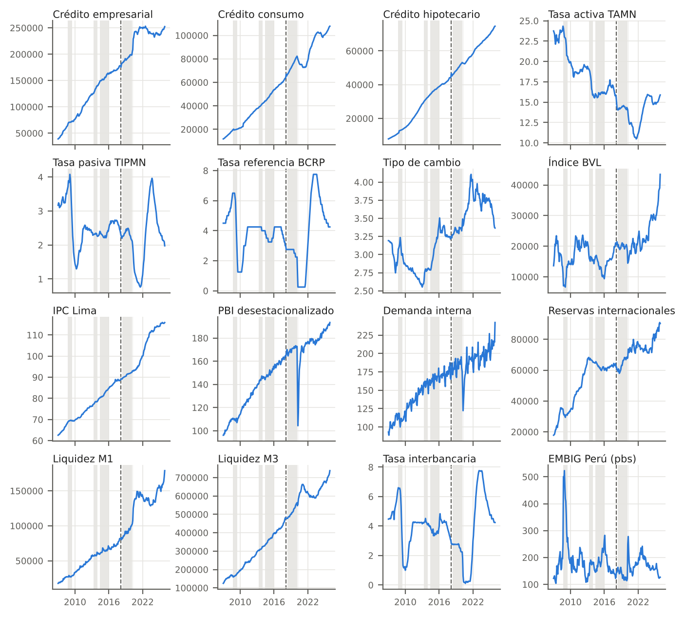{#fig-series width=100%}

**Secuencia de análisis.**

1. **PCA global.** Estructura de correlación y número de ejes, con los criterios de Kaiser, de la vara quebrada y el análisis paralelo [@horn_1965]. La adecuación muestral se evalúa con la medida KMO y la prueba de Bartlett, corregida por el tamaño efectivo de la muestra.
2. **Nulos de tendencia.** Se simulan series independientes con la misma tendencia o deriva que las observadas, para saber qué inercia tendrían los ejes si no hubiera estructura común.
3. **HFC** [@camiz_et_al_2020]. Agrupa las series; su estabilidad se mide con bootstrap por bloques de meses.
4. **EPCA.** PCA en ventanas móviles de 24, 36, 48 y 60 meses, con pesos uniformes y gaussianos. Se mide cuánto cambia la estructura entre ventanas y se contrasta con un nulo de estructura constante.
5. **Datación.** Partición óptima de Fisher, con el procedimiento de @camiz_cerda_atoche_2026, sobre los tres primeros *scores* del PCA suavizados con una media móvil de 12 meses, con tramos de al menos 12 meses.
6. **Aprendizaje profundo.** Autoencoders y LSTM-autoencoder, comparados con el PCA fuera de muestra.

Todo el código está en Python, con una réplica en R que reproduce los mismos resultados. Ambos están en un repositorio público.

## Desarrollo del modelo matemático

Sea $X\in\mathbb{R}^{n\times p}$ la matriz de datos estandarizados, con $n$ meses y $p$ series, y $R=\tfrac1n X^\top X$ su matriz de correlaciones.

**PCA.** Con la descomposición espectral $R=V\Lambda V^\top$, $\lambda_1\ge\dots\ge\lambda_p$, los *scores* son $F=XV$ y la inercia del eje $k$ es $\lambda_k/p$. La carga de la serie $j$ en el eje $k$ es $\sqrt{\lambda_k}\,v_{jk}$, su correlación con el eje. Con $d$ ejes, $X\approx F_dV_d^\top$ es la mejor aproximación de rango $d$ en norma de Frobenius.

**HFC.** Parte de $p$ clases de una serie. Cada clase se representa por un factor: el primer componente principal de sus series. En cada paso se hace un PCA de los factores de cada par de clases y se fusionan las dos cuyo PCA tiene el menor segundo valor propio, es decir, las que mejor se resumen con un solo factor [@camiz_et_al_2020].

**EPCA.** Para una ventana de ancho $w$ que empieza en el mes $i$, con pesos $\omega_t\ge0$ y $\sum_t\omega_t=1$, la correlación ponderada es
$$
r^{(i)}_{jl}=\frac{\sum_{t}\omega_t\,(x_{tj}-\bar x_j)(x_{tl}-\bar x_l)}{\sqrt{\sum_t\omega_t(x_{tj}-\bar x_j)^2}\sqrt{\sum_t\omega_t(x_{tl}-\bar x_l)^2}},
$$
con medias ponderadas $\bar x_j$. Los pesos son uniformes o gaussianos centrados en la ventana. El PCA de cada $R^{(i)}$ da valores propios y cargas que evolucionan en el tiempo.

**Similitud entre ventanas.** Dos configuraciones $A$ y $B$ de las mismas $p$ series se comparan con el coeficiente RV,
$$
\mathrm{RV}(A,B)=\frac{\operatorname{tr}(AA^\top BB^\top)}{\sqrt{\operatorname{tr}\big((AA^\top)^2\big)\operatorname{tr}\big((BB^\top)^2\big)}}\in[0,1],
$$
que vale 1 cuando ambas definen el mismo subespacio con las mismas proporciones.

**Partición óptima de Fisher.** Dada una trayectoria $z_1,\dots,z_n\in\mathbb{R}^d$, se buscan $K$ segmentos contiguos $S_1,\dots,S_K$ que minimicen $\sum_{k}\sum_{t\in S_k}\lVert z_t-\bar z_{S_k}\rVert^2$, con $\lvert S_k\rvert\ge12$. La solución exacta se obtiene por programación dinámica, y el número $K$ se elige con la caída de la suma de cuadrados y el índice de Caliński y Harabasz, como en @camiz_cerda_atoche_2026.

**Autoencoder.** Un codificador $g_\phi:\mathbb{R}^p\to\mathbb{R}^d$ y un decodificador $h_\theta:\mathbb{R}^d\to\mathbb{R}^p$ se entrenan para minimizar $\tfrac1n\sum_t\lVert x_t-h_\theta(g_\phi(x_t))\rVert^2$. Si ambos son lineales, el óptimo genera el mismo subespacio que el PCA de $d$ ejes [@baldi_hornik_1989]. La versión no lineal y el LSTM-autoencoder, que codifica ventanas de meses consecutivos [@srivastava_mansimov_salakhutdinov_2015], se evalúan frente a ese anclaje lineal, con validación por bloques de meses y *walk-forward*.

## Resultados

Los resultados corresponden al análisis principal, con las  series en niveles. La interpretación es preliminar y todavía no se ha discutido con el asesor.

### Estructura de correlación

La correlación entre las series es muy alta en un bloque grande (crédito, liquidez, precios, actividad y reservas) y menor en las tasas y en los indicadores de mercado (@fig-correlaciones). Gran parte de esa correlación proviene de la tendencia común. Al quitar a cada serie su tendencia lineal, el bloque se debilita y aparecen relaciones de signo distinto.

::: {#fig-correlaciones layout-ncol=2}
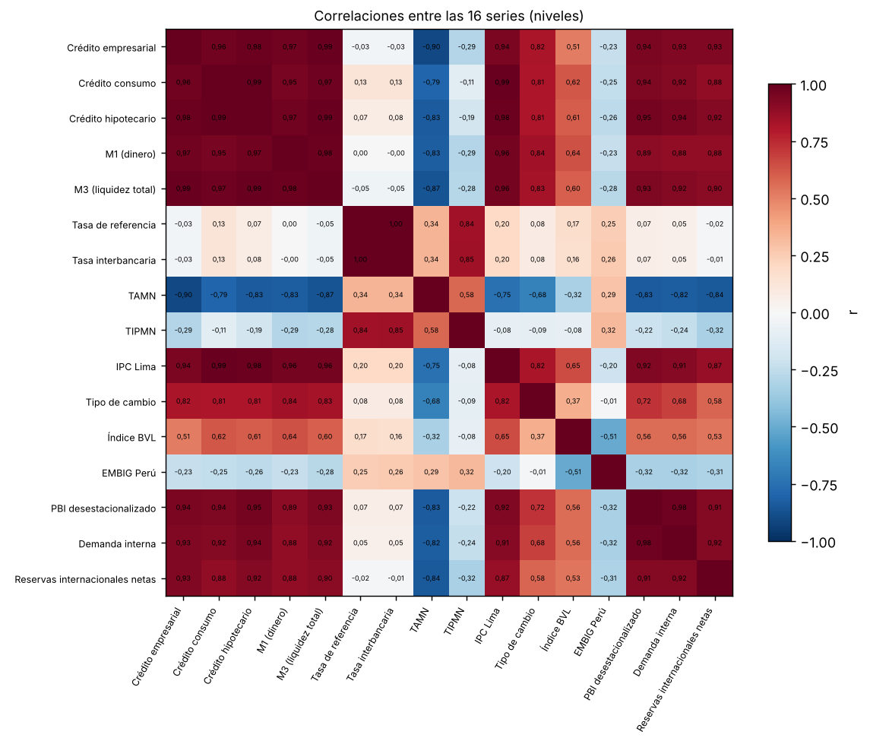

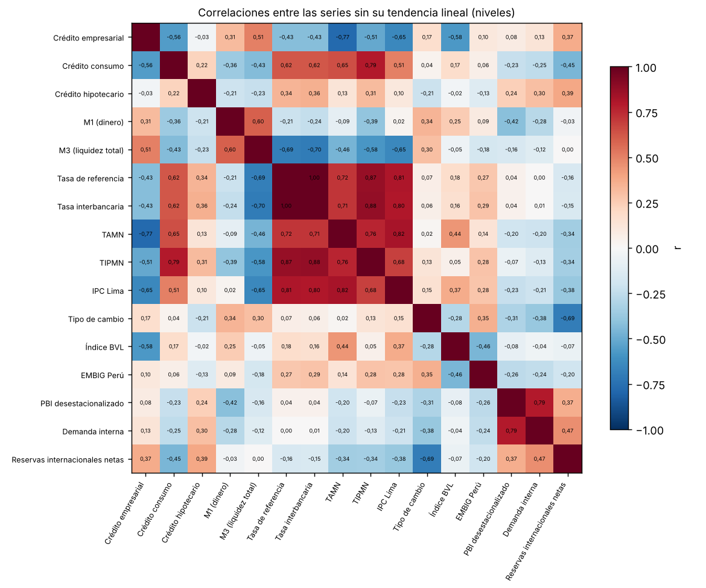

Matrices de correlación entre las  series. Fuente: elaboración propia con datos del BCRP.
:::

### PCA: tres ejes, uno de ellos tendencia

Los tres primeros ejes explican el  %, el  % y el  % de la inercia. El criterio de Kaiser retiene  ejes; el análisis paralelo y la vara quebrada,  (@fig-sedimentacion). Se trabaja con tres ejes porque el tercero tiene una lectura clara y es estable bajo remuestreo. La medida KMO es alta (). Sin embargo, el tamaño efectivo de la muestra es pequeño, de unas  observaciones independientes por la fuerte autocorrelación, y con él la prueba de Bartlett pasa de un estadístico de  a uno de  ($p$ = ).

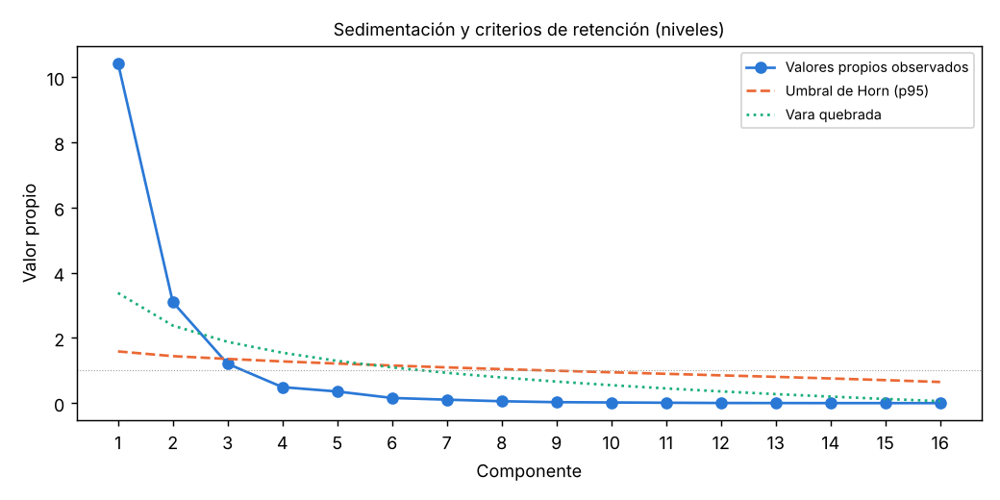{#fig-sedimentacion width=60%}



: Cargas de las series en los tres primeros ejes. En negrita, las de valor absoluto igual o mayor que 0,6. {#tbl-cargas tbl-colwidths="[40,20,20,20]"}

- **Eje 1, tendencia común.** Cargan los saldos, los precios y la actividad, y la TAMN en sentido opuesto (). Su coordenada está casi perfectamente correlacionada con el tiempo ($r$ = ). Series independientes con deriva producen un primer eje igual o mayor en una proporción  de las simulaciones. El eje 1, por tanto, no prueba una estructura cíclica común: refleja que casi todas las series crecen.
- **Eje 2, política monetaria.** Lo definen la tasa de referencia (), la interbancaria y la TIPMN (). Es el único eje que supera con claridad los nulos (proporción de ).
- **Eje 3, riesgo de mercado.** Opone el EMBIG Perú () a la bolsa (). Sus picos coinciden con la crisis financiera global, el final del colapso de las materias primas y el inicio de la pandemia (@fig-scores), pero no supera el nulo con deriva (proporción de ).

Bajo bootstrap por bloques de 24 meses, el percentil 5 de la congruencia con el eje original es ,  y  para los ejes 1 a 3, frente a  para el cuarto.

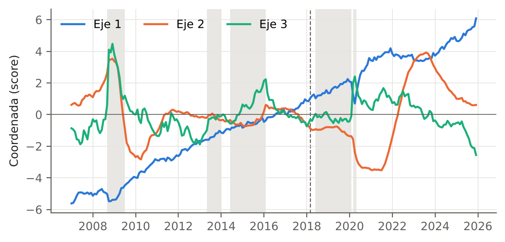{#fig-scores width=100%}

### HFC: tres bloques estables

La HFC agrupa las series en tres clases que coinciden con los tres ejes del PCA: tendencia o «salud económica», tasas y riesgo de mercado (@tbl-hfc). En  réplicas por bloques, la partición en tres clases se reproduce exactamente en una proporción  de las réplicas, y la de cuatro, en . La mediana de la correlación cofenética es . Los tres bloques se parecen a los que reportan @camiz_cerda_atoche_2026 para series del BCRP; la comparación bloque por bloque está pendiente.



: Clases de la HFC en las particiones de 3 y 4 clases. En negrita, la serie más correlacionada con el factor de su clase. {#tbl-hfc tbl-colwidths="[16,10,74]"}

### EPCA: la estructura cambia poco

Las cargas y la inercia de los ejes cambian entre ventanas (@fig-epca-cargas). La estabilidad del eje 2 entre ventanas sucesivas tiene caídas puntuales que dependen del ancho de la ventana (@fig-epca). Con 60 meses, las caídas marcan transiciones candidatas en .

::: {#fig-epca-cargas layout-ncol=2}
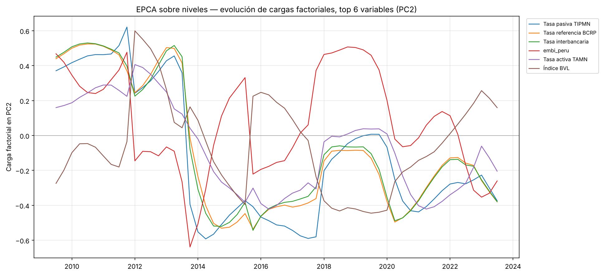

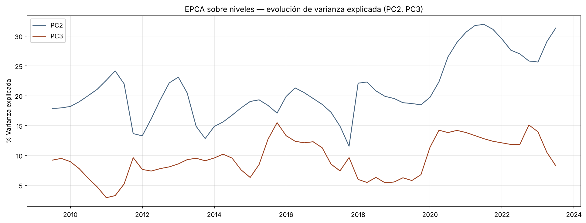

EPCA con ventana móvil de 60 meses. Fuente: elaboración propia con datos del BCRP.
:::

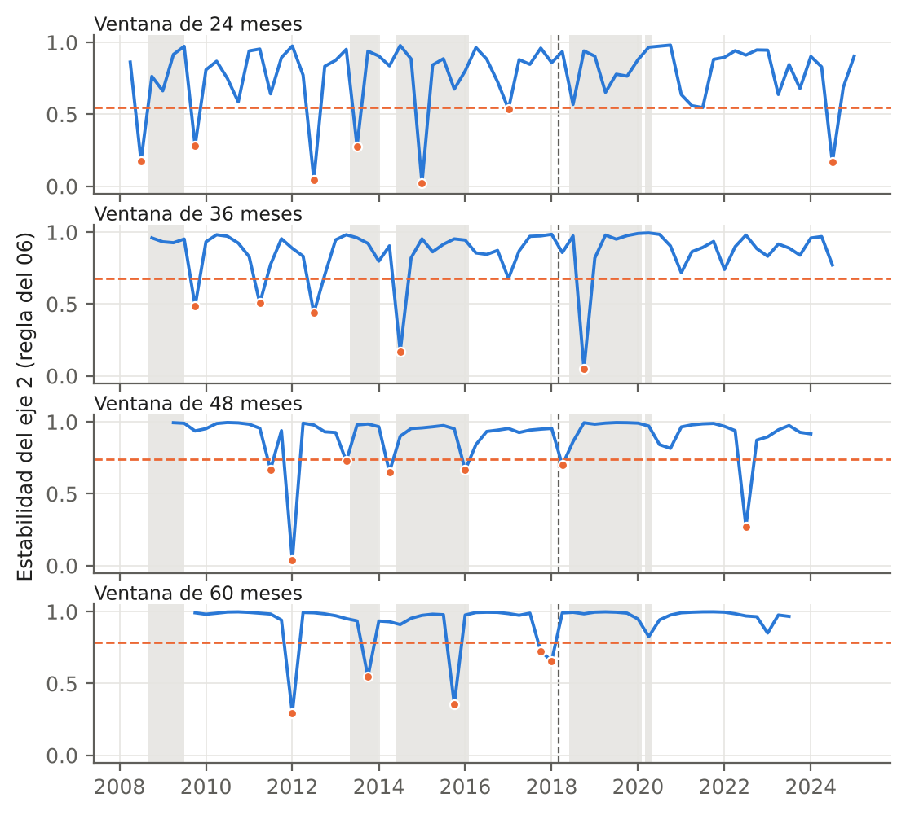{#fig-epca width=95%}

El nulo de estructura constante simula series con la misma dependencia temporal y una correlación fija, y cuenta cuántos pares de ventanas resultan tan distintos como los observados. En ninguna de las  configuraciones principales (anchos de 24 a 60 meses, pesos uniformes y gaussianos) el resultado se distingue del nulo: el menor $p$ es . Con los datos en niveles, las caídas de estabilidad del EPCA son compatibles con el ruido muestral de ventanas cortas, y la evidencia no respalda, por ahora, un cambio en la estructura de correlación.

### Datación de regímenes

La partición de Fisher sobre los *scores* suavizados da  regímenes, con cortes en  (@tbl-regimenes, @fig-datacion). Si se permite un número mayor de regímenes, la regla de selección elige : el número depende de la cota.



: Regímenes de la datación con los *scores* del PCA. El primero empieza en diciembre de 2007 porque la media móvil consume los primeros 11 meses. *Crédito medio:* promedio del crédito estandarizado en el régimen. *Frec. del corte:* proporción de réplicas bootstrap que reproducen el corte inicial con ±3 meses. {#tbl-regimenes tbl-colwidths="[6,20,8,11,13,10,32]"}

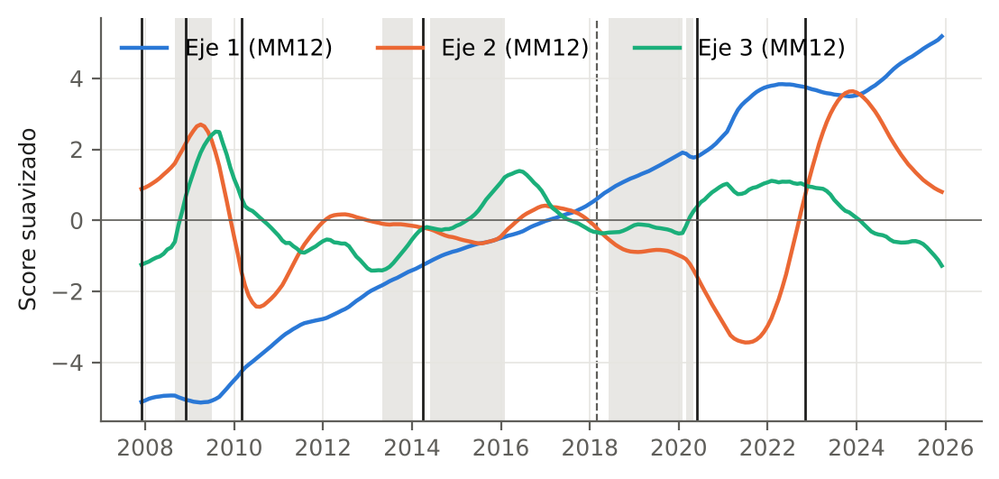{#fig-datacion width=100%}

Cuatro de los cinco cortes se reproducen en más de cuatro de cada cinco réplicas. El de  solo en una proporción . Con la tolerancia de tres meses, el corte de diciembre de 2008 cae dentro de la crisis financiera global, el de abril de 2014 queda a dos meses del inicio del colapso de las materias primas y el de junio de 2020, a dos meses del fin del episodio de la pandemia. Los cortes de marzo de 2010 y noviembre de 2022 no tienen un episodio compatible.

**Las etiquetas de fase no son válidas todavía.** La regla preliminar asigna la fase según el promedio del crédito estandarizado en cada régimen. En niveles, ese promedio refleja la posición en la tendencia: los primeros regímenes quedan por debajo de la media y los últimos por encima. Por eso el período 2010–2014, de fuerte crecimiento del crédito, recibe la etiqueta de «contracción». La @fig-fases-lstm, de una corrida anterior, muestra el mismo problema: la variable que define la fase es casi una recta.

### Aprendizaje profundo: corrida exploratoria

Los autoencoders y el LSTM-autoencoder se corrieron con una versión anterior del conjunto de datos, que incluía la liquidez M2 (17 series). Con las 16 series vigentes quedan por repetir. Sus resultados se muestran como exploración, no como resultado de la tesis.

- Fuera de muestra, el autoencoder no lineal reconstruye peor que el PCA para todas las dimensiones probadas, con o sin preentrenamiento (@fig-ae-cv).
- La trayectoria latente del LSTM-autoencoder reproduce la forma general de los ejes 1 y 2 del PCA, con menos variación, y aplana los picos del eje 3 (@fig-lstm-latente).
- El error de reconstrucción mensual sube en la crisis financiera global y en la pandemia, y aumenta al final de la muestra (@fig-error-rec).

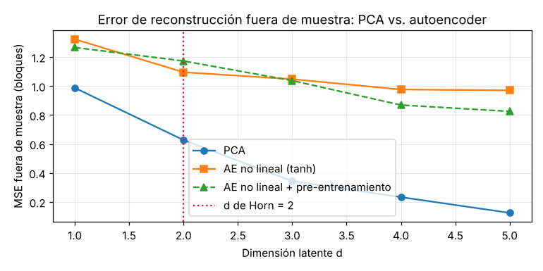{#fig-ae-cv width=58%}

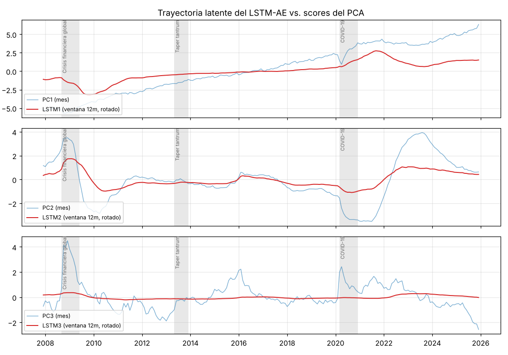{#fig-lstm-latente width=72%}

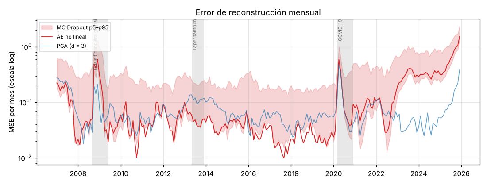{#fig-error-rec width=72%}

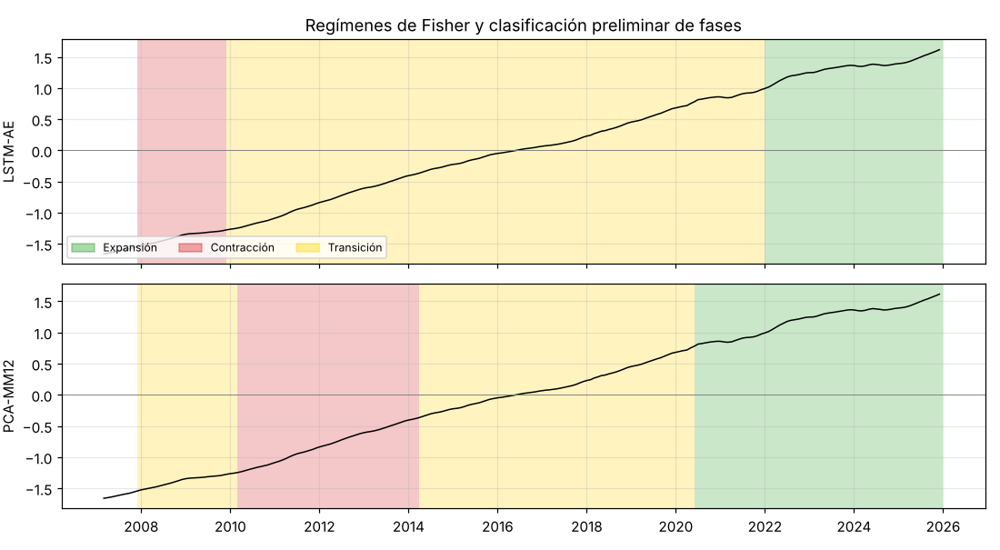{#fig-fases-lstm width=72%}

## Discusión de resultados

1. **La estructura transversal es el resultado más firme.** PCA y HFC coinciden en tres bloques, tendencia, tasas de política y riesgo de mercado, y los tres se reproducen bajo remuestreo.
2. **En niveles, la tendencia domina y la dinámica es difícil de separar del ruido.** El primer eje no supera un nulo de series con deriva, y el EPCA no supera el de estructura constante. La evidencia de regímenes no viene del cambio en la estructura de correlación, sino del movimiento de los *scores*. Allí la datación encuentra cortes estables, en parte compatibles con episodios externos.
3. **La clasificación en fases sigue abierta.** Es el punto metodológico más importante, porque es uno de los aportes que se buscan. La posición exploratoria pide trabajar con las series sin transformar, pero en niveles lo primero que muestran los datos es su tendencia. Separar tendencia y ciclo exige una decisión explícita, tomada antes de calcular.
4. **El aprendizaje profundo no supera todavía al PCA.** En la corrida exploratoria, el autoencoder no mejora la reconstrucción fuera de muestra. Con unas  observaciones efectivas, es un resultado esperable que debe confirmarse con las 16 series.

# Conclusiones y recomendaciones

## Conclusiones preliminares

1. La base de datos de  series mensuales del BCRP (2007–2025) está construida, documentada y congelada.
2. Las series se organizan en tres bloques estables: tendencia o «salud económica», tasas de política y riesgo de mercado.
3. En niveles, el primer eje del PCA es la tendencia común. Solo el eje de las tasas supera con claridad los nulos de tendencia.
4. Las variaciones de la estructura que muestra el EPCA no se distinguen de las que produciría una estructura constante.
5. La datación con los *scores* del PCA da  regímenes, con cortes mayormente estables y en parte compatibles con la crisis financiera global, el colapso de las materias primas y la pandemia.
6. La regla de fases actual no mide el ciclo; debe reemplazarse.

## Estado del avance y trabajo pendiente

| Etapa (ficha de inscripción) | Estado |
|---|---|
| Revisión bibliográfica | En curso: ver el estado de la revisión al final de este documento |
| Base de datos del BCRP | Terminada |
| PCA, HFC y EPCA | Terminados en niveles; falta el análisis de robustez con series transformadas |
| Datación de regímenes | Terminada con el PCA; falta con el EPCA y con el LSTM |
| Clasificación en fases | Pendiente: regla nueva por definir con el asesor |
| Autoencoders y LSTM | Corrida exploratoria con 17 series; falta repetirla con 16 |
| Comparación de métodos y contexto simulado | Pendiente |
| Redacción de la tesis y artículo | En curso |

: Estado del avance frente al plan de la ficha de inscripción. {#tbl-estado tbl-colwidths="[45,55]"}

## Recomendaciones

1. Definir, antes de calcular, una regla de fases basada en la desviación respecto de la tendencia o en la tasa de crecimiento del crédito, y discutirla con el asesor.
2. Repetir el EPCA, la HFC y la datación con las series transformadas, para separar lo que depende de la tendencia.
3. Repetir los autoencoders y el LSTM-autoencoder con las 16 series vigentes.
4. Medir con datos simulados, con un quiebre de tamaño conocido, si el nulo de estructura constante puede detectar los cambios que interesan.
5. Completar la lectura de las fuentes pendientes.

# Referencias {.unnumbered}

::: {#refs}
:::

# Estado de la revisión bibliográfica {.unnumbered}

Las referencias anteriores son las únicas que se citan, porque se leyó su texto completo o parcial; en el caso de @horn_1965, su resumen oficial. Se usan, además, métodos cuyas fuentes originales están localizadas pero todavía no se han leído, por lo que no se citan en este avance: la partición óptima de Fisher (1958), el índice de Caliński y Harabasz (1974), el criterio de Kaiser (1960), la medida KMO (Kaiser, 1970; Kaiser y Rice, 1974), la prueba de esfericidad de Bartlett (1950, 1951), el coeficiente RV (Robert y Escoufier, 1976), el bootstrap por bloques móviles (Künsch, 1989), el tamaño efectivo de muestra (Pyper y Peterman, 1998; Kish, 1965) y la obra de Benzécri (1973) sobre el análisis de datos. Su lectura es parte del trabajo pendiente.
