# 2. MARCO TEÓRICO

<!-- Versión del 8-11-2026 con las correcciones del asesor-agente. Pendientes de verificación en la fuente original (no se citan en el texto hasta verificarlas): forma exacta de la fórmula de Pyper y Peterman (1998); autoría de la versión aumentada de la prueba de Dickey-Fuller (Said y Dickey, 1984); tamaño efectivo de una muestra ponderada (Kish, 1965); variante del análisis paralelo con percentil (Glorfeld, 1995); bootstrap por bloques local (Paparoditis y Politis, 2002); cifras de Winkelried (2017) y de Alcaraz et al. (2024) verificadas solo por resumen; ausencia de validación en Atoche Murrieta (2022). -->

## 2.1 Antecedentes y estado del arte

### 2.1.1 Medición del ciclo financiero y del ciclo económico

La medición del ciclo financiero se ha basado en dos procedimientos aplicados a series individuales: la identificación de puntos de giro y los filtros de frecuencia. @drehmann_borio_tsatsaronis_2012 aplican ambos al crédito, a la razón entre crédito y producto y a los precios inmobiliarios de siete economías desarrolladas, y encuentran un componente común de mediano plazo, de 8 a 30 años, cuyos máximos coinciden con crisis bancarias.

En el Perú, la medición se ha orientado sobre todo al ciclo económico y al crediticio. @winkelried_2017 identifica las fases del ciclo económico entre 1992 y 2016 a partir de 145 indicadores mensuales de actividad: identifica primero los puntos de giro de cada indicador y luego los agrega en un índice de difusión, con el que obtiene seis fases contractivas que suman cerca de la cuarta parte del período. @torres_baltazar_2023 extraen el componente cíclico de series trimestrales con el filtro de Baxter-King y miden su correlación con el ciclo del PBI. @alcaraz_cabello_nivin_2024 miden los ciclos de distintas medidas del crédito y encuentran que no guardan una correlación dinámica fuerte con el ciclo del PBI. En estos trabajos cada indicador se analiza por separado o en relación bivariada con el producto, y la síntesis, cuando existe, es un agregado posterior: la estructura conjunta de asociación entre los indicadores no se modela.

### 2.1.2 Métodos factoriales exploratorios aplicados a series temporales

Una segunda línea modela directamente la estructura de asociación entre las series. El análisis en componentes principales evolutivo repite el análisis en ventanas móviles para seguir la evolución de esa estructura [@camiz_maulucci_roig_2010; @camiz_diblasi_2013]. @camiz_spada_2024 lo extienden a la clasificación factorial jerárquica y delimitan intervalos de estructura homogénea mediante la partición de Fisher del primer valor propio. @purizaca_2023 aplica el análisis evolutivo y la partición de Fisher a 21 precios internacionales de materias primas entre 1990 y 2021; como el índice de Caliński y Harabasz no presenta un máximo, el número de tramos se fija por un criterio de incrementos marginales.

Para el Perú, @atoche_murrieta_2022 aplica el análisis en componentes principales, la clasificación factorial jerárquica y su versión evolutiva a 17 indicadores mensuales del BCRP e identifica tres componentes, asociados a la evolución del sistema financiero, a las tasas de interés y a la volatilidad del mercado. @camiz_cerda_atoche_2026 aplican los mismos métodos a 17 indicadores entre 1999 y 2020, identifican tres grupos —salud económica y financiera, tasas de interés y riesgo de mercado— y delimitan transiciones con la partición de Fisher del primer valor propio, con el número de cortes elegido mediante el índice de Caliński y Harabasz.

### 2.1.3 Representaciones no lineales

Los autoencoders y las redes recurrentes se han empleado para representar estructuras financieras de alta dimensión. @tuhin_et_al_2025 entrenan un autoencoder LSTM con los retornos diarios de 375 acciones del S&P 500 entre 2000 y 2022, muestran que las redes de influencia derivadas de sus pesos cambian en las crisis financieras y advierten que el procedimiento requiere grandes volúmenes de datos.

### 2.1.4 Síntesis

Los procedimientos univariados no modelan la estructura conjunta de asociación entre indicadores. Los métodos factoriales exploratorios sí lo hacen. En sus aplicaciones al Perú, los regímenes se delimitan con la partición de Fisher y el número de tramos con el índice de Caliński y Harabasz, un criterio que carece de distribución de referencia cuando las observaciones son dependientes y que puede no presentar un máximo [@purizaca_2023]; la partición no se contrasta con series de referencia simuladas ni se evalúa por remuestreo, y el período termina en 2020. No se han identificado aplicaciones de representaciones no lineales a indicadores macrofinancieros del Perú ni comparaciones controladas con la representación lineal en ese contexto. La investigación se ubica en esa intersección.

## 2.2 Bases teóricas

**Notación.** Se emplea la siguiente notación común:

| Símbolo | Significado |
|---|---|
| $n$, $t$ | Número de meses e índice del mes ($t=1,\dots,n$) |
| $p$, $j$ | Número de indicadores e índice del indicador ($j=1,\dots,p$) |
| $x_{tj}$, $z_{tj}$ | Valor del indicador $j$ en el mes $t$, original y estandarizado |
| $R$ | Matriz de correlaciones |
| $\lambda_k$, $\mathbf v_k$ | Valor y vector propio $k$ del PCA |
| $w$, $\nu$ | Ancho de la ventana y parámetro de concentración de los pesos |
| $K$ | Número de tramos de una partición |
| $\ell$ | Largo de los bloques del remuestreo |
| $B$ | Número de réplicas simuladas o remuestreadas |
| $d$ | Dimensión de la representación reducida |

### 2.2.1 Ciclo financiero, régimen y fase

El **ciclo financiero** es la alternancia de fases de expansión y contracción del crédito y de los precios de los activos. @drehmann_borio_tsatsaronis_2012 lo caracterizan por el comportamiento conjunto del crédito, la razón entre crédito y producto y los precios inmobiliarios, que comparten un componente de mediano plazo de 8 a 30 años, más largo que el ciclo económico de 1 a 8 años; los precios bursátiles, más volátiles y menos sincronizados con el crédito, quedan fuera de ese componente.

Sobre esta base se definen los conceptos operativos de la investigación:

- Un **régimen** es un intervalo de meses consecutivos $I=\{t_a,\dots,t_b\}$ en el que una propiedad del conjunto de indicadores permanece relativamente estable. Se distinguen dos tipos: en un **régimen de estructura** permanece estable la estructura de asociación entre los indicadores; en un **régimen de posición**, su nivel conjunto, es decir, la zona del espacio de los indicadores en que se encuentra el sistema.
- Un **corte** es el primer mes de cada régimen distinto del primero; $K$ regímenes se separan por $K-1$ cortes, y la sucesión de cortes define una **partición** del período.
- Una **fase** es la etiqueta económica —expansión, contracción o transición— que se asigna a un régimen según el comportamiento del crédito en el intervalo. La delimitación del régimen usa la información multivariada; la fase es una interpretación posterior.

### 2.2.2 Series temporales multivariadas

Sea $\mathbf{x}_t=(x_{t1},\dots,x_{tp})^\top$ el vector de indicadores en el mes $t$. La estructura de asociación que estudian los métodos de esta investigación se mide con correlaciones, cuya distribución muestral depende de dos propiedades de cada serie: su tendencia y su dependencia temporal.

**Tendencia determinística y estocástica.** Una serie es **estacionaria en tendencia** (TS) si fluctúa alrededor de una función determinística del tiempo, $x_t=\alpha+\beta t+u_t$, con $u_t$ estacionario: los choques son transitorios y la serie retorna a su tendencia. Es **integrada de orden uno** (DS) si no es estacionaria y su primera diferencia sí lo es, $\Delta x_t=\delta+u_t$: los choques se acumulan y la serie no retorna a una trayectoria fija. El parámetro $\delta$ es la **deriva**, el crecimiento medio por período. La prueba de Dickey-Fuller contrasta la hipótesis nula de raíz unitaria [@dickey_fuller_1979]; en su versión aumentada incorpora rezagos de la diferencia para absorber la autocorrelación de $u_t$. La prueba KPSS contrasta la hipótesis nula de estacionariedad [@kwiatkowski_et_al_1992]. Ambas se especifican con tendencia determinística. Como sus hipótesis nulas son opuestas, la serie se clasifica como TS si la primera rechaza y la segunda no, como DS si la segunda rechaza y la primera no, e indeterminada en los demás casos. La significación de la deriva se evalúa con el estadístico $\hat\delta/\widehat{\mathrm{ee}}(\hat\delta)$, con un error estándar robusto a la autocorrelación [@newey_west_1987].

**Regresión espuria.** Dos series integradas independientes pueden exhibir una correlación muestral elevada y una regresión aparentemente significativa sin relación alguna entre ellas [@granger_newbold_1974]; lo mismo ocurre, de forma trivial, con series que comparten una tendencia determinística. En consecuencia, una correlación alta entre series en niveles no implica, por sí sola, una estructura común. La Figura {F:espuria} lo ilustra con caminatas aleatorias simuladas.

::: {custom-style="Rotulo"}
**Figura {F:espuria}**\
*Correlación entre series independientes con y sin tendencia estocástica*
:::

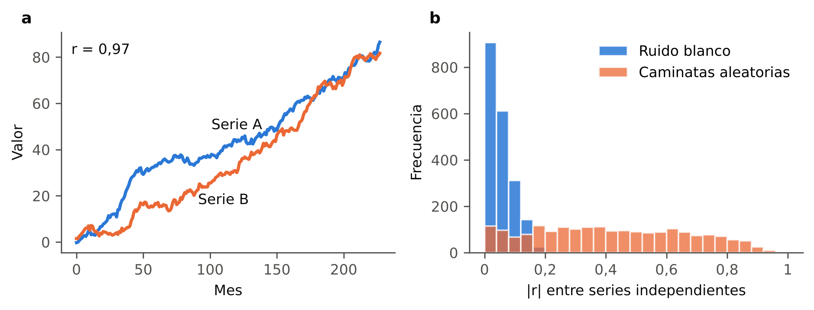{width=95%}

::: {custom-style="Nota"}
*Nota.* (a) Dos caminatas aleatorias independientes con deriva, de 228 meses. (b) Distribución del valor absoluto de la correlación en 2000 pares de series independientes de ruido blanco y de caminatas aleatorias sin deriva. Elaboración propia con datos simulados.
:::

**Diferenciación.** La primera diferencia elimina la tendencia estocástica de una serie DS; aplicada a una serie TS, introduce un componente de medias móviles no invertible. Su efecto sobre una oscilación de período $P$ meses es multiplicar la amplitud por

$$
\gamma_1(P)=\big\lvert 1-e^{-2\pi\mathrm{i}/P}\big\rvert=2\sin(\pi/P),
$$

que tiende a cero cuando $P$ crece. Como la correlación no depende de la escala, lo relevante es la atenuación relativa: frente a una oscilación anual, una oscilación de 96 meses conserva el 1,6 % de su varianza relativa. La diferencia interanual, $x_t-x_{t-12}$, tiene ganancia $\gamma_{12}(P)=2\lvert\sin(12\pi/P)\rvert$: elimina las oscilaciones de período 12, 6, 4, … meses, entre ellas la estacionalidad, y conserva en mayor medida las de baja frecuencia (para $P=96$, el 59 % de la varianza). La Figura {F:ganancia} muestra ambas ganancias.

::: {custom-style="Rotulo"}
**Figura {F:ganancia}**\
*Factor que la primera diferencia y la diferencia interanual aplican a la varianza de una oscilación*
:::

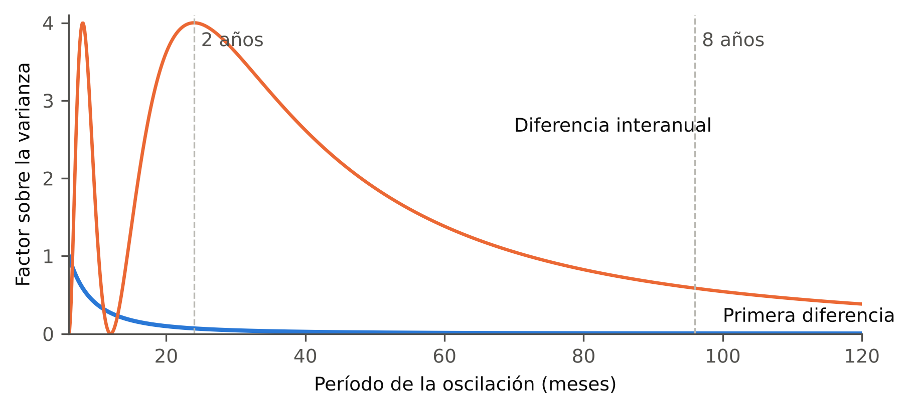{width=85%}

::: {custom-style="Nota"}
*Nota.* Factor $\gamma(P)^2$ para períodos de 6 a 120 meses. Elaboración propia.
:::

**Autocorrelación y tamaño efectivo.** La autocorrelación de orden $\tau$ de una serie es $\rho(\tau)=\operatorname{corr}(x_t,x_{t+\tau})$. Cuando las observaciones están autocorrelacionadas, $n$ meses contienen menos información que $n$ observaciones independientes. Para la correlación entre dos series $x$ e $y$, el **tamaño efectivo de muestra** se aproxima por

$$
\frac{1}{n_{\mathrm{ef}}}=\frac{1}{n}+\frac{2}{n}\sum_{\tau=1}^{J}\rho_{x}(\tau)\,\rho_{y}(\tau),
$$

donde $J$ es el retardo máximo considerado [@pyper_peterman_1998]. La aproximación es válida bajo la hipótesis de ausencia de correlación entre las series y, en la práctica, emplea autocorrelaciones estimadas. Con series muy persistentes, $n_{\mathrm{ef}}$ es una fracción pequeña de $n$, y los procedimientos que suponen independencia sobrestiman la evidencia.

### 2.2.3 Análisis en componentes principales

El análisis en componentes principales (PCA) resume $p$ variables correlacionadas en un número menor de variables no correlacionadas que conservan la mayor parte de su variabilidad [@camiz_2021_pca].

**Datos y matriz de correlaciones.** Como los indicadores tienen unidades distintas, cada uno se estandariza:

$$
z_{tj}=\frac{x_{tj}-\bar x_j}{s_j},\qquad \bar x_j=\frac1n\sum_t x_{tj},\qquad s_j^2=\frac1n\sum_t (x_{tj}-\bar x_j)^2 .
$$

La tabla estandarizada $Z\in\mathbb{R}^{n\times p}$ define la matriz de correlaciones $R=\tfrac1n Z^\top Z$. Cada mes es un punto de $\mathbb{R}^p$, y la **inercia** de la nube de puntos —la media de sus distancias cuadradas al centro de gravedad— es $\operatorname{tr}R=p$: cada indicador estandarizado aporta una unidad.

**Ejes y valores propios.** El PCA es la descomposición espectral

$$
R=V\Lambda V^\top,\qquad V^\top V=I,\qquad \Lambda=\operatorname{diag}(\lambda_1,\dots,\lambda_p),\qquad \lambda_1\ge\dots\ge\lambda_p\ge 0 .
$$

La columna $\mathbf v_k$ es el $k$-ésimo **eje factorial** y $\lambda_k$ es la inercia que recoge; $\lambda_k/p$ es su proporción. Los ejes son las direcciones de máxima dispersión de la nube, cada una entre las ortogonales a las anteriores, y la proyección sobre los $d$ primeros es la mejor aproximación de rango $d$ de $Z$ en el sentido de mínimos cuadrados [@eckart_young_1936].

**Coordenadas e interpretación.** Las coordenadas de los meses (*scores*) son $F=ZV$; en series temporales, cada columna de $F$ es una nueva serie. La interpretación de cada eje se basa en tres medidas:

- la **carga** $a_{jk}=\sqrt{\lambda_k}\,v_{jk}$, igual a la correlación entre el indicador $j$ y el eje $k$;
- la **calidad de representación** $\cos^2_{jk}=a_{jk}^2$, proporción de la varianza del indicador $j$ que recoge el eje $k$, aditiva entre ejes;
- la **contribución** $v_{jk}^2$, peso del indicador $j$ en la construcción del eje $k$, con $\sum_j v_{jk}^2=1$.

Las cargas se representan en el **círculo de correlaciones**: para indicadores bien representados en el plano, el ángulo entre sus vectores aproxima su correlación, y el cuadrado de la longitud de cada vector es su calidad de representación en el plano. El signo de un eje es arbitrario; solo es interpretable el signo relativo de las cargas. La Figura {F:pca} ilustra ambos elementos.

::: {custom-style="Rotulo"}
**Figura {F:pca}**\
*Ejes factoriales de una nube de puntos y círculo de correlaciones*
:::

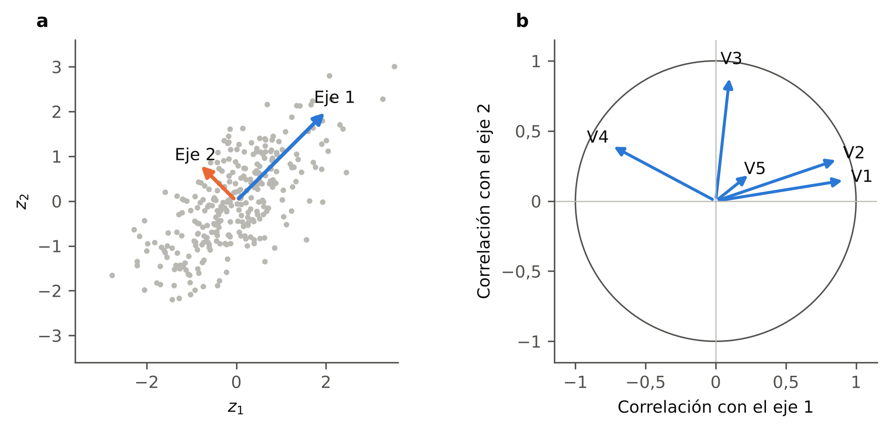{width=95%}

::: {custom-style="Nota"}
*Nota.* (a) Nube de 300 observaciones de dos variables estandarizadas y sus ejes factoriales, con longitud proporcional a $\sqrt{\lambda_k}$. (b) Círculo de correlaciones con cargas ilustrativas de cinco variables. Elaboración propia con datos simulados.
:::

**Reconstrucción.** La aproximación de rango $d$ es $\hat Z=ZV_dV_d^\top$, con $V_d$ las $d$ primeras columnas de $V$, y el error de reconstrucción del mes $t$ es $\lVert\mathbf z_t-V_dV_d^\top\mathbf z_t\rVert^2$. Para evaluarlo fuera de muestra, $V_d$ y los parámetros de estandarización se estiman con los datos de entrenamiento.

**Número de ejes.** No existe una regla única [@camiz_pillar_2018]. Se emplean tres criterios con supuestos distintos:

- *Kaiser:* se retienen los ejes con $\lambda_k>1$, que resumen más que un indicador.
- *Vara quebrada:* se retienen los ejes cuya proporción de inercia supera la esperada si la inercia se repartiera al azar, $b_k=\frac1p\sum_{i=k}^{p}\frac1i$.
- *Análisis paralelo:* se retienen los ejes cuyo valor propio supera la media de los valores propios obtenidos en tablas de variables aleatorias independientes del mismo tamaño [@horn_1965]. Como las variables simuladas carecen de autocorrelación, con series persistentes el criterio tiende a retener más ejes de los justificados.

**Limitaciones.** El PCA es lineal y global: describe la asociación mediante correlaciones calculadas con todo el período, de modo que, si la estructura cambia, produce un promedio que puede no representar a ningún subperíodo [@camiz_diblasi_2013]. Sus ejes son ortogonales por construcción, lo que puede mezclar grupos de variables [@camiz_et_al_2020]. Si dos valores propios son casi iguales, los ejes correspondientes no están determinados por separado y solo es interpretable el plano que generan.

### 2.2.4 Clasificación factorial jerárquica

La clasificación factorial jerárquica (HFC) agrupa las variables de forma jerárquica y asocia a cada grupo un factor que lo resume [@denimal_2007; @camiz_et_al_2020]. A diferencia de los ejes del PCA, los factores de los grupos no son ortogonales entre sí.

**Algoritmo.** Cada variable estandarizada constituye inicialmente un grupo, cuyo **representante** es la propia variable. En cada paso:

1. para cada par de grupos $(A,B)$ se calcula el PCA de sus dos representantes;
2. se fusiona el par cuyo segundo valor propio es mínimo;
3. el primer componente del PCA de los dos representantes fusionados es el representante del nuevo grupo.

El proceso termina cuando todas las variables forman un solo grupo; con $p$ variables se obtienen $p-1$ nodos.

**Índice de nodo.** Si los representantes de $A$ y $B$ tienen varianzas $\lambda_A$ y $\lambda_B$ y correlación $r_{AB}$, los valores propios de su PCA son

$$
\eta_{1,2}=\frac{\lambda_A+\lambda_B\pm\sqrt{(\lambda_A-\lambda_B)^2+4\,r_{AB}^2\,\lambda_A\lambda_B}}{2}.
$$

El **índice del nodo** es $\eta_2$: la inercia que se pierde al resumir ambos grupos con un único factor. Como depende de $r_{AB}^2$, dos grupos fuertemente correlacionados con signo negativo también se fusionan con un índice bajo. Si en un nodo las variables se correlacionan con el representante con signos opuestos, el nodo es un **dipolo**: reúne dos subgrupos que varían en sentido contrario, y su representante crece con el subgrupo de correlación positiva y decrece con el de correlación negativa [@camiz_et_al_2020].

**Dendrograma y corte.** La jerarquía se representa en un dendrograma, con cada nodo a la altura de su índice. Una partición de las variables se obtiene cortando el dendrograma a una altura dada: se mantienen separados los grupos cuya fusión tendría un índice superior al umbral. @camiz_et_al_2020 emplean el umbral 0,7, tomado de la recomendación de Jolliffe de considerar relevante un valor propio de al menos 0,7. La Figura {F:hfc} muestra un ejemplo.

::: {custom-style="Rotulo"}
**Figura {F:hfc}**\
*Dendrograma de una clasificación factorial jerárquica*
:::

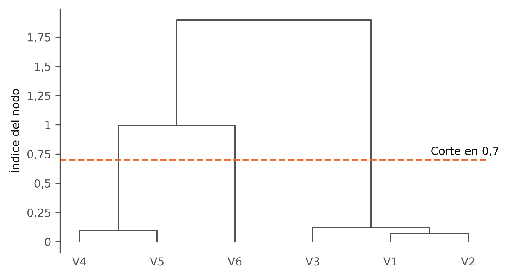{width=80%}

::: {custom-style="Nota"}
*Nota.* Seis variables simuladas: V1–V3 comparten un factor; V4 y V5 comparten otro con signos opuestos (dipolo), y V6 es independiente. Calculado con la rutina clahfac [@camiz_aedeclahfac]. Elaboración propia con datos simulados.
:::

**Descomposición de la inercia.** La suma de los índices de todos los nodos más la varianza del representante de la raíz es igual a $p$ [@camiz_et_al_2020]: la inercia total se reparte entre lo que resume el factor común y lo que se pierde en cada fusión.

### 2.2.5 Análisis evolutivo

El análisis evolutivo estudia la variación temporal de la estructura de asociación repitiendo el análisis en subperíodos consecutivos [@camiz_maulucci_roig_2010; @camiz_diblasi_2013].

**Ventana móvil.** Una ventana de ancho $w$ es un conjunto de $w$ meses consecutivos $\{t_0,\dots,t_0+w-1\}$; la ventana se desplaza un mes cada vez, de modo que una muestra de $n$ meses produce $n-w+1$ ventanas. Cada resultado se asigna al centro de su ventana: el mes $t_0+(w-1)/2$ si $w$ es impar y, si $w$ es par, por convención de la rutina de referencia, el mes $t_0+w/2$ [@camiz_aedeclahfac]. En consecuencia, las trayectorias evolutivas no cubren alrededor de $w/2$ meses en cada extremo de la muestra. Como en cada ventana las series se centran, el análisis evolutivo capta los cambios de la estructura de asociación y no los de nivel; estos se recogen en las coordenadas del análisis global.

**Pesos gaussianos.** Para atenuar el efecto de los meses que entran y salen de la ventana, el mes que ocupa la posición $r=1,\dots,w$ recibe un peso [@camiz_diblasi_2013; @camiz_aedeclahfac]

$$
\omega_r\propto\exp\!\Big[-\tfrac12\Big(\nu\,\frac{r-\bar r}{\kappa}\Big)^2\Big],\qquad \bar r=\frac{w+1}{2},\qquad \kappa=\frac{w-1}{\sqrt2},\qquad \sum_r\omega_r=1,
$$

donde $\nu$ controla la concentración de los pesos ($\nu=0$ corresponde a pesos uniformes); la desviación estándar de los pesos, expresada en meses, es $\kappa/\nu$. En cada ventana se calcula la correlación ponderada

$$
r^{\omega}_{jl}=\frac{\sum_r\omega_r\,(x_{rj}-\bar x^{\omega}_j)(x_{rl}-\bar x^{\omega}_l)}{\sqrt{\sum_r\omega_r(x_{rj}-\bar x^{\omega}_j)^2\;\sum_r\omega_r(x_{rl}-\bar x^{\omega}_l)^2}},\qquad \bar x^{\omega}_j=\sum_r\omega_r x_{rj},
$$

donde $x_{rj}$ denota el valor del indicador $j$ en el mes $t_0+r-1$. La ponderación reduce la información de la ventana: el número de meses con igual peso que equivale a una ventana ponderada es $n_\omega=1/\sum_r\omega_r^2$, igual a $w$ con pesos uniformes. Esta expresión supone observaciones independientes; con series autocorrelacionadas, la información de la ventana es menor, como se indicó en la sección 2.2.2. La Figura {F:ventana} ilustra el desplazamiento de la ventana y los dos esquemas de pesos.

::: {custom-style="Rotulo"}
**Figura {F:ventana}**\
*Ventanas móviles sucesivas y pesos uniformes y gaussianos*
:::

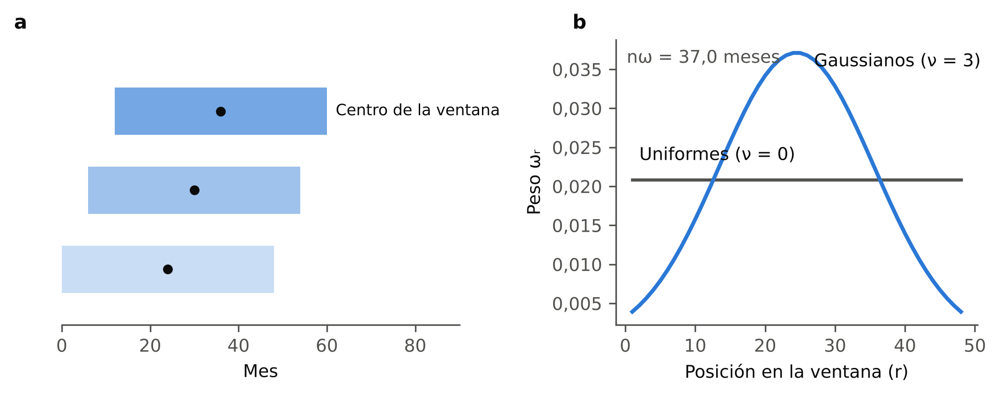{width=95%}

::: {custom-style="Nota"}
*Nota.* (a) Tres ventanas de 48 meses desplazadas seis meses entre sí, con su mes central. (b) Pesos de una ventana de 48 meses con $\nu=0$ y $\nu=3$, y tamaño efectivo $n_\omega$ de la segunda. Pesos calculados con la rutina de referencia [@camiz_aedeclahfac]. Elaboración propia.
:::

**EPCA.** El análisis en componentes principales evolutivo aplica el PCA a la matriz $R^{\omega}$ de cada ventana. Sus resultados se resumen en dos trayectorias [@camiz_diblasi_2013]: los primeros valores propios $\lambda_k(t)$, que miden la intensidad de la asociación común en torno al mes $t$, y las correlaciones de cada variable con los primeros ejes, que indican si cambia el significado de los ejes. Como el signo de cada vector propio es arbitrario, se alinea con el de la ventana anterior [@camiz_spada_2024]; cuando dos valores propios son casi iguales, los ejes pueden intercambiar su orden entre ventanas, y su correspondencia se establece con el valor absoluto del coeficiente de congruencia. Ventanas sucesivas comparten $w-1$ meses, de modo que las trayectorias son suaves por construcción, y un cambio ocurrido en un mes afecta a todas las ventanas que lo contienen: su ubicación en la trayectoria tiene una imprecisión del orden de la semiamplitud efectiva de la ventana.

**HFC evolutiva.** La clasificación factorial jerárquica se aplica, con los mismos pesos, a cada ventana; se siguen los índices de los nodos superiores, que miden la diferenciación entre los grupos principales, y la composición de los grupos [@camiz_spada_2024].

**Similitud entre configuraciones.** Para comparar dos estructuras de las mismas variables se emplean dos coeficientes [@abdi_2010]. El **coeficiente de congruencia** entre dos vectores de cargas $\mathbf a$ y $\mathbf b$,

$$
\phi(\mathbf a,\mathbf b)=\frac{\sum_j a_jb_j}{\sqrt{\sum_j a_j^2\,\sum_j b_j^2}}\in[-1,1],
$$

compara un eje concreto; por la arbitrariedad del signo, se usa su valor absoluto. El **coeficiente RV** entre dos matrices de cargas $A$ y $C$,

$$
\mathrm{RV}(A,C)=\frac{\operatorname{tr}(AA^\top CC^\top)}{\sqrt{\operatorname{tr}\big((AA^\top)^2\big)\operatorname{tr}\big((CC^\top)^2\big)}}\in[0,1],
$$

compara configuraciones completas y es invariante a rotaciones y cambios de signo de los ejes. Su valor esperado bajo ausencia de relación depende del número de filas y columnas, por lo que se evalúa frente a una distribución de referencia y no con un umbral fijo [@abdi_2010].

### 2.2.6 Partición óptima de Fisher

Una forma de delimitar regímenes es dividir una trayectoria ordenada $\mathbf y_1,\dots,\mathbf y_n$ —univariada o multivariada— en $K$ intervalos contiguos $I_1,\dots,I_K$ de máxima homogeneidad interna. @fisher_1958 plantea el problema de minimizar la suma de cuadrados dentro de los grupos,

$$
\mathrm{SCD}_K=\sum_{k=1}^{K}\sum_{t\in I_k}\lVert\mathbf y_t-\bar{\mathbf y}_{I_k}\rVert^2,
$$

y distingue el caso sin restricciones del caso **restringido**, en que los grupos deben respetar un orden previo; en una serie temporal, cada grupo es un intervalo de períodos consecutivos. Con trayectorias multivariadas, la norma euclídea hace depender el resultado de la escala de cada componente.

**Solución exacta.** El **lema de suboptimización** de @fisher_1958 establece que, si una partición óptima en $K$ grupos se divide en dos partes, cada parte es óptima para su subconjunto con su número de grupos. De ello se sigue la recurrencia

$$
D(m,1)=S(1,m),\qquad D(m,k)=\min_{k\le j\le m}\Big[D(j-1,k-1)+S(j,m)\Big],
$$

donde $D(m,k)$ es el mínimo de la suma de cuadrados para los $m$ primeros elementos en $k$ grupos y $S(j,m)$ la suma de cuadrados del intervalo $\{j,\dots,m\}$. La recurrencia se resuelve por programación dinámica con un costo del orden de $Kn^2$ y proporciona, para cada $K$, la partición óptima global, sin dependencia de una inicialización.

**Número de tramos.** $\mathrm{SCD}_K$ decrece monótonamente con $K$, por lo que el método no determina el número de tramos. El índice de @calinski_harabasz_1974,

$$
\mathrm{CH}(K)=\frac{\mathrm{SCE}_K/(K-1)}{\mathrm{SCD}_K/(n-K)},
$$

donde $\mathrm{SCE}_K$ es la suma de cuadrados entre tramos, se usa para elegir $K$ en su máximo. En trayectorias suaves, como las del análisis evolutivo, $\mathrm{SCD}_K$ decrece rápidamente y el índice puede crecer sin alcanzar un máximo interior [@purizaca_2023]; además, como las observaciones de la trayectoria no son independientes, el índice carece de distribución de referencia. La Figura {F:fisher} ilustra la partición y la caída de $\mathrm{SCD}_K$.

::: {custom-style="Rotulo"}
**Figura {F:fisher}**\
*Partición óptima de Fisher de una trayectoria*
:::

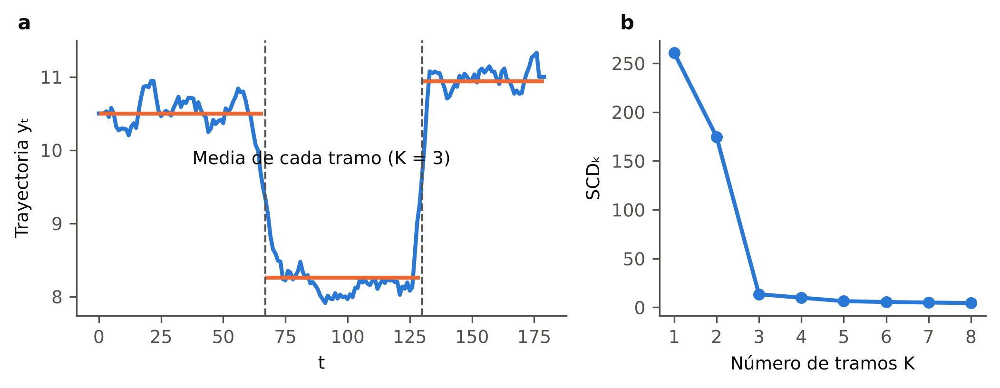{width=95%}

::: {custom-style="Nota"}
*Nota.* (a) Trayectoria simulada con tres niveles, partición óptima en $K=3$ tramos y media de cada tramo. (b) Suma de cuadrados dentro de los tramos para $K=1,\dots,8$. Elaboración propia con datos simulados.
:::

### 2.2.7 Contraste con series de referencia simuladas y remuestreo por bloques

**Contraste con series de referencia simuladas.** Todo método exploratorio produce un resultado aunque los datos carezcan de la estructura buscada: el PCA siempre tiene un primer eje y la partición de Fisher siempre produce $K$ tramos. El contraste consiste en: (i) especificar un mecanismo generador que conserve determinadas propiedades de los datos —por ejemplo, la tendencia de cada serie o su autocorrelación— y carezca de la estructura buscada; (ii) generar $B$ conjuntos de series con ese mecanismo; (iii) aplicar a cada uno el mismo procedimiento y calcular el estadístico de interés $T_b$, y (iv) comparar el valor observado $T$ con la distribución de $\{T_b\}$ mediante

$$
\hat p=\frac{1+\sum_{b=1}^{B}\mathbf 1\{T_b\ge T\}}{B+1},
$$

en un contraste unilateral cuya dirección depende del estadístico. Una proporción pequeña indica que el resultado observado es improbable bajo el mecanismo especificado. El análisis paralelo de @horn_1965 es un caso de este procedimiento, aplicado al número de ejes. La conclusión depende de las propiedades que el mecanismo conserva, y una proporción alta no prueba la ausencia de estructura: puede reflejar una baja capacidad del contraste para detectarla. La Figura {F:referencia} muestra cómo el mecanismo elegido cambia la distribución de referencia.

::: {custom-style="Rotulo"}
**Figura {F:referencia}**\
*Distribución de referencia de la proporción de inercia del primer eje según el mecanismo generador*
:::

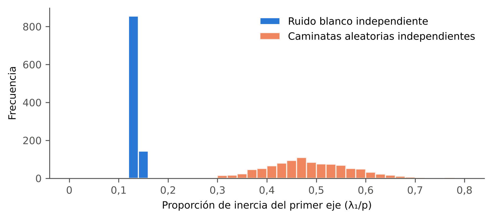{width=85%}

::: {custom-style="Nota"}
*Nota.* 1000 conjuntos de 10 series independientes de 228 meses, generadas como ruido blanco y como caminatas aleatorias. Con caminatas aleatorias, el primer eje recoge una proporción de inercia mucho mayor aunque las series no estén relacionadas. Elaboración propia con datos simulados.
:::

**Remuestreo por bloques.** El remuestreo ordinario sortea observaciones independientes y destruye la dependencia temporal. El bootstrap por bloques móviles [@kunsch_1989] sortea, con reemplazo, bloques de $\ell$ meses consecutivos y los concatena hasta completar $n$ meses; con los mismos inicios de bloque para todas las series se conservan la autocorrelación de cada una y la correlación entre ellas. El procedimiento supone series estacionarias con dependencia débil y no conserva la ubicación cronológica de las observaciones, por lo que es adecuado para evaluar la estabilidad de resultados globales —valores propios, cargas, grupos— y no la de cortes temporales; para estos se requieren esquemas que conserven el orden, como el remuestreo dentro de cada régimen. El largo $\ell$ es un compromiso: bloques largos conservan mejor la dependencia, pero producen réplicas más parecidas entre sí. La Figura {F:bloques} esquematiza el procedimiento.

::: {custom-style="Rotulo"}
**Figura {F:bloques}**\
*Esquema del bootstrap por bloques móviles*
:::

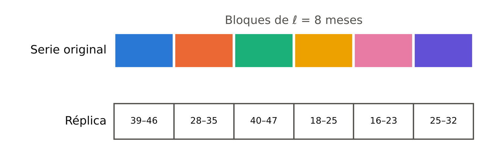{width=85%}

::: {custom-style="Nota"}
*Nota.* Una serie de 48 meses y una réplica formada por seis bloques de ocho meses consecutivos sorteados con reemplazo; los números indican los meses originales de cada bloque. Elaboración propia.
:::

**Comparación de particiones.** La reproducción de una partición en las réplicas se mide con un índice de concordancia, como el índice de Rand ajustado, que vale 1 si dos particiones coinciden y alrededor de 0 si coinciden por azar [@hubert_arabie_1985], o, para cortes temporales, con la frecuencia de cortes dentro de una tolerancia temporal fijada de antemano.

### 2.2.8 Redes neuronales artificiales

Una **red neuronal artificial** es una función paramétrica compuesta por unidades elementales organizadas en capas [@goodfellow_bengio_courville_2016].

**Neurona y función de activación.** Una neurona transforma un vector de entrada $\mathbf u\in\mathbb R^{q}$ en

$$
y=\psi(\mathbf w^\top\mathbf u+b),
$$

donde $\mathbf w$ son los pesos, $b$ el sesgo y $\psi$ una **función de activación**, en general no lineal; las más usadas son la logística $\sigma(s)=1/(1+e^{-s})$, la tangente hiperbólica y la rectificada lineal $\max(0,s)$. La capa de salida suele ser lineal cuando la salida es continua.

**Red prealimentada multicapa.** Una red prealimentada compone $M$ capas sin conexiones cíclicas:

$$
\mathbf h^{(0)}=\mathbf u,\qquad \mathbf h^{(m)}=\psi\big(W^{(m)}\mathbf h^{(m-1)}+\mathbf b^{(m)}\big),\quad m=1,\dots,M,
$$

y su salida es $f_\theta(\mathbf u)=\mathbf h^{(M)}$, con parámetros $\theta=\{W^{(m)},\mathbf b^{(m)}\}$.

**Entrenamiento.** Los parámetros se estiman minimizando una **función de pérdida** sobre los datos de entrenamiento, por ejemplo el error cuadrático medio $\mathcal L(\theta)=\frac1n\sum_t\lVert\mathbf y_t-f_\theta(\mathbf u_t)\rVert^2$, mediante descenso de gradiente, $\theta\leftarrow\theta-\eta\,\nabla_\theta\mathcal L$, con tasa de aprendizaje $\eta$. El gradiente se calcula por **retropropagación**, que aplica la regla de la cadena desde la capa de salida hacia la de entrada [@rumelhart_hinton_williams_1986]. Como la red puede ajustar particularidades de la muestra de entrenamiento, su desempeño se evalúa **fuera de muestra** y se emplean técnicas de **regularización**, como la desactivación aleatoria de neuronas durante el entrenamiento (*dropout*) [@goodfellow_bengio_courville_2016].

**Clasificación.** Para los fines de esta investigación, las redes se distinguen según dos criterios independientes, a partir de la exposición de @goodfellow_bengio_courville_2016:

- *Por el tipo de aprendizaje:* **supervisado**, en el que la red aprende una relación entre entradas y salidas conocidas, y **no supervisado**, en el que solo se dispone de las entradas y el objetivo es describir su estructura.
- *Por la arquitectura:* **prealimentada**, que procesa cada observación de forma independiente, y **recurrente**, que transmite información de un período al siguiente y procesa secuencias.

El **autoencoder** se define por su objetivo —reproducir la entrada a través de una representación de menor dimensión— y no por su arquitectura: es una forma de aprendizaje no supervisado en la que la salida objetivo es la propia entrada. En esta investigación se emplean dos combinaciones de ambos criterios: el autoencoder prealimentado, al que se denomina simplemente autoencoder, y el autoencoder LSTM, de arquitectura recurrente. La Figura {F:taxonomia} resume la clasificación.

::: {custom-style="Rotulo"}
**Figura {F:taxonomia}**\
*Clasificación de las redes neuronales según el tipo de aprendizaje y la arquitectura*
:::

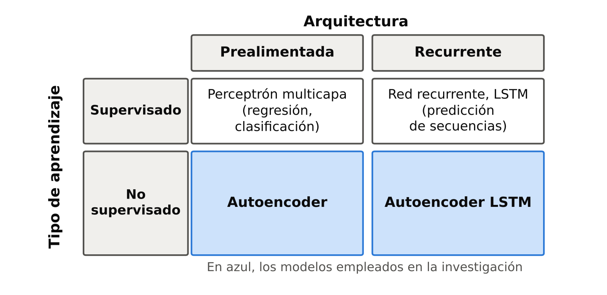{width=80%}

::: {custom-style="Nota"}
*Nota.* Elaboración propia a partir de @goodfellow_bengio_courville_2016.
:::

### 2.2.9 Autoencoders

Un **autoencoder** está formado por un codificador $\mathrm{enc}:\mathbb R^p\to\mathbb R^d$ y un decodificador $\mathrm{dec}:\mathbb R^d\to\mathbb R^p$, con $d<p$, cuyos parámetros se estiman para reproducir la entrada [@goodfellow_bengio_courville_2016]:

$$
\min\ \frac1n\sum_{t=1}^{n}\big\lVert\mathbf z_t-\mathrm{dec}(\mathrm{enc}(\mathbf z_t))\big\rVert^2 .
$$

El vector $\mathrm{enc}(\mathbf z_t)$ es la **representación latente** del mes $t$, y la restricción $d<p$ obliga a la red a retener la información que permite reconstruir la entrada. La Figura {F:autoencoder} muestra su estructura.

::: {custom-style="Rotulo"}
**Figura {F:autoencoder}**\
*Estructura de un autoencoder*
:::

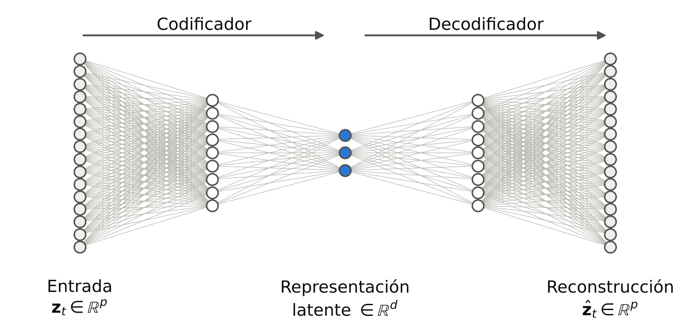{width=80%}

::: {custom-style="Nota"}
*Nota.* Ejemplo con $p=16$ entradas y $d=3$ dimensiones latentes. Elaboración propia.
:::

**Relación con el PCA.** Si el codificador y el decodificador son lineales y la pérdida es cuadrática, el óptimo genera el mismo subespacio que los $d$ primeros ejes del PCA, aunque no recupera los ejes individuales ni su orden [@baldi_hornik_1989]. Con activaciones no lineales, el autoencoder puede representar relaciones que el PCA no capta [@hinton_salakhutdinov_2006]; la variante con eliminación de ruido, que reconstruye la entrada original a partir de una versión perturbada, mejora la robustez de la representación [@vincent_et_al_2008].

**Error de reconstrucción.** El error de cada observación, $e_t=\lVert\mathbf z_t-\hat{\mathbf z}_t\rVert^2$, mide cuánto se aparta el mes $t$ de la estructura aprendida. Calculado fuera de muestra, permite comparar modelos en una misma escala —incluido el PCA, mediante la reconstrucción de la sección 2.2.3— y señalar los meses atípicos.

**Limitaciones.** La representación latente no es identificable: cualquier reparametrización invertible del espacio latente produce la misma reconstrucción, por lo que sus coordenadas no tienen la interpretación de las cargas del PCA. El entrenamiento parte de una inicialización aleatoria y puede conducir a soluciones distintas, y con pocas observaciones el riesgo de sobreajuste es alto. En series temporales, la evaluación fuera de muestra exige separar los datos de entrenamiento y de evaluación por orden cronológico.

### 2.2.10 Redes recurrentes y LSTM

**Red recurrente.** Una red recurrente procesa una secuencia $\mathbf u_1,\dots,\mathbf u_q$ actualizando un estado oculto,

$$
\mathbf h_t=\psi(W\mathbf u_t+U\mathbf h_{t-1}+\mathbf b),
$$

que resume la información de los períodos anteriores. Su entrenamiento propaga el gradiente a lo largo de la secuencia; en secuencias largas, el gradiente tiende a desvanecerse o a crecer sin control, lo que impide aprender dependencias de muchos períodos [@hochreiter_schmidhuber_1997].

**Celda LSTM.** La red de memoria de corto y largo plazo (LSTM) resuelve ese problema con una celda de memoria $\mathbf c_t$ regulada por compuertas [@hochreiter_schmidhuber_1997]:

$$
\begin{aligned}
\mathbf i_t&=\sigma(W_i\mathbf u_t+U_i\mathbf h_{t-1}+\mathbf b_i), &
\mathbf f_t&=\sigma(W_f\mathbf u_t+U_f\mathbf h_{t-1}+\mathbf b_f), &
\mathbf o_t&=\sigma(W_o\mathbf u_t+U_o\mathbf h_{t-1}+\mathbf b_o),\\
\tilde{\mathbf c}_t&=\tanh(W_c\mathbf u_t+U_c\mathbf h_{t-1}+\mathbf b_c), &
\mathbf c_t&=\mathbf f_t\odot\mathbf c_{t-1}+\mathbf i_t\odot\tilde{\mathbf c}_t, &
\mathbf h_t&=\mathbf o_t\odot\tanh(\mathbf c_t),
\end{aligned}
$$

donde $\mathbf i_t$, $\mathbf f_t$ y $\mathbf o_t$ son las compuertas de entrada, de olvido y de salida, y $\odot$ el producto elemento a elemento. La compuerta de olvido fue incorporada posteriormente [@gers_schmidhuber_cummins_2000]. La Figura {F:lstm} esquematiza la celda.

::: {custom-style="Rotulo"}
**Figura {F:lstm}**\
*Esquema de una celda LSTM*
:::

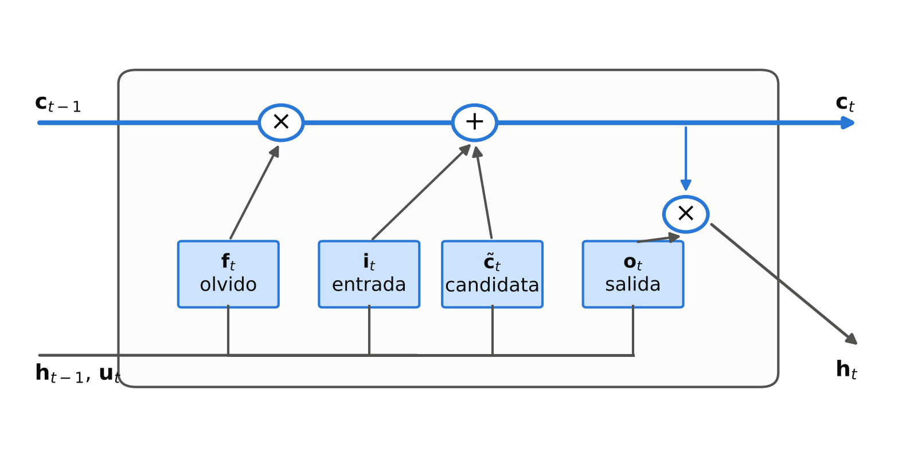{width=85%}

::: {custom-style="Nota"}
*Nota.* Las compuertas de olvido y de entrada regulan la actualización de la memoria $\mathbf c_t$; la de salida, el estado $\mathbf h_t$. Elaboración propia a partir de @hochreiter_schmidhuber_1997.
:::

**Autoencoder LSTM.** Un codificador LSTM lee una ventana de $q$ meses consecutivos y la resume en un vector latente; un decodificador LSTM reconstruye la ventana a partir de ese vector [@srivastava_mansimov_salakhutdinov_2015]. La sucesión de vectores latentes de ventanas consecutivas forma una **trayectoria latente** que resume la evolución del sistema; como las ventanas se solapan, la trayectoria es suave por construcción.

**Incertidumbre.** El método Monte Carlo Dropout mantiene activa la desactivación aleatoria de neuronas al predecir y repite la predicción $R_d$ veces; la dispersión de las predicciones aproxima la incertidumbre del modelo bajo una interpretación bayesiana aproximada y depende de la tasa de desactivación [@gal_ghahramani_2016].

## 2.3 Definición de términos

- **Régimen:** intervalo de meses consecutivos en el que una propiedad del conjunto de indicadores permanece relativamente estable.
- **Régimen de estructura:** régimen en el que permanece estable la estructura de asociación entre los indicadores.
- **Régimen de posición:** régimen en el que permanece estable el nivel conjunto de los indicadores.
- **Corte:** primer mes de cada régimen distinto del primero.
- **Partición:** división del período en intervalos contiguos y disjuntos.
- **Fase:** etiqueta económica (expansión, contracción o transición) asignada a un régimen según el comportamiento del crédito.
- **Estructura de asociación:** conjunto de correlaciones entre los indicadores.
- **Trayectoria:** sucesión ordenada en el tiempo de un resultado del análisis evolutivo, de las coordenadas de un análisis factorial o de una representación latente.
- **Inercia:** dispersión total de la nube de observaciones; con variables estandarizadas, igual al número de variables.
- **Eje factorial:** dirección de máxima dispersión de la nube de observaciones entre las ortogonales a las anteriores.
- **Carga:** correlación entre un indicador y un eje factorial.
- **Representante:** primer componente principal del análisis de los representantes de los dos grupos que se fusionan; en el paso inicial, la propia variable estandarizada.
- **Índice de nodo:** inercia que se pierde al resumir dos grupos con un único factor.
- **Dipolo:** grupo cuyas variables se correlacionan con su representante con signos opuestos.
- **Ventana:** conjunto de meses consecutivos sobre el que se calcula un análisis evolutivo.
- **Tamaño efectivo:** número de observaciones independientes equivalente a una muestra autocorrelacionada o ponderada.
- **Series de referencia simuladas:** series generadas por un mecanismo que conserva propiedades especificadas de los datos y carece de la estructura buscada.
- **Remuestreo por bloques:** generación de réplicas de una serie mediante la concatenación de bloques de observaciones consecutivas.
- **Representación latente:** vector de baja dimensión que una red neuronal asigna a cada observación o secuencia.
- **Error de reconstrucción:** distancia cuadrática entre una observación y su reconstrucción por el modelo.
