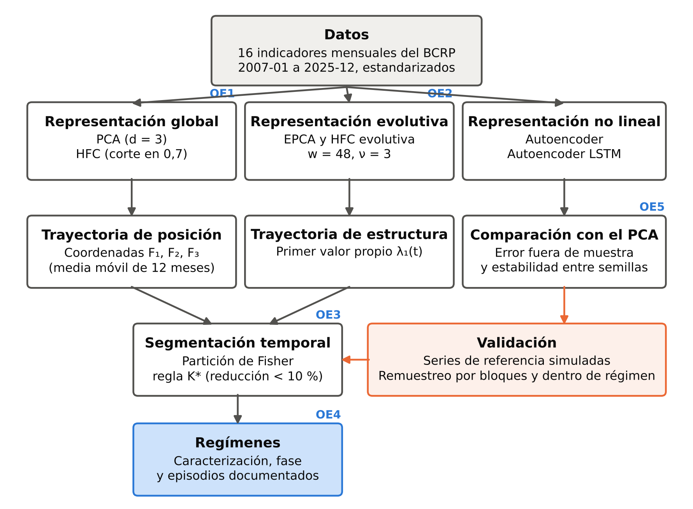

# 3. METODOLOGÍA Y DESARROLLO DEL MODELO

<!-- Versión del 9-11-2026 con las correcciones del asesor-agente, aprobadas por el tesista. Decisiones: dos tipos de régimen (estructura y posición); número de tramos por contraste con series de referencia simuladas (regla del 10 % y mayor caída como sensibilidad); diagnóstico de influencia de meses atípicos; coordenadas sin estandarizar y media móvil centrada; remuestreo de incrementos para la estabilidad global; precisión de ubicación de los cortes por remuestreo de residuos dentro de cada tramo; regla de fases con crédito real; lista de episodios fija con línea base de azar. Pendientes: datos de 2006 y crédito a tipo de cambio constante (requieren descarga del BCRP); criterio numérico de mes atípico; tabla de hiperparámetros con los valores de la corrida definitiva. -->

## 3.1 Metodología

### 3.1.1 Tipo, nivel y diseño de la investigación

La investigación es cuantitativa, de nivel exploratorio y descriptivo, con un componente comparativo entre métodos. El diseño es no experimental, longitudinal y retrospectivo: se analizan series temporales publicadas, sin manipulación de variables.

### 3.1.2 Datos

**Población y muestra.** La población está formada por los indicadores macrofinancieros mensuales que publica el Banco Central de Reserva del Perú (BCRP). La muestra, obtenida por muestreo no probabilístico intencional, comprende 16 series que representan el crédito, los agregados monetarios, las tasas de interés, los precios, la actividad, el sector externo, el mercado bursátil y el riesgo soberano (Tabla {T:series}), observadas mensualmente de enero de 2007 a diciembre de 2025 ($n=228$ meses). El período inicia en el primer mes en que todas las series están disponibles.

::: {custom-style="Rotulo"}
**Tabla {T:series}**\
*Series analizadas, código en la base de datos del BCRP y unidad*
:::

| Serie | Código | Unidad |
|---|---|---|
| Crédito empresarial | PN00532MM | Millones de soles |
| Crédito de consumo | PN00533MM | Millones de soles |
| Crédito hipotecario | PN00534MM | Millones de soles |
| M1 | PN00199MM | Millones de soles |
| M3 | PN00214MM | Millones de soles |
| Tasa de referencia | PD04722MM | Porcentaje |
| Tasa interbancaria | PN07819NM | Porcentaje |
| TAMN | PN07807NM | Porcentaje |
| TIPMN | PN07816NM | Porcentaje |
| Índice de precios de Lima | PN38705PM | Índice |
| Tipo de cambio | PN01246PM | Soles por dólar |
| Índice de la BVL | PN01142MM | Índice |
| EMBIG | PD04709XD | Puntos básicos |
| PBI | PN01773AM | Índice, desestacionalizado |
| Demanda interna | PN01774AM | Índice, desestacionalizado |
| Reservas internacionales netas | PN00027MM | Millones de dólares |

::: {custom-style="Nota"}
*Nota.* Valores nominales, salvo los índices de actividad. TAMN: tasa activa en moneda nacional; TIPMN: tasa pasiva en moneda nacional; BVL: Bolsa de Valores de Lima; EMBIG: diferencial de rendimiento de los bonos soberanos peruanos frente a los del Tesoro de los Estados Unidos. Elaboración propia con datos del BCRP.
:::

**Criterios de selección.** Se excluyeron del análisis factorial el crédito total y la liquidez en moneda nacional (M2), casi colineales con los créditos por tipo y con M3, respectivamente: como cada indicador estandarizado aporta una unidad de inercia, su inclusión duplicaría el peso de esa información. El BCRP no publica un índice mensual de precios inmobiliarios, por lo que el componente inmobiliario del ciclo financiero [@drehmann_borio_tsatsaronis_2012] no está representado; es una limitación del estudio. Se incluye el índice bursátil, que Drehmann et al. excluyen de su caracterización, porque el enfoque exploratorio deja que la estructura de los datos indique si su comportamiento difiere del resto.

**Tratamiento.** Las series se emplean tal como las publica el BCRP: el PBI y la demanda interna en su versión desestacionalizada y las demás sin ajuste estacional, en valores nominales. Los meses de 2020 no se modifican; su influencia se evalúa con el diagnóstico de la sección 3.2.4. Las series se descargaron por su código, se verificaron en unidades, frecuencia, cobertura y continuidad, y se congelaron el 16 de octubre de 2026 con una huella digital de cada archivo, de modo que los resultados no dependen de revisiones posteriores de la fuente —en particular, del ajuste estacional, que el BCRP revisa—. El análisis principal emplea las series en niveles, porque la diferenciación atenúa las oscilaciones de baja frecuencia (sección 2.2.2); el riesgo de correlación espuria que conllevan los niveles se controla con el contraste con series de referencia con tendencia (sección 3.2.5), y las series en logaritmos y en primeras diferencias se emplean como control de robustez.

**Alcance temporal.** Los indicadores se observan entre enero de 2007 y diciembre de 2025. Con ventanas de 48 meses sin truncamiento, los regímenes de estructura se identifican entre enero de 2009 y enero de 2024; los de posición, en todo el período.

**Operacionalización.** La Tabla {T:operacional} relaciona cada objetivo específico con lo que se mide y con sus indicadores.

::: {custom-style="Rotulo"}
**Tabla {T:operacional}**\
*Operacionalización: dimensiones e indicadores por objetivo específico*
:::

| Objetivo | Dimensión | Indicadores |
|---|---|---|
| OE1 | Estructura factorial global | Valores propios e inercia; cargas, calidad de representación y contribuciones; clases e índices de la HFC; $\hat p$ de cada eje frente a series de referencia con tendencia |
| OE2 | Evolución de la estructura | Valores propios evolutivos; correlaciones evolutivas; índices y composición de los grupos por ventana; $\hat p$ del cambio de estructura |
| OE3 | Regímenes | Cortes; suma de cuadrados por número de tramos; $\hat p$ de la partición; precisión de la ubicación de cada corte |
| OE4 | Caracterización | Crecimiento del crédito, actividad, inflación, tasa de referencia y riesgo soberano por régimen; fase; compatibilidad con los episodios frente a la esperada por azar |
| OE5 | Comparación de representaciones | Error de reconstrucción fuera de muestra; coeficiente RV entre representaciones de distintas semillas; concordancia entre particiones |

::: {custom-style="Nota"}
*Nota.* Elaboración propia.
:::

### 3.1.3 Episodios documentados

Los cortes se comparan con seis episodios cuya fecha proviene de documentos externos a las series (Tabla {T:episodios}). La lista se fijó antes de examinar los cortes y no se modifica en función de ellos. Los episodios no se fechan con las series ni con indicadores derivados de ellas, para que la comparación no sea circular; la fecha corresponde al evento externo y no a su efecto en la economía peruana. Un corte es compatible con un episodio si dista tres meses o menos de su fecha de inicio o de fin; seis meses se emplean como sensibilidad. Como las fechas de los episodios cubren una fracción apreciable del período, se informa también la proporción de compatibilidades esperada si los cortes se ubicaran al azar, respetando la duración mínima de los tramos, estimada con 10 000 ubicaciones simuladas.

::: {custom-style="Rotulo"}
**Tabla {T:episodios}**\
*Episodios documentados y fuentes de sus fechas*
:::

| Episodio | Inicio | Fin | Fuente del inicio | Fuente del fin |
|---|---|---|---|---|
| Crisis financiera global | 2008-09 | 2009-06 | @lehman_brothers_2008 | @nber_2010 |
| *Taper tantrum* | 2013-05 | 2013-12 | @bernanke_2013 | @reserva_federal_2013 |
| Colapso de los precios de las materias primas | 2014-06 | 2016-01 | @stocker_et_al_2015 | @fmi_2016 |
| Renuncia presidencial de 2018 (Kuczynski) | 2018-03 | Puntual | @congreso_2018 | — |
| Guerra comercial entre Estados Unidos y China | 2018-06 | 2020-01 | @ustr_2018 | @ustr_2020 |
| Pandemia de COVID-19 | 2020-03 | 2020-04 | @oms_2020b | @nber_2021 |

::: {custom-style="Nota"}
*Nota.* La crisis global va de la quiebra de Lehman Brothers al valle de la recesión estadounidense fijado por el NBER; el *taper tantrum*, del testimonio del presidente de la Reserva Federal ante el Congreso al comunicado que anunció la reducción de las compras de activos; el colapso de las materias primas, de la caída del precio del petróleo al primer repunte de los precios informado por el FMI; la pandemia, de la declaración de la OMS al valle de la actividad estadounidense fijado por el NBER. Elaboración propia.
:::

### 3.1.4 Estrategia de análisis

El análisis avanza de la estructura global a su evolución y de esta a los regímenes, y cada etapa responde a un objetivo específico (Figura {F:esquema}): (1) la representación global de los indicadores mediante PCA y HFC (OE1); (2) su evolución mediante EPCA y HFC evolutiva (OE2); (3) la segmentación temporal de dos trayectorias mediante la partición de Fisher, con su contraste (OE3); (4) la caracterización de los regímenes y su comparación con los episodios (OE4), y (5) la comparación de la representación lineal con las no lineales (OE5).

::: {custom-style="Rotulo"}
**Figura {F:esquema}**\
*Esquema del modelo: etapas, trayectorias y validación*
:::

{width=100%}

::: {custom-style="Nota"}
*Nota.* Elaboración propia.
:::

### 3.1.5 Implementación computacional

El procesamiento se realizó en R y en Python. Los métodos factoriales, las series de referencia, los remuestreos y la segmentación temporal se implementaron en ambos lenguajes, con verificación de que producen resultados idénticos hasta $10^{-12}$, y se contrastaron con las rutinas de referencia de @camiz_aedeclahfac —clahfac para la HFC y aede para el análisis evolutivo y la partición de Fisher—; la HFC evolutiva sigue el procedimiento del programa claede [@camiz_claede_2025]. Los autoencoders se implementaron con la biblioteca PyTorch, con semillas fijas. Los datos, el código y los resultados se publican en un repositorio de acceso público (https://github.com/RobertoSam/Tesis-modelamiento-matematico), con una versión etiquetada que corresponde a los resultados de este documento.

## 3.2 Desarrollo del modelo matemático y computacional

### 3.2.1 Formulación del problema

Sea $X\in\mathbb{R}^{n\times p}$ la matriz de los $p=16$ indicadores observados en $n=228$ meses, y $Z$ su versión estandarizada. El modelo tiene dos componentes:

1. **Representación.** Una aplicación $f:\mathbb{R}^p\to\mathbb{R}^d$, con $d<p$, que asigna a cada mes $\mathbf z_t$ una representación $f(\mathbf z_t)$ que conserva la información común de los indicadores. En el caso lineal, $f(\mathbf z)=V_d^\top\mathbf z$ (PCA), interpretable mediante las cargas; en el no lineal, $f$ es el codificador de un autoencoder, cuya representación no es identificable (sección 2.2.9). La representación evolutiva aplica el PCA a cada ventana.
2. **Segmentación temporal.** Dada una trayectoria $\mathbf y_1,\dots,\mathbf y_N$ derivada de la representación global o evolutiva, una partición del índice temporal en $K$ intervalos contiguos de al menos 12 meses que minimiza $\mathrm{SCD}_K$. La restricción modifica la recurrencia de la sección 2.2.6: el índice $j$ que inicia el último intervalo cumple $j-1\ge 12(k-1)$ y $m-j+1\ge 12$.

Se segmentan dos trayectorias, que dan lugar a dos tipos de régimen:

- La **trayectoria de estructura**, $y_t=\lambda_1(t)$, primer valor propio del EPCA en la ventana asociada al mes $t$, mide la intensidad de la asociación común. Sus intervalos son **regímenes de estructura**: períodos en que la estructura de asociación entre los indicadores permanece relativamente estable.
- La **trayectoria de posición**, $\mathbf y_t=(F_{t1},F_{t2},F_{t3})$, coordenadas del mes $t$ en los tres primeros ejes del PCA global, mide el nivel conjunto de los indicadores. Sus intervalos son **regímenes de posición**: períodos en que el sistema permanece en una misma zona del espacio factorial.

Ambos tipos se caracterizan y se comparan entre sí; un corte común a las dos trayectorias indica un cambio simultáneo de estructura y de posición.

### 3.2.2 Representación global

**PCA.** Se aplica a la matriz de correlaciones de las 16 series en niveles. Se informan los valores propios y su proporción de inercia simple y acumulada; las cargas, la calidad de representación y la contribución de cada serie a cada eje; las coordenadas de los meses; los círculos de correlaciones en los planos 1–2 y 1–3, y, como diagnósticos de adecuación, la medida de Kaiser, Meyer y Olkin (KMO), global y por serie, y la prueba de esfericidad de Bartlett, calculada con $n$ y con el tamaño efectivo $n_{\mathrm{ef}}$ (sección 2.2.2). El número de ejes interpretados se fija en $d=3$, por comparabilidad con los tres grupos identificados por @camiz_cerda_atoche_2026. Se informan los criterios de Kaiser, vara quebrada y análisis paralelo —este último con el percentil 95 de los valores propios de 1000 tablas simuladas, una variante más conservadora que la media empleada por @horn_1965, que como ella ignora la autocorrelación—, y $d=2$ y $d=4$ se emplean como sensibilidad. El control apropiado frente a la tendencia y la autocorrelación es el contraste con series de referencia con tendencia (sección 3.2.5).

**HFC.** Se aplica a las mismas series. Se informan los nodos de la jerarquía con su índice, la varianza de su representante y la proporción de inercia local y acumulada; el dendrograma; la partición por el corte en 0,7, y la correlación de cada serie con el representante de su clase.

### 3.2.3 Representación evolutiva

**Ventana y pesos.** El análisis principal emplea ventanas de $w=48$ meses con pesos gaussianos de parámetro $\nu=3$, la especificación de @camiz_cerda_atoche_2026, para que los resultados sean comparables con el antecedente; el tamaño efectivo de la ventana es $n_\omega\approx 37$ meses. Cada resultado se asigna al mes que ocupa la posición $w/2+1$ de la ventana, convención de la rutina de referencia, medio mes después del centro de los pesos. Con $w=48$ se obtienen 181 ventanas, asignadas a los meses de enero de 2009 a enero de 2024; no se emplean ventanas truncadas en los extremos. Como lectura multiescala se emplean los anchos de 24, 36 y 60 meses, con pesos uniformes y gaussianos. Como el primer valor propio de una matriz de correlaciones estimada con pocos meses está sesgado hacia arriba, y con 24 meses el tamaño efectivo es de unos 18 meses para 16 series, los anchos se comparan mediante el cociente entre $\lambda_1$ y el umbral del análisis paralelo del mismo ancho.

**EPCA.** En cada ventana se calculan los tres primeros valores propios y las correlaciones de las 16 series con los dos primeros ejes. Cada valor propio se compara con el umbral de Kaiser y con el del análisis paralelo calculado con el tamaño efectivo de la ventana, que ignora la autocorrelación.

**HFC evolutiva.** En cada ventana se calcula la jerarquía completa con los mismos pesos. Se informan los índices de los tres nodos superiores, el número de clases que deja el corte en 0,7 y la composición de las clases en las ventanas asignadas al mes central de cada régimen de estructura.

### 3.2.4 Segmentación temporal

**Trayectorias.** La trayectoria de estructura es $\lambda_1(t)$ con $w=48$ y $\nu=3$. La trayectoria de posición son las coordenadas de los tres primeros ejes del PCA global, suavizadas con una media móvil centrada de 12 meses y sin estandarizar, de modo que la distancia euclídea es la del subespacio factorial y cada eje pesa según su inercia. Como sensibilidad se emplean la media móvil de los 12 meses anteriores, que introduce un retardo medio de 5,5 meses, y las coordenadas estandarizadas.

**Diagnóstico de influencia.** Un mes extremo $\tau$ entra en la ventana asignada al mes $\tau-23$ y sale de la asignada al mes $\tau+24$, y puede producir en $\lambda_1(t)$ saltos que no corresponden a un cambio de régimen. Se marca como posible efecto de la ventana todo corte de la trayectoria de estructura situado a tres meses o menos de las fechas $\tau-23$ o $\tau+24$ de un mes atípico $\tau$, y el EPCA se recalcula excluyendo los meses de marzo a junio de 2020.

**Partición y número de tramos.** Cada trayectoria se particiona con el algoritmo de @fisher_1958 para $K=1,\dots,10$. El número de tramos $K^*$ es el mayor $K$ tal que la reducción relativa de la suma de cuadrados al pasar de $K-1$ a $K$ tramos,

$$
\Delta_K=\frac{\mathrm{SCD}_{K-1}-\mathrm{SCD}_K}{\mathrm{SCD}_{K-1}},
$$

supera el percentil 95 de la misma reducción en las series de referencia de la sección 3.2.5: un tramo adicional se acepta solo si reduce la heterogeneidad más de lo que lo haría en series sin la estructura buscada. Como sensibilidad se informan la regla del menor $K$ a partir del cual un tramo adicional reduce $\mathrm{SCD}_K$ en menos de 10 % —con umbrales de 10, 12 y 15 %— y la regla de la mayor caída. El índice de @calinski_harabasz_1974 se informa, pero no se usa para elegir $K$ (sección 2.2.6).

**Especificación preliminar.** Como el contraste de la sección 3.2.5 no identifica regímenes que superen a las series de referencia (capítulo 4), los regímenes que se caracterizan en este informe se obtienen con una especificación preliminar, que se declara como tal y no como resultado validado: para la trayectoria de posición, las coordenadas de los tres primeros ejes suavizadas con la media móvil de los 12 meses anteriores y estandarizadas; para ambas trayectorias, el número de tramos elegido con la regla del menor $K$ a partir del cual un tramo adicional reduce $\mathrm{SCD}_K$ en menos de 10 % y, si ningún $K$ cumple esa condición, el de mayor caída de esa reducción. Esta especificación permite describir y caracterizar los regímenes de forma tentativa mientras se evalúan formulaciones alternativas de la segmentación.

**Sensibilidad.** Se informan los cortes obtenidos con $d=2$ y $d=4$ ejes en la trayectoria de posición, y con los anchos de 24, 36 y 60 meses en la trayectoria de estructura.

### 3.2.5 Validación

**Contraste de la partición.** La cadena completa —representación, trayectoria, partición de Fisher y número de tramos— se aplica a cada conjunto de series de referencia: las de estructura constante para la trayectoria de estructura y las de tendencia para la trayectoria de posición. Para cada $K\le 10$ se compara la reducción $\Delta_K$ observada con su distribución simulada y se informa $\hat p$ (sección 2.2.7); esa comparación determina $K^*$ (sección 3.2.4).

**Series de referencia con tendencia.** Para evaluar si los ejes del PCA y la trayectoria de posición reflejan asociación entre las series o solo su crecimiento, se generan 1000 conjuntos de 16 series independientes entre sí, cada una con el tipo de tendencia de la serie observada (sección 2.2.2): las series TS, como su recta de tendencia más sus residuos remuestreados por bloques de $\ell=24$ meses; las DS con deriva significativa ($\lvert t\rvert>2$), como la acumulación de sus incrementos centrados, remuestreados por bloques, más la deriva estimada, y las demás DS, como la acumulación de sus incrementos centrados remuestreados por bloques. Los remuestreos son independientes entre series, lo que elimina la asociación y conserva la tendencia y la dependencia temporal de cada una. Las series de tipo indeterminado se simulan de las dos formas, y se informan ambos resultados. Para los ejes del PCA, el estadístico es la proporción de inercia de cada uno de los tres primeros ejes.

**Series de referencia con estructura constante.** Para evaluar si la estructura de asociación cambia más de lo que cambiaría por azar, se generan 200 conjuntos de series por remuestreo conjunto de bloques de $\ell=24$ meses de los incrementos mensuales, con los mismos inicios de bloque para todas las series, acumulados desde el valor inicial: las series conservan la correlación contemporánea y la dinámica de corto plazo, pero cualquier cambio de estructura queda dispersado en el tiempo. En cada conjunto se calcula el coeficiente RV entre las cargas de los dos primeros ejes de ventanas adyacentes que no comparten meses; el estadístico global es el mínimo de esa sucesión a lo largo del período, y se informa su $\hat p$, con una resolución de $1/201$, junto con la banda simulada. Como la acumulación de incrementos no conserva el tipo de tendencia de las series TS, el contraste se repite con esas series en desviaciones de su tendencia.

**Estabilidad de la estructura global.** Se evalúa con 500 réplicas obtenidas por remuestreo conjunto, en bloques móviles de $\ell=24$ meses (12 y 36 como sensibilidad), de los incrementos mensuales, acumulados desde el valor inicial: para el PCA, la congruencia de cada uno de los tres primeros ejes con el eje original emparejado por el valor absoluto de la congruencia, y la distribución de los valores propios; para la HFC, la frecuencia con que se reproduce la partición, medida con el índice de Rand ajustado, y la correlación cofenética entre dendrogramas.

**Precisión de la ubicación de los cortes.** Dados $K^*$ y la partición obtenida, se remuestrean por bloques de seis meses los residuos de la trayectoria respecto de la media de cada tramo, dentro de ese tramo, y se suman a la media del tramo; en cada una de 200 réplicas se repite la partición con $K^*$ y se informa, para cada corte, la proporción de réplicas con un corte a tres meses o menos y el intervalo entre los percentiles 5 y 95 de su ubicación. El procedimiento es condicional en la existencia de los cortes y en $K^*$: mide la precisión de su ubicación y no su existencia, que se evalúa con el contraste de la partición. Es un procedimiento propio de la investigación, análogo a los intervalos por remuestreo para la ubicación de un punto de cambio; en tramos de menos de 24 meses, el resultado se informa con esa advertencia.

**Correspondencia con los episodios.** Para cada corte se informa la distancia, en meses, al inicio o al fin del episodio más cercano, su compatibilidad con él y la proporción de compatibilidades esperada por azar (sección 3.1.3).

### 3.2.6 Caracterización de los regímenes y regla de fases

Cada régimen se caracteriza con indicadores calculados directamente de las series: el crecimiento interanual promedio del crédito, del PBI y del índice de precios; la tasa de referencia promedio del primer y del último trimestre del régimen, y el promedio del EMBIG.

La fase se asigna con una regla basada en el crecimiento interanual real del crédito total $C_t$, suma de los créditos empresarial, de consumo e hipotecario, deflactada por el índice de precios de Lima:

$$
g_t=100\Big(\frac{C_t/P_t}{C_{t-12}/P_{t-12}}-1\Big),
$$

donde $P_t$ es el índice de precios. La diferencia interanual conserva las oscilaciones de baja frecuencia y elimina la estacionalidad (sección 2.2.2). Sean $m$ la mediana y $s$ la desviación estándar de $g_t$ en el período, y $\tilde g_k$ la mediana de $g_t$ en el régimen $k$. La fase del régimen es:

$$
\text{fase}_k=\begin{cases}
\text{expansión} & \text{si } \tilde g_k>m+c\,s,\\
\text{contracción} & \text{si } \tilde g_k<m-c\,s,\\
\text{transición} & \text{en otro caso,}
\end{cases}
$$

con $c=1$ en el análisis principal y $c=0{,}5$ como sensibilidad. La mediana hace que la fase refleje el comportamiento predominante del régimen aunque contenga meses atípicos. Se informan $\tilde g_k$, la distribución de $g_t$ y el signo de la variación de $g_t$ dentro de cada régimen, porque la regla clasifica el crecimiento del crédito respecto de su valor habitual en el período y no la dirección del ciclo. Tres limitaciones se declaran: $g_t$ no está disponible en los primeros 12 meses de la muestra, de modo que la fase de un régimen que los incluye se calcula con los meses disponibles; el crédito en moneda extranjera está valorado al tipo de cambio de cada mes, por lo que una depreciación aumenta $C_t$ sin que aumente el crédito, y el crecimiento del crédito empresarial en 2020–2022 está afectado por el programa de créditos con garantía estatal Reactiva Perú.

### 3.2.7 Representaciones no lineales

**Autoencoder.** Red prealimentada con arquitectura $16\to 8\to 3\to 8\to 16$, activación tangente hiperbólica en la capa oculta, capas latente y de salida lineales, y pesos compartidos entre codificador y decodificador; $d=3$ dimensiones latentes, como en el PCA. Se entrena con el método de Adam, con penalización de los pesos, ruido gaussiano en la entrada (variante con eliminación de ruido) y detención temprana sobre el último 15 % cronológico de cada conjunto de entrenamiento.

**Autoencoder LSTM.** Codificador y decodificador LSTM con 16 unidades ocultas y $d=3$ dimensiones latentes, aplicados a ventanas de $q=12$ meses; cada vector latente se asigna al centro de su ventana, para que su trayectoria sea comparable con las de estructura y de posición.

**Especificación.** Los valores de la penalización, la varianza del ruido, la tasa de aprendizaje, el tamaño del lote, el número de épocas, la paciencia y el número de semillas se presentan en la Tabla {T:hiperparametros} del capítulo 4.

**Evaluación.** Ambos modelos se comparan con el PCA de la misma dimensión mediante el error de reconstrucción fuera de muestra, con dos esquemas cronológicos: validación por cinco bloques contiguos, para $d=1,\dots,5$, que muestra si la ventaja relativa depende de la dimensión, y evaluación anual sucesiva (*walk-forward*), en la que el modelo se entrena con los meses anteriores a cada año y se evalúa en ese año, de 2011 a 2025. La estandarización se estima solo con los datos de entrenamiento, y entre bloques de entrenamiento y de evaluación se deja un margen de $q$ meses para que ninguna ventana del autoencoder LSTM los comparta. Como las series en niveles alcanzan en la evaluación valores fuera del rango de entrenamiento y la tangente hiperbólica se satura, la comparación se repite con las series en primeras diferencias. La estabilidad de la representación se mide con el coeficiente RV entre las representaciones latentes obtenidas con distintas semillas. La trayectoria latente se segmenta con el procedimiento de la sección 3.2.4, y su partición se compara con la de la trayectoria de posición mediante el índice de Rand ajustado y la distancia entre cortes. Con alrededor de 200 ventanas muy solapadas y miles de parámetros, el riesgo de sobreajuste del autoencoder LSTM es alto, y los resultados se interpretan con esa reserva.
