# 4. RESULTADOS Y DISCUSIÓN

<!-- Plantilla: las marcas TABLA se sustituyen con tablas_cap4.py, que lee los resultados sin transcribirlos. -->

La estructura factorial y su evolución se presentan como resultados del análisis. Los regímenes se obtienen con la especificación de trabajo de la sección 3.2.4, porque el contraste con las series de referencia simuladas todavía no los respalda y su validación está en estudio (sección 4.3).

## 4.1 Estructura factorial global (OE1)

### 4.1.1 Las series

La Figura {F:series} muestra las 16 series en sus unidades originales. Los saldos y los niveles de actividad y de precios crecen de forma sostenida. Entre 2007 y 2025, los créditos se multiplicaron entre 6,5 y 9,5 veces, M3 por 5,9, las reservas internacionales por 5,1, el índice de precios aumentó 85 % y el PBI se duplicó. Las tasas de interés, el tipo de cambio, el índice bursátil y el EMBIG oscilan sin una tendencia sostenida. Doce series son integradas, una (el EMBIG) es estacionaria en tendencia y tres (el crédito de consumo, la TIPMN y el PBI) quedan sin clasificar. Por la persistencia de las series, la mediana del tamaño efectivo de los pares es de 10,6 observaciones independientes.

::: {custom-style="Rotulo"}
**Figura {F:series}**\
*Series analizadas en sus unidades originales*
:::

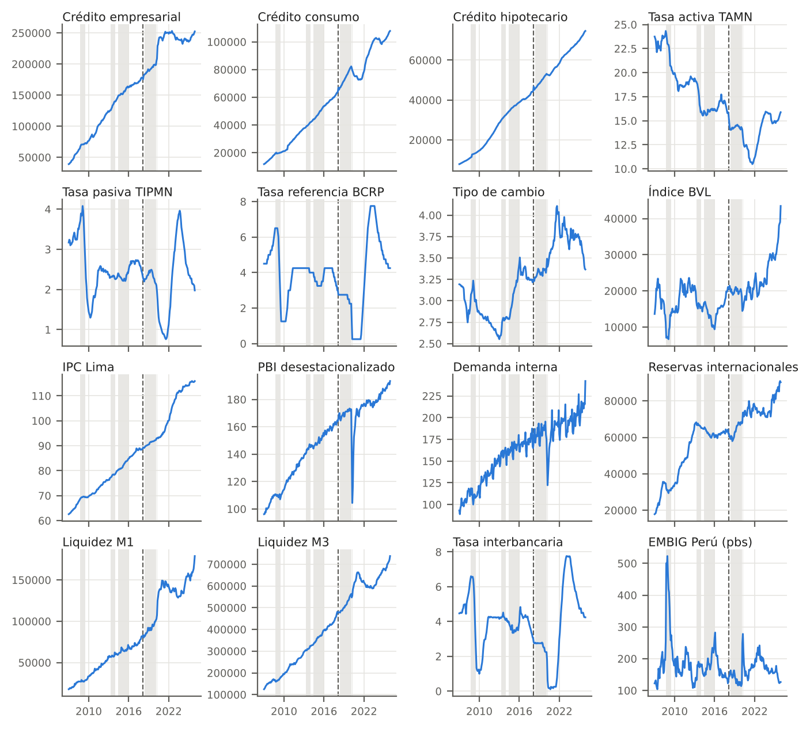{width=100%}

::: {custom-style="Nota"}
*Nota.* En gris, los episodios de la Tabla {T:episodios}. Elaboración propia con datos del BCRP.
:::

### 4.1.2 Análisis en componentes principales

La medida KMO global es 0,84, y la de cada serie va de 0,61 (tasa de referencia) a 0,95 (demanda interna) (Tabla {T:kmo}). La prueba de Bartlett rechaza la esfericidad con $n=228$ ($\chi^2=10\,492$, 120 grados de libertad); con el tamaño efectivo, el estadístico baja a 162 ($p=0{,}007$), y como $n_{\mathrm{ef}}<p$ la aproximación $\chi^2$ no es fiable y el resultado es solo un indicio.

::: {custom-style="Rotulo"}
**Tabla {T:kmo}**\
*Medida KMO por serie y calidad de representación en los tres primeros ejes*
:::

{{TABLA:kmo}}

::: {custom-style="Nota"}
*Nota.* Elaboración propia con datos del BCRP.
:::

Los tres primeros ejes recogen el 65,2 %, el 19,4 % y el 7,6 % de la inercia, 92,2 % en conjunto (Tabla {T:valores}, Figura {F:sedim}). Kaiser retiene tres ejes; el análisis paralelo y la vara quebrada, dos. El tercer valor propio (1,21) supera el umbral de Kaiser pero no el del análisis paralelo (1,36). Es un eje de frontera, y se interpreta por la decisión tomada en la sección 3.2.2.

::: {custom-style="Rotulo"}
**Tabla {T:valores}**\
*Valores propios, inercia y criterios para el número de ejes*
:::

{{TABLA:valores}}

::: {custom-style="Nota"}
*Nota.* Umbral del análisis paralelo: percentil 95 de 1000 tablas simuladas. Vara quebrada: proporción esperada de inercia. Elaboración propia con datos del BCRP.
:::

::: {custom-style="Rotulo"}
**Figura {F:sedim}**\
*Valores propios frente al análisis paralelo y la vara quebrada*
:::

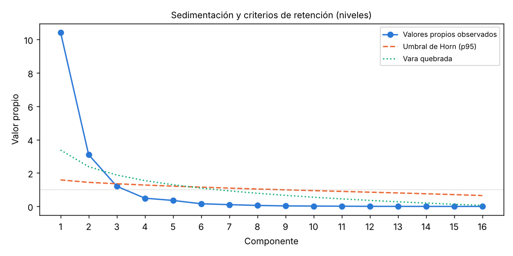{width=60%}

::: {custom-style="Nota"}
*Nota.* Elaboración propia con datos del BCRP.
:::

La Tabla {T:pca} da, para cada eje, la correlación de cada serie con el eje, su calidad de representación (cos²) y su contribución a la inercia del eje. La Figura {F:circulos} representa esas correlaciones en los planos 1–2 y 1–3.

- *Eje 1, escala del sistema.* Once series contribuyen en proporciones parecidas, entre 6,1 % y 9,4 %, cerca de 1/11: los tres créditos, M1, M3, el índice de precios, el PBI, la demanda interna y las reservas, con correlaciones de 0,93 a 0,99; el tipo de cambio (0,80), y la TAMN con signo opuesto. Las otras cinco series aportan poco. La coordenada de los meses en este eje está casi perfectamente correlacionada con el tiempo (Figura {F:scores}).
- *Eje 2, condiciones monetarias.* Las tasas de referencia, interbancaria y pasiva suman el 88,0 % de su formación. Su mínimo coincide con la tasa de referencia en 0,25 % (julio de 2021) y su máximo, con el fin del ciclo de alzas (agosto de 2023).
- *Eje 3, riesgo de mercado.* Opone el EMBIG a la bolsa, que suman el 85,2 % de su formación. Sus valores más altos ocurren en diciembre de 2008, febrero de 2016 y abril de 2020.

El tipo de cambio (0,77) y el índice de la BVL (0,79) son las series peor representadas por los tres ejes.

::: {custom-style="Rotulo"}
**Tabla {T:pca}**\
*Correlación con el eje, calidad de representación (cos²) y contribución de cada serie en los tres primeros ejes*
:::

{{TABLA:pca}}

::: {custom-style="Nota"}
*Nota.* r: correlación de la serie con el eje; en negrita, valores absolutos iguales o mayores que 0,6. Ctr.: contribución a la inercia del eje. La calidad en el subespacio 1–3 es la suma de los cos² de los tres ejes. Elaboración propia con datos del BCRP.
:::

::: {custom-style="Rotulo"}
**Figura {F:circulos}**\
*Círculos de correlaciones en los planos 1–2 y 1–3*
:::

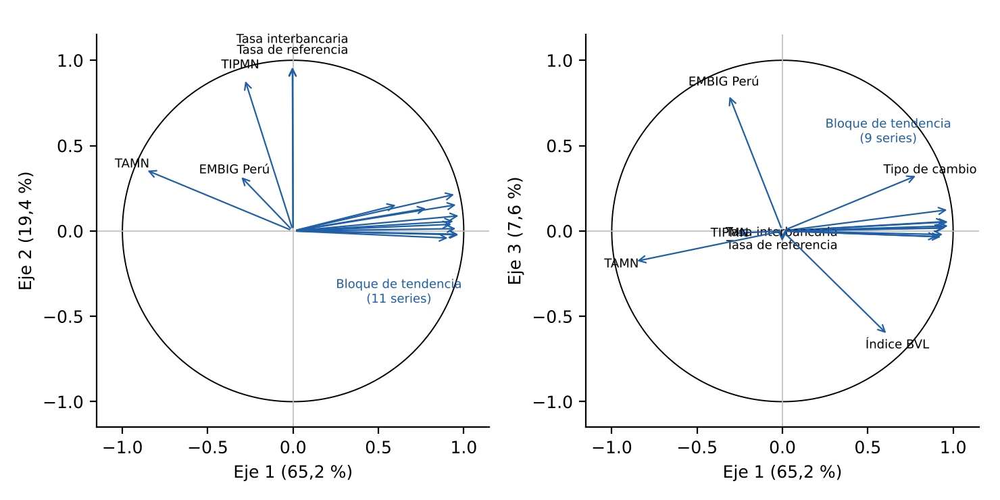{width=100%}

::: {custom-style="Nota"}
*Nota.* Elaboración propia con datos del BCRP.
:::

::: {custom-style="Rotulo"}
**Figura {F:scores}**\
*Coordenadas de los meses en los tres primeros ejes*
:::

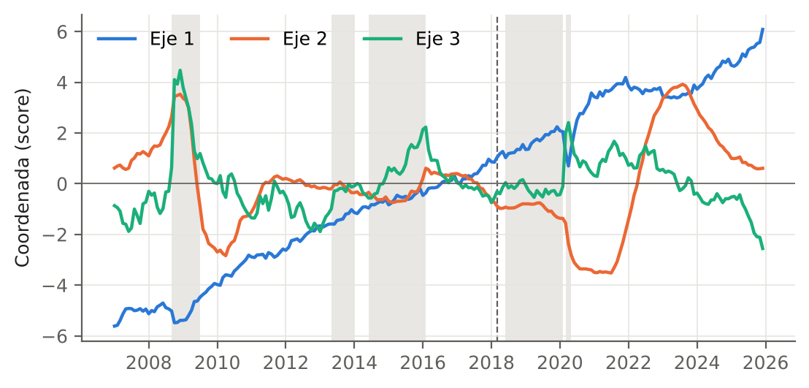{width=100%}

::: {custom-style="Nota"}
*Nota.* En gris, los episodios de referencia. Elaboración propia con datos del BCRP.
:::

Solo el segundo eje supera a las series de referencia (Tabla {T:ref_ejes}). Con series independientes, cada una con su propia tendencia, se obtiene un primer eje igual o mayor que el observado en cerca del 80 % de las simulaciones y un tercero en cerca del 25 %, mientras que un segundo eje como el observado aparece en menos del 1 %. El bloque de escala refleja, entonces, que casi todas las series crecen, y el único co-movimiento que no puede atribuirse a la tendencia es el de las tasas de interés.

::: {custom-style="Rotulo"}
**Tabla {T:ref_ejes}**\
*Proporción de inercia de los tres primeros ejes frente a series de referencia con tendencia*
:::

{{TABLA:ref_ejes}}

::: {custom-style="Nota"}
*Nota.* 1000 conjuntos de 16 series independientes, cada una con su tipo de tendencia (sección 3.2.5). Elaboración propia con datos del BCRP.
:::

Con el remuestreo de los incrementos en bloques de 24 meses, la mediana de la congruencia de cada eje con el original es de 0,87, 0,78 y 0,75, y el percentil 5, de 0,68, 0,56 y 0,54 (Tabla {T:estab}, Figura {F:estab}). El primer eje es el más estable; los ejes 2 y 3 conservan su orientación en la mayoría de las réplicas, pero con una dispersión apreciable. Como las réplicas recombinan los incrementos de cada serie, cambian las trayectorias en niveles y, con ellas, las correlaciones. La estructura en niveles depende en buena medida de la trayectoria particular que siguieron las series.

::: {custom-style="Rotulo"}
**Tabla {T:estab}**\
*Estabilidad de los ejes del PCA frente al remuestreo de los incrementos*
:::

{{TABLA:estab}}

::: {custom-style="Nota"}
*Nota.* 500 réplicas por largo de bloque. Elaboración propia con datos del BCRP.
:::

::: {custom-style="Rotulo"}
**Figura {F:estab}**\
*Congruencia de los tres primeros ejes con el original en 500 réplicas*
:::

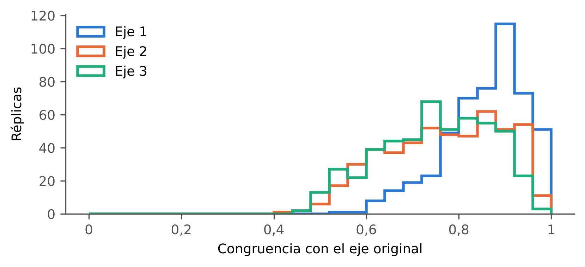{width=70%}

::: {custom-style="Nota"}
*Nota.* Bloques de 24 meses. Elaboración propia con datos del BCRP.
:::

### 4.1.3 Clasificación factorial jerárquica

La Figura {F:dendro} muestra el dendrograma y la Tabla {T:nodos}, los 15 nodos de la jerarquía. Las series se unen primero en pares casi intercambiables, con índices menores que 0,03. Así se unen la tasa de referencia con la interbancaria, el crédito de consumo con el hipotecario, el crédito empresarial con M3 y el PBI con la demanda interna. El nodo 28 reúne once series con un índice de 0,353; el nodo 25, las tres tasas de corto plazo (0,207), y el nodo 29, el EMBIG y la bolsa (0,494). Los dos nodos superiores tienen índices de 1,110 y 2,768.

::: {custom-style="Rotulo"}
**Figura {F:dendro}**\
*Dendrograma de la clasificación factorial jerárquica*
:::

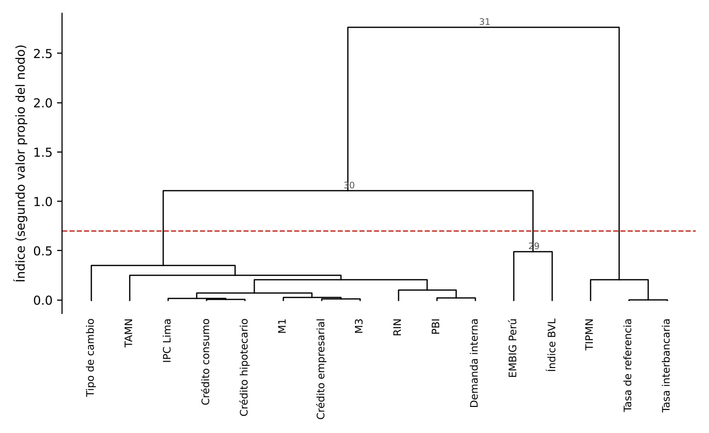{width=92%}

::: {custom-style="Nota"}
*Nota.* La altura de cada nodo es su índice; la línea discontinua marca el corte en 0,7. Elaboración propia con datos del BCRP.
:::

::: {custom-style="Rotulo"}
**Tabla {T:nodos}**\
*Nodos de la jerarquía de la HFC*
:::

{{TABLA:nodos}}

::: {custom-style="Nota"}
*Nota.* Los nodos 1 a 16 son las series. λ1: varianza del representante del nodo; índice (λ2): segundo valor propio del nodo; % local: proporción de la inercia de las series del nodo que recoge cada valor propio; % global: la misma cantidad como porcentaje de la inercia total (16); % acum. λ2: suma acumulada de los índices como porcentaje de la inercia total. Elaboración propia con datos del BCRP.
:::

El corte en 0,7 deja tres clases que coinciden con los tres ejes del PCA (Tabla {T:hfc}). La clase de escala del sistema tiene 11 series, y su representante recoge el 96,6 % de su inercia. La de condiciones monetarias tiene 3 series (93,1 %), y la de riesgo de mercado, 2 (75,3 %); esta última es un dipolo, en el que el EMBIG y la bolsa se mueven en sentido opuesto. Las series más representativas de cada clase son el crédito hipotecario, la tasa interbancaria y el EMBIG. La varianza del representante de la raíz (10,337) es casi igual al primer valor propio del PCA (10,437), y la suma de los índices (5,663) más esa varianza da 16. Los representantes de la escala y de las tasas no están correlacionados en niveles (−0,07); al quitar a las series su recta de tendencia, su correlación es −0,41.

::: {custom-style="Rotulo"}
**Tabla {T:hfc}**\
*Clases de la HFC en las particiones de tres y cuatro clases*
:::

{{TABLA:hfc}}

::: {custom-style="Nota"}
*Nota.* En negrita, la serie más correlacionada con el representante de su clase. Elaboración propia con datos del BCRP.
:::

Con el remuestreo de los incrementos en bloques de 24 meses, la partición en tres clases se reproduce exactamente solo en el 5,6 % de las réplicas, la mediana del índice de Rand ajustado es 0,50 y la de la correlación cofenética, 0,64; el corte en 0,7 deja tres clases en el 48 % de las réplicas. La organización en bloques es sensible, entonces, a la trayectoria particular de las series en niveles.

## 4.2 Evolución de la estructura (OE2)

### 4.2.1 Análisis en componentes principales evolutivo

En las ventanas asignadas a los meses de enero de 2009 a diciembre de 2019, el primer valor propio está entre 8,4 y 12,1, y las series se mueven casi como una sola (Figura {F:aede}). Desde 2020 cae hasta 6,20 en la ventana asignada a mayo de 2021, en la que el primer eje recoge el 39 % de la inercia, frente a cerca del 75 % en las ventanas de 2011. Con el tamaño efectivo de cada ventana, el segundo valor propio queda por debajo del umbral del análisis paralelo en 32 de las 181 ventanas y el tercero en 164; en la mayoría de las ventanas, entonces, solo dos ejes superan el ruido (Figura {F:epcavp}). El segundo y el tercer valor propio se cruzan en junio de 2011, abril de 2014 y mayo de 2018, y en las ventanas de 2021 el primero y el segundo son casi iguales (6,20 y 5,79).

::: {custom-style="Rotulo"}
**Figura {F:aede}**\
*Primer valor propio del EPCA y cortes de la especificación de trabajo*
:::

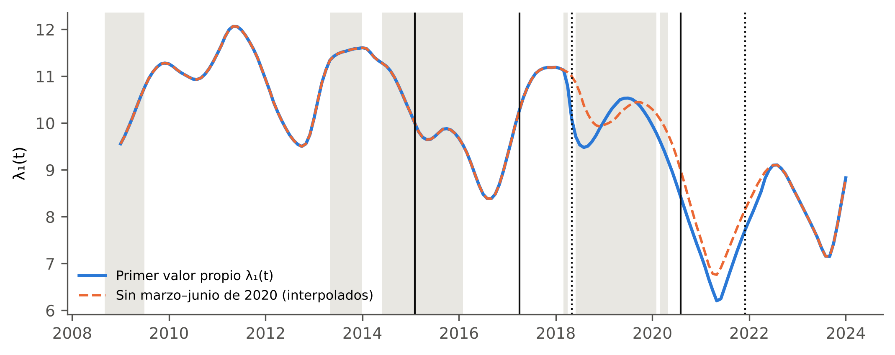{width=100%}

::: {custom-style="Nota"}
*Nota.* Ventana de 48 meses con pesos gaussianos ($\nu=3$). Líneas verticales: cortes de la especificación de trabajo; en punteado, los cortes relacionados con la entrada o salida de los meses atípicos de 2020. Línea discontinua: trayectoria con los meses de marzo a junio de 2020 interpolados. En gris, los episodios. Elaboración propia con datos del BCRP.
:::

::: {custom-style="Rotulo"}
**Figura {F:epcavp}**\
*Valores propios del EPCA frente al umbral del análisis paralelo*
:::

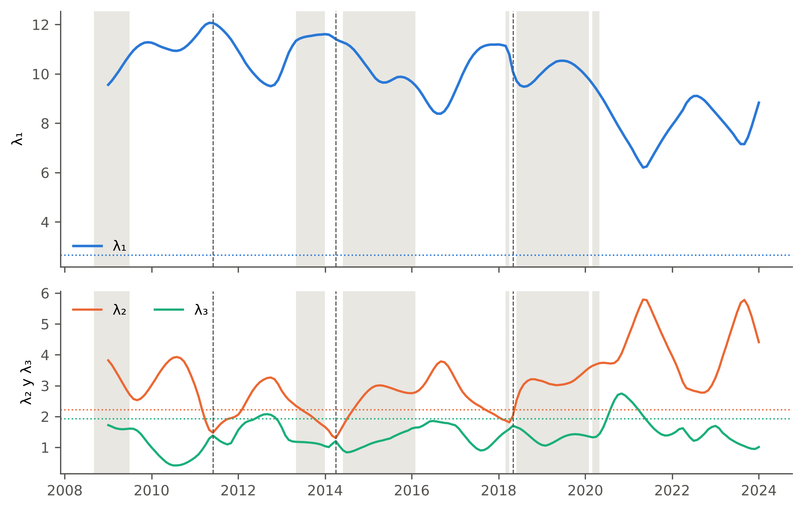{width=100%}

::: {custom-style="Nota"}
*Nota.* Líneas punteadas: percentil 95 del análisis paralelo con el tamaño efectivo de la ventana (37 meses), 2,65, 2,22 y 1,93 para los ejes 1 a 3. Líneas discontinuas verticales: ventanas en que los ejes 2 y 3 intercambian su orden. En gris, los episodios. Elaboración propia con datos del BCRP.
:::

La regla de signo de la rutina de referencia ya alinea cada eje con el de la ventana anterior, de modo que las discontinuidades de las correlaciones evolutivas no se deben a reflexiones del signo. Se deben a que, en las tres ventanas señaladas, el segundo y el tercer eje intercambian su orden, de modo que el antiguo segundo eje pasa a ser el tercero. Con el seguimiento de los ejes por congruencia (sección 3.2.3), la congruencia entre ventanas consecutivas es mayor que 0,9 en todas las ventanas salvo cinco, y la menor (0,57) corresponde al tercer eje en la ventana de julio de 2014. En junio de 2021 el primer eje rota hacia el segundo (congruencia de 0,75), porque sus valores propios son casi iguales. En ese caso los ejes no se intercambian, sino que giran dentro del plano 1–2.

La Figura {F:aedecorr} muestra la correlación de cada serie con los dos primeros ejes seguidos en cada ventana, y la Figura {F:epcaseries}, las mismas correlaciones serie por serie. Hasta 2014, el crédito, la liquidez, los precios y la actividad tienen correlaciones mayores que 0,8 con el primer eje. Entre 2015 y 2020, el PBI y la demanda interna se desacoplan del crédito. Desde 2020, el crédito empresarial, M1 y M3 dejan de correlacionarse con el primer eje, mientras el crédito hipotecario, el de consumo y los precios se mantienen. En las ventanas de 2021, como el primer y el segundo eje no están determinados por separado, solo es interpretable el plano 1–2.

::: {custom-style="Rotulo"}
**Figura {F:aedecorr}**\
*Correlaciones evolutivas de las series con los dos primeros ejes seguidos*
:::

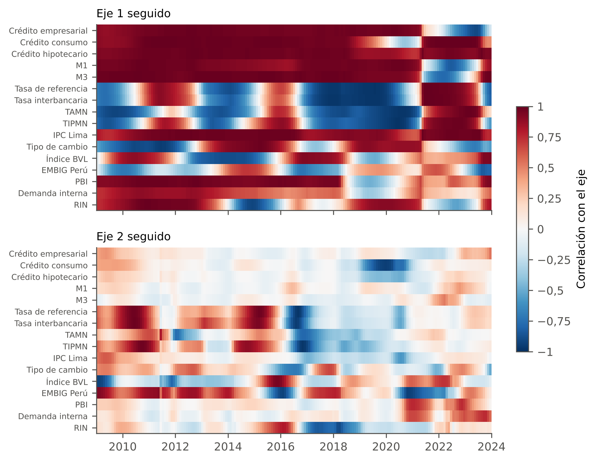{width=100%}

::: {custom-style="Nota"}
*Nota.* Ventana de 48 meses con pesos gaussianos ($\nu=3$). Signo alineado con la ventana anterior y ejes emparejados por congruencia. Elaboración propia con datos del BCRP.
:::

::: {custom-style="Rotulo"}
**Figura {F:epcaseries}**\
*Correlación de cada serie con los dos primeros ejes seguidos, por ventana*
:::

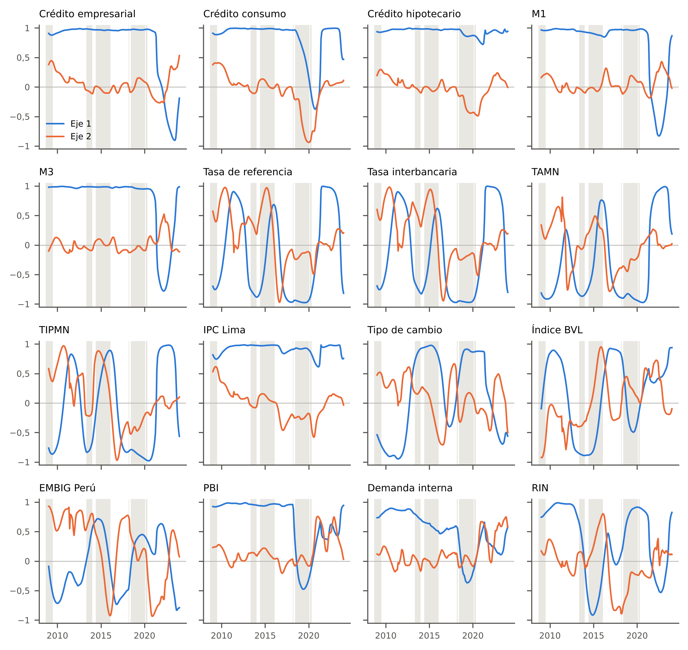{width=100%}

::: {custom-style="Nota"}
*Nota.* Igual que la Figura {F:aedecorr}. En gris, los episodios. Elaboración propia con datos del BCRP.
:::

El coeficiente RV entre las correlaciones de las series con los ejes de ventanas adyacentes sin meses comunes alcanza su mínimo (0,09) en la frontera de junio de 2020 (Figura {F:rv}). Las series con estructura constante producen mínimos iguales o menores en el 37 % de las réplicas ($\hat p=0{,}37$). El cambio de 2020 es el mayor del período, pero no se distingue de las variaciones que produciría una estructura constante con la autocorrelación de los datos.

::: {custom-style="Rotulo"}
**Figura {F:rv}**\
*Coeficiente RV entre ventanas adyacentes sin meses comunes frente a series con estructura constante*
:::

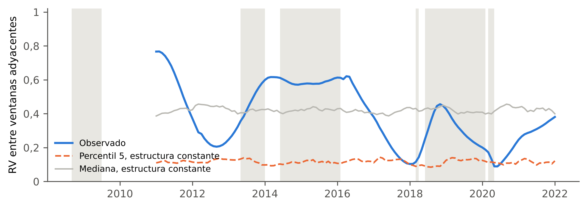{width=100%}

::: {custom-style="Nota"}
*Nota.* Correlaciones de las series con los dos primeros ejes; cada valor se asigna al primer mes de la segunda ventana. 200 réplicas. Elaboración propia con datos del BCRP.
:::

### 4.2.2 Clasificación factorial jerárquica evolutiva

El índice de la raíz fluctúa entre 1 y 3,6 hasta 2018 y sube de forma sostenida entre 2019 y 2021, hasta 4,9. Después de la pandemia los grupos de series están más diferenciados, lo que concuerda con la caída del primer valor propio. El número de clases por encima del corte en 0,7 varía entre 2 y 6, con 4 como valor más frecuente (Figura {F:claede}). En la ventana asignada a julio de 2009 hay tres clases, formadas por las cuatro tasas, por el tipo de cambio, la bolsa y el EMBIG, y por los saldos, los precios y la actividad. En la de julio de 2014 hay dos, las tasas de corto plazo y todas las demás. En la de julio de 2020, cuatro, con el crédito de consumo aislado y la bolsa y el EMBIG unidos al PBI y a la demanda interna. En la de julio de 2023, cinco.

::: {custom-style="Rotulo"}
**Figura {F:claede}**\
*Dendrogramas de la HFC evolutiva en cuatro ventanas*
:::

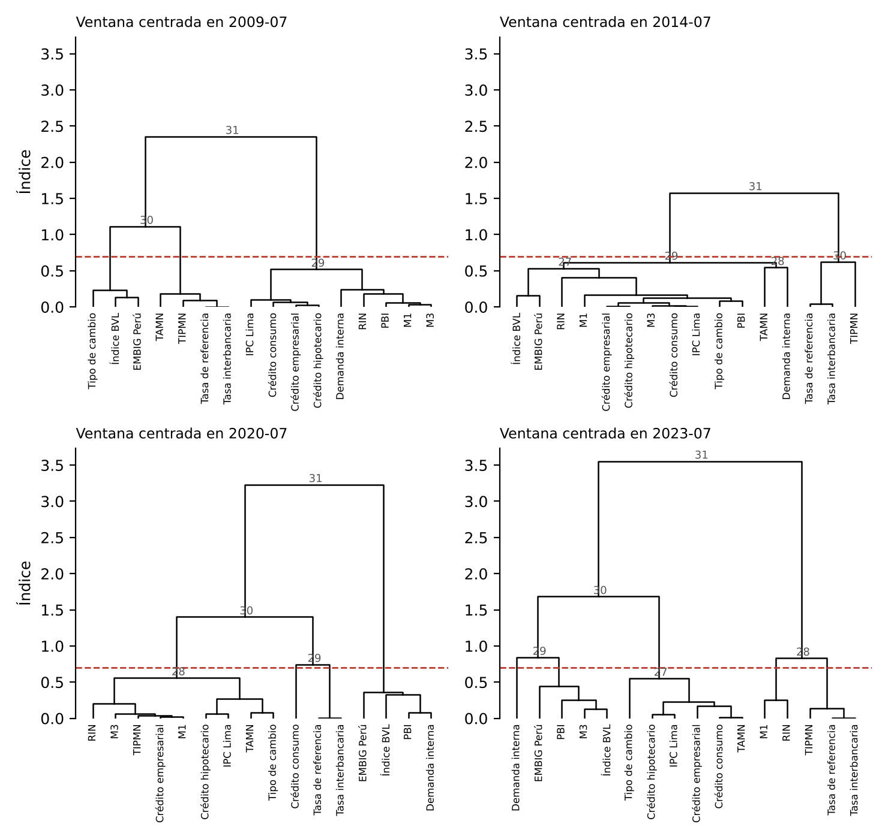{width=100%}

::: {custom-style="Nota"}
*Nota.* Ventanas de 48 meses con pesos gaussianos, asignadas a las fechas indicadas. Elaboración propia con datos del BCRP.
:::

La Figura {F:c1} sigue la clase C1, la que contiene al crédito hipotecario, en las 181 ventanas. El crédito hipotecario y el índice de precios están juntos en todas. Hasta mediados de 2013, C1 reúne nueve de las once series de la clase de escala de la HFC global, que son los tres créditos, M1, M3, los precios, el PBI, la demanda interna y las reservas; el tipo de cambio se suma en algunas ventanas. Entre mediados de 2013 y setiembre de 2018 se le suman en parte de las ventanas las tasas activa y pasiva, el tipo de cambio y la bolsa, mientras la demanda interna y las reservas salen de ella con frecuencia. Entre octubre de 2018 y agosto de 2019, el crédito empresarial, M1 y M3 la abandonan, y la clase queda formada por el crédito de consumo, el hipotecario, los precios y las reservas. En las ventanas de setiembre de 2019 a agosto de 2020 llega a reunir 11 series, incluidas las tasas, pero no el crédito de consumo. Entre setiembre de 2020 y abril de 2021 se reduce a tres series, el crédito hipotecario, los precios y el tipo de cambio. Desde mayo de 2021 agrupa, en la mayoría de las ventanas, el crédito de consumo, el hipotecario, los precios y las tasas de interés, y deja fuera al crédito empresarial y a los agregados monetarios. El número de clases es 4 en 81 ventanas, 3 en 69, 5 en 22, 2 en 5 y 6 en 4.

::: {custom-style="Rotulo"}
**Figura {F:c1}**\
*Composición de la clase C1 de la HFC evolutiva por ventana*
:::

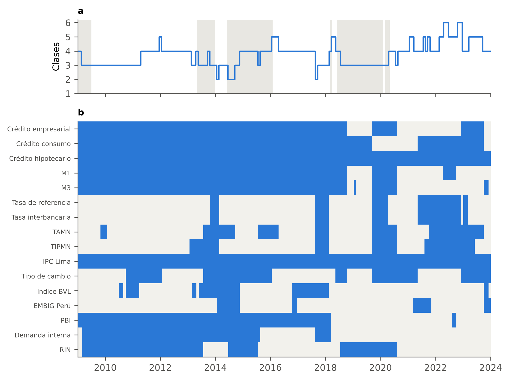{width=100%}

::: {custom-style="Nota"}
*Nota.* (a) Número de clases que deja el corte en 0,7. (b) En azul, las series que pertenecen a la clase del crédito hipotecario en cada ventana. Ventanas de 48 meses con pesos gaussianos. En gris, los episodios. Elaboración propia con datos del BCRP.
:::

## 4.3 Segmentación temporal (OE3)

### 4.3.1 Contraste de la partición

Ninguna partición supera a las series de referencia (Tabla {T:contraste}, Figura {F:contraste}). En la trayectoria de estructura, el mejor candidato son dos tramos con un corte en mayo de 2020, cuya reducción (0,627) queda apenas por debajo del percentil 95 simulado (0,639; $\hat p=0{,}065$); los tramos adicionales tienen $\hat p$ entre 0,13 y 0,94. En la trayectoria de posición, series que solo comparten su tendencia producen reducciones mayores que las observadas para todo $K$. Con la regla de la sección 3.2.4, $K^*=1$ en ambas trayectorias. Con las series en niveles, los regímenes no se distinguen de los que producirían la tendencia y la dependencia temporal de las series.

::: {custom-style="Rotulo"}
**Tabla {T:contraste}**\
*Reducción relativa de la suma de cuadrados frente a las series de referencia simuladas*
:::

{{TABLA:contraste}}

::: {custom-style="Nota"}
*Nota.* Estructura: 200 réplicas de estructura constante. Posición: 1000 réplicas de series con tendencia (indeterminadas como DS; la versión con indeterminadas como TS da resultados similares). Elaboración propia con datos del BCRP.
:::

::: {custom-style="Rotulo"}
**Figura {F:contraste}**\
*Reducción relativa observada y percentil 95 simulado, por número de tramos*
:::

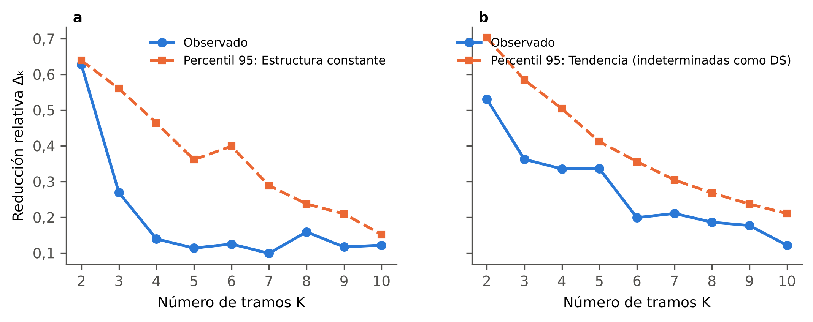{width=100%}

::: {custom-style="Nota"}
*Nota.* (a) Trayectoria de estructura. (b) Trayectoria de posición. Elaboración propia con datos del BCRP.
:::

La Tabla {T:sens} resume los cortes con las reglas alternativas. La partición depende de la regla. En la trayectoria de estructura, la regla del 10 % da seis tramos; la del 12 %, cuatro; la del 15 %, tres, y la de mayor caída, dos. El único corte presente en todas es el de mediados de 2020.

::: {custom-style="Rotulo"}
**Tabla {T:sens}**\
*Cortes según la regla y la especificación*
:::

{{TABLA:sens}}

::: {custom-style="Nota"}
*Nota.* Trayectoria de posición principal: coordenadas sin estandarizar, media móvil centrada. Elaboración propia con datos del BCRP.
:::

### 4.3.2 Regímenes tentativos

Con la especificación de trabajo de la sección 3.2.4 se obtienen seis regímenes de posición, con cortes en diciembre de 2008, marzo de 2010, abril de 2014, junio de 2020 y noviembre de 2022 (Figura {F:posicion}), y seis de estructura, con cortes en febrero de 2015, abril de 2017, mayo de 2018, agosto de 2020 y diciembre de 2021 (Figura {F:aede}). En la trayectoria de posición, la regla del 10 % no se cumple para ningún $K$, y el número de tramos corresponde a la mayor caída de la reducción.

::: {custom-style="Rotulo"}
**Figura {F:posicion}**\
*Coordenadas suavizadas y cortes de los regímenes tentativos de posición*
:::

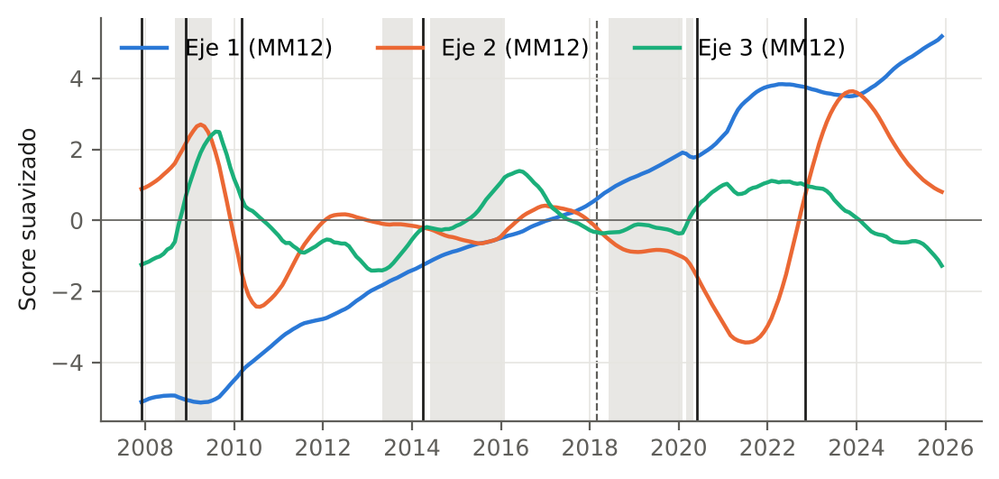{width=100%}

::: {custom-style="Nota"}
*Nota.* Media móvil de los 12 meses anteriores; en negro, los cortes; en gris, los episodios. Elaboración propia con datos del BCRP.
:::

Los cinco cortes de posición se reproducen a tres meses o menos en el 99 % o más de las réplicas (Tabla {T:precision}). En la trayectoria de estructura, los cortes de mayo de 2018 (70 %) y de diciembre de 2021 (61 %) son los menos precisos, y ambos coinciden con la entrada y la salida de la ventana de los meses atípicos de 2020 (marzo a junio). Si esos meses se interpolan, la trayectoria cambia en ese tramo (Figura {F:aede}). Los meses atípicos identificados son octubre de 2008 y marzo a junio de 2020.

::: {custom-style="Rotulo"}
**Tabla {T:precision}**\
*Precisión de la ubicación de los cortes tentativos*
:::

{{TABLA:precision}}

::: {custom-style="Nota"}
*Nota.* 200 réplicas con los residuos de cada tramo remuestreados en bloques de seis meses. La medida es condicional en la existencia de los cortes. Elaboración propia con datos del BCRP.
:::

## 4.4 Caracterización de los regímenes (OE4)

Las Tablas {T:reg_posición} y {T:reg_estructura} caracterizan los regímenes tentativos, y la Figura {F:fases} muestra el crecimiento real del crédito con los umbrales de la regla de fases (mediana del período $m=6{,}2$ %, desviación estándar $s=8{,}1$ puntos).

::: {custom-style="Rotulo"}
**Tabla {T:reg_posición}**\
*Perfil y fase de los regímenes tentativos de posición*
:::

{{TABLA:reg_posición}}

::: {custom-style="Nota"}
*Nota.* Crédito real: mediana del crecimiento interanual del crédito total deflactado por el índice de precios. PBI e inflación: promedio del crecimiento interanual. Tasa BCRP: promedio del primer y del último trimestre. EMBIG: promedio. El régimen 1 tiene un mes sin crecimiento interanual. Elaboración propia con datos del BCRP.
:::

::: {custom-style="Rotulo"}
**Tabla {T:reg_estructura}**\
*Perfil y fase de los regímenes tentativos de estructura*
:::

{{TABLA:reg_estructura}}

::: {custom-style="Nota"}
*Nota.* Igual que la Tabla {T:reg_posición}. Elaboración propia con datos del BCRP.
:::

::: {custom-style="Rotulo"}
**Figura {F:fases}**\
*Crecimiento interanual real del crédito, regímenes tentativos de posición y umbrales de la regla de fases*
:::

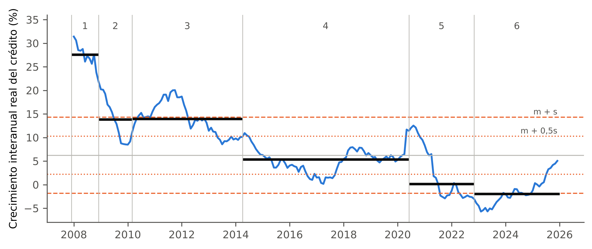{width=100%}

::: {custom-style="Nota"}
*Nota.* Líneas horizontales negras: mediana del crecimiento en cada régimen. Líneas discontinuas: $m\pm s$; punteadas: $m\pm 0{,}5s$. Elaboración propia con datos del BCRP.
:::

Los regímenes de posición siguen una secuencia económica coherente. El primero es el auge previo a la crisis global, con el crédito real creciendo 27,6 %. El segundo corresponde a la crisis y a la respuesta monetaria, con la tasa de referencia bajando de 6,5 % a 1,25 %. Le sigue una expansión, con el crédito real al 14 % y el PBI al 6,6 %, y luego una desaceleración entre 2014 y 2020, con el crédito real al 5,3 %. El quinto régimen es la reactivación posterior a la pandemia, en la que el crédito real se estanca (0,2 %) mientras la tasa sube de 0,25 % a 6,75 %, y el último es de contracción real del crédito (−2,0 %). Con $c=1$, la regla de fases clasifica como transición cuatro de los seis regímenes; con $c=0{,}5$, la secuencia es expansión (2007–2014), transición (2014–2020) y contracción (2020–2025). El régimen de la crisis (2008-12 a 2010-02) se clasifica como expansión con $c=0{,}5$ porque el crédito real aún crecía 13,8 %, aunque su crecimiento cayó 12,7 puntos dentro del régimen; la regla mide el ritmo del crecimiento y no su dirección. Con el crédito real, el régimen de 2020–2022 aparece estancado, porque su crecimiento nominal de 7,5 % correspondía a la inflación.

Tres de los cinco cortes de posición están a tres meses o menos de un episodio: diciembre de 2008, de la crisis global; abril de 2014, del colapso de las materias primas, y junio de 2020, de la pandemia. Por azar se esperarían 1,4 coincidencias, y la probabilidad de obtener tres o más es de 0,12. En la trayectoria de estructura coincide uno de los cinco cortes, menos de lo esperado por azar (Tabla {T:episodios_azar}).

::: {custom-style="Rotulo"}
**Tabla {T:episodios_azar}**\
*Compatibilidad de los cortes tentativos con los episodios frente a la esperada por azar*
:::

{{TABLA:episodios}}

::: {custom-style="Nota"}
*Nota.* 10 000 ubicaciones aleatorias de los cortes con tramos de al menos 12 meses. Distancia al inicio o al fin del episodio más cercano. Elaboración propia con datos del BCRP.
:::

## 4.5 Representaciones no lineales (OE5)

Los autoencoders se evaluaron en una corrida exploratoria con una versión anterior de la base, de 17 series (incluida M2), y deben repetirse con las 16 series y la especificación de la sección 3.2.7. En esa corrida, el autoencoder reconstruye peor que el PCA fuera de muestra, con un error 13,6 % mayor con tres dimensiones latentes y 40,7 % mayor con cinco (Figura {F:aecv}). La trayectoria latente del autoencoder LSTM reproduce la de los dos primeros ejes del PCA sin una dinámica distinta. En la evaluación anual sucesiva, el error de reconstrucción mediano del PCA en los meses de la pandemia es unas siete veces el de los meses sin episodio (Figura {F:error}); los modelos señalan la mitad de los meses de la pandemia y ninguno del *taper tantrum*.

::: {custom-style="Rotulo"}
**Figura {F:aecv}**\
*Error de reconstrucción fuera de muestra del PCA y de dos autoencoders, por dimensión latente*
:::

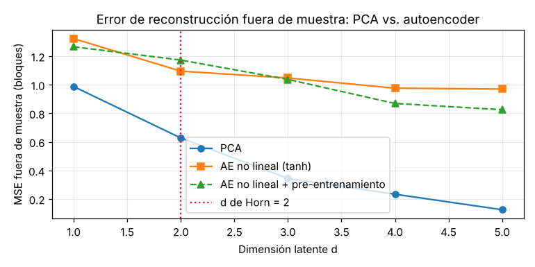{width=60%}

::: {custom-style="Nota"}
*Nota.* Validación por bloques. Corrida exploratoria con 17 series. Elaboración propia con datos del BCRP.
:::

::: {custom-style="Rotulo"}
**Figura {F:error}**\
*Error de reconstrucción mensual del PCA y del autoencoder*
:::

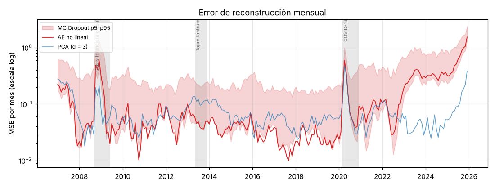{width=75%}

::: {custom-style="Nota"}
*Nota.* Corrida exploratoria con 17 series. Elaboración propia con datos del BCRP.
:::

## 4.6 Especificaciones evaluadas y robustez

Con las series en logaritmos, los tres ejes del PCA son prácticamente los mismos que en niveles (congruencias de 0,999, 0,996 y 0,992); con primeras diferencias, el primer eje baja a 23,5 % de la inercia y su congruencia con el de niveles es 0,61. Para la segmentación de la trayectoria de posición se evaluaron, además de las especificaciones de la Tabla {T:sens}, dos formulaciones alternativas que conservan las series en niveles, la partición por tendencias segmentadas, con una recta por tramo, y la partición de las desviaciones de las coordenadas respecto de su tendencia. La primera da su menor $\hat p$ con ocho tramos (0,002–0,004), pero los tramos de 2 a 5 no son significativos, la significación depende de la regla de elección de $K$ y dos de sus tramos, de 14 y 15 meses, corresponden a la caída y recuperación de 2008–2009 y de 2020–2021; la segunda no supera las series de referencia. Ambas están en estudio y no se emplean en este informe.

## 4.7 Discusión

### 4.7.1 Organización de los indicadores

El PCA y la HFC organizan los indicadores en los mismos tres bloques: escala del sistema, condiciones monetarias y riesgo de mercado. Cada bloque puede asociarse a un mecanismo distinto, que son el crecimiento y la profundización del sistema financiero, la política monetaria y la percepción de riesgo. Los bloques equivalen a los grupos de salud económica y financiera, tasas de interés y riesgo de mercado de @camiz_cerda_atoche_2026, obtenidos con otras series y otro período, y a los componentes de @atoche_murrieta_2022. Las diferencias están en la composición. La TAMN entra aquí en el bloque de escala por su caída secular, y el tipo de cambio, que el antecedente excluye por su baja correlación, se une a ese bloque en último lugar.

### 4.7.2 Efecto de la tendencia común

El bloque de escala no se distingue de series independientes con tendencia. Además, la partición en tres clases se reproduce en pocas réplicas cuando se remuestrean los incrementos, de modo que la organización en bloques depende de la trayectoria particular que siguieron las series. En niveles, la asociación entre las series refleja en buena medida su crecimiento común, lo que extiende al análisis factorial la advertencia de @granger_newbold_1974 sobre las regresiones entre series integradas. La señal común que resiste el contraste es la monetaria. Los antecedentes peruanos no realizan este contraste.

### 4.7.3 Cambio de estructura en 2020

La intensidad del movimiento común cae desde 2020, y el mayor cambio entre ventanas ocurre en la frontera de junio de 2020. La HFC evolutiva muestra que después de 2020 los bloques se fragmentan: desde mayo de 2021, la clase del crédito hipotecario deja fuera, en la mayoría de las ventanas, al crédito empresarial y a los agregados monetarios, e incluye las tasas de interés. Sin embargo, ni la partición del primer valor propio ($\hat p=0{,}065$) ni el mínimo del RV ($\hat p=0{,}37$) se distinguen de lo que produce una estructura constante. Con unas diez observaciones independientes, el contraste puede carecer de potencia para detectar un cambio de este tamaño.

Las discontinuidades que se observaban en las correlaciones evolutivas del segundo eje no se debían al signo, que la rutina de referencia ya alinea entre ventanas, sino al intercambio del segundo y el tercer eje cuando sus valores propios se cruzan. Con los ejes seguidos por congruencia, las correlaciones cambian de forma gradual, salvo en 2021, cuando el primer y el segundo valor propio se igualan y el plano 1–2 gira.

### 4.7.4 Regímenes tentativos

Los regímenes de posición describen una secuencia económica reconocible, y tres de sus cortes coinciden con episodios documentados, más de lo esperable por azar, aunque sin significación. La misma especificación, aplicada a series que solo comparten su tendencia, produce particiones igual de marcadas. Por eso, los regímenes describen por ahora la trayectoria, y no demuestran cambios de régimen del ciclo financiero. Para separar ambas cosas hace falta una segmentación que distinga la velocidad del crecimiento de su nivel acumulado, y ese es el objeto de las alternativas en estudio.

### 4.7.5 Representaciones no lineales

Con unas diez observaciones efectivas, el autoencoder ajusta particularidades de la muestra que no se repiten fuera de ella, una exigencia de datos que @tuhin_et_al_2025 ya advierten. Su aporte está en señalar meses atípicos, como los de la pandemia.

### 4.7.6 Limitaciones

La muestra de 19 años es corta para un ciclo de 8 a 30 años, y la autocorrelación limita la potencia de todos los contrastes. Los regímenes dependen de la regla con que se elige $K$. La HFC evolutiva está pendiente de verificación contra el programa original y los autoencoders deben repetirse con la base vigente. Por último, el crecimiento del crédito que usa la regla de fases incluye el efecto del tipo de cambio sobre el crédito en moneda extranjera.
