::: {custom-style="Titulo preliminar"}
ÍNDICE DE CONTENIDOS
:::

[[TOC]]

::: {custom-style="Titulo preliminar"}
LISTA DE TABLAS
:::

[[LISTA_TABLAS]]

::: {custom-style="Titulo preliminar"}
LISTA DE FIGURAS
:::

[[LISTA_FIGURAS]]

# RESUMEN

La identificación del régimen financiero de una economía a partir de múltiples indicadores requiere resumir su información común y delimitar los períodos en que su comportamiento conjunto es homogéneo. Esta investigación construye un modelo matemático-computacional de reducción de dimensión y segmentación temporal para 16 indicadores macrofinancieros mensuales del Banco Central de Reserva del Perú entre 2007 y 2025. El modelo combina el análisis en componentes principales, la clasificación factorial jerárquica y sus versiones evolutivas con la partición óptima de Fisher, y compara la representación lineal con autoencoders. Cada resultado se contrasta con series de referencia simuladas que conservan la tendencia y la autocorrelación de los datos. Los indicadores se organizan en tres bloques (escala del sistema financiero, condiciones monetarias y riesgo de mercado); en niveles, solo el bloque monetario supera el contraste, y el de escala refleja el crecimiento común de las series. La intensidad del movimiento común cae desde 2020, pero ese cambio no se distingue del que produciría una estructura constante. Ninguna partición en regímenes supera a las series de referencia; con una especificación de trabajo se identifican seis regímenes con un perfil económico coherente, cuya validación estadística está en estudio. El autoencoder no supera al análisis en componentes principales fuera de muestra, aunque señala la pandemia como período atípico. El contraste con series de referencia simuladas resulta indispensable para no confundir la tendencia común con regímenes del ciclo financiero.

**Palabras clave:** ciclo financiero, análisis factorial evolutivo, segmentación temporal, series de referencia simuladas.

# ABSTRACT

Identifying the financial regime of an economy from multiple indicators requires summarising their common information and delimiting the periods in which their joint behaviour is homogeneous. This research builds a mathematical and computational model of dimension reduction and temporal segmentation for 16 monthly macro-financial indicators from the Central Reserve Bank of Peru between 2007 and 2025. The model combines principal component analysis, hierarchical factor classification and their evolutionary versions with Fisher's optimal partition, and compares the linear representation with autoencoders. Each result is tested against simulated reference series that preserve the trend and autocorrelation of the data. The indicators form three blocks (scale of the financial system, monetary conditions and market risk); in levels, only the monetary block passes the test, while the scale block reflects the common growth of the series. The intensity of the common movement falls from 2020 onwards, but this change cannot be distinguished from that of a constant structure. No partition into regimes exceeds the reference series; a working specification identifies six regimes with a coherent economic profile, whose statistical validation is under study. The autoencoder does not outperform principal component analysis out of sample, although it flags the pandemic as an atypical period. Testing against simulated reference series proves essential to avoid mistaking the common trend for regimes of the financial cycle.

**Keywords:** financial cycle, evolutionary factor analysis, temporal segmentation, simulated reference series.

# CAPÍTULO I. INTRODUCCIÓN

## 1.1 Planteamiento y descripción del problema

El ciclo financiero se ha caracterizado como la alternancia de fases de expansión y contracción del crédito y de los precios de los activos; su duración excede la del ciclo económico y sus puntos máximos tienden a coincidir con crisis bancarias [@borio_2014]. En el Perú, los ciclos crediticios no presentan una correlación dinámica fuerte con el ciclo del producto, por lo que una medida macroprudencial basada en este último podría tener una efectividad limitada para atenuar el sobrecalentamiento del crédito [@alcaraz_cabello_nivin_2024]. La fase del ciclo financiero no puede, en consecuencia, inferirse del ciclo del producto, y su identificación requiere incorporar información del sistema financiero junto con la de la actividad y los precios.

En esta investigación, un **régimen financiero** es un intervalo de tiempo contiguo en el que la estructura de asociación entre los indicadores macrofinancieros (régimen de estructura) o su nivel conjunto (régimen de posición) permanece relativamente estable. Como el período de estudio es menor que la duración reportada del ciclo, los regímenes se entienden como subperíodos del ciclo y no como ciclos completos. Un régimen no es directamente observable. Se manifiesta de forma parcial en indicadores de crédito, agregados monetarios, tasas de interés, precios, actividad, reservas internacionales, mercado bursátil y riesgo soberano. Entre ellos hay información redundante y señales divergentes, sus movimientos no son necesariamente sincrónicos y su estructura de asociación puede variar en el tiempo. Cada régimen puede asociarse, además, a una fase del ciclo financiero (expansión, contracción o transición) según el comportamiento del crédito durante el intervalo.

La multiplicidad de indicadores plantea así tres dificultades de modelización: resumir la información común en pocas dimensiones sin imponer de antemano ponderaciones ni agrupaciones de los indicadores; seguir la evolución de esa representación, porque una estimación sobre el período completo puede ocultar sus cambios, y segmentar el período con un criterio explícito cuyos cortes puedan contrastarse con los que producirían la dependencia temporal de las series y la variabilidad muestral. A ello se suma que las relaciones entre los indicadores pueden no ser lineales, lo que plantea si una representación no lineal recoge información que la lineal no capta.

En el Perú, los estudios identificados que aplican métodos de reducción de dimensión a indicadores del BCRP cubren el período hasta 2020 [@atoche_murrieta_2022; @camiz_cerda_atoche_2026]. En ellos, el número de cortes se elige con el índice de Caliński y Harabasz, pero la partición resultante no se contrasta con series de referencia simuladas ni se evalúa su estabilidad ante remuestreo, y no se examinan representaciones no lineales.

### 1.1.1 Problema general

¿Cómo construir un modelo matemático-computacional de reducción de dimensión de los indicadores macrofinancieros mensuales del Perú observados en el período 2007–2025, que identifique los regímenes del ciclo financiero mediante un criterio de segmentación explícito y validado estadísticamente, y que permita interpretarlos en términos de los indicadores originales?

### 1.1.2 Problemas específicos

- **PE1.** ¿Qué estructura factorial (componentes principales y clasificación factorial jerárquica de los indicadores) resume su información común en el período 2007–2025?
- **PE2.** ¿Cómo evoluciona esa estructura factorial a lo largo del período?
- **PE3.** ¿Qué partición del período en regímenes se deriva de esa evolución mediante un criterio explícito de segmentación, contrastado con series de referencia simuladas y evaluado por remuestreo?
- **PE4.** ¿Cómo se caracteriza cada régimen en términos de los indicadores originales, de la fase del ciclo financiero a la que corresponde y de los episodios económicos documentados?
- **PE5.** ¿En qué medida las representaciones no lineales (autoencoder y autoencoder LSTM) difieren de la lineal en error de reconstrucción fuera de muestra, estabilidad de la representación y partición en regímenes resultante?

## 1.2 Justificación

*Justificación matemática y computacional.* Los antecedentes en el Perú representan los indicadores macrofinancieros mediante análisis en componentes principales, clasificación factorial jerárquica y sus versiones evolutivas, pero no contrastan la partición en regímenes con series de referencia simuladas ni examinan representaciones no lineales [@atoche_murrieta_2022; @camiz_cerda_atoche_2026]. La investigación aborda esas brechas con un modelo compuesto por etapas articuladas: (1) una representación de baja dimensión de los indicadores y su extensión evolutiva en ventanas móviles con pesos gaussianos; (2) la delimitación de regímenes mediante la partición de Fisher, óptima en intervalos contiguos respecto de la dispersión intragrupo para un número dado de regímenes; (3) un procedimiento de validación por contraste con series de referencia simuladas, que compara la partición obtenida con la que el mismo método produciría en series sin cambio de estructura pero con la misma estructura de autocorrelación, y que evalúa su estabilidad mediante remuestreo por bloques, y (4) la comparación de la representación lineal con representaciones no lineales (autoencoder y autoencoder LSTM) bajo un mismo criterio de error fuera de muestra, para valorar el aporte de la no linealidad en series con dependencia temporal y relativamente cortas para modelos neuronales. El procedimiento de validación y la comparación controlada son transferibles a otras aplicaciones del análisis factorial evolutivo. La implementación en Python de los métodos factoriales se contrasta con las rutinas de referencia en R del paquete AedeClahfac, de S. Camiz, y se publica, junto con los datos, en un repositorio de acceso público.

*Justificación práctica.* @alcaraz_cabello_nivin_2024 muestran que en el Perú los ciclos crediticios no presentan una correlación dinámica fuerte con el ciclo del PBI; su medición es, sin embargo, univariada. La investigación busca delimitar, para el período 2007–2025, una cronología de regímenes basada en la estructura conjunta de indicadores de crédito, agregados monetarios, tasas de interés, precios, actividad, sector externo, mercado bursátil y riesgo soberano, contrastada con episodios económicos documentados. Esa cronología complementa la medición univariada del ciclo crediticio y es una referencia retrospectiva para el análisis de la estabilidad financiera.

*Línea de investigación.* La investigación se inscribe en la línea de Probabilidad y estadística del programa, sublínea Ciencia de datos, y en el área de aprendizaje automatizado, en su vertiente no supervisada.

## 1.3 Objetivos

### 1.3.1 Objetivo general

Construir un modelo matemático-computacional de reducción de dimensión de los indicadores macrofinancieros mensuales del Perú observados en el período 2007–2025, que identifique los regímenes del ciclo financiero mediante un criterio de segmentación explícito y validado estadísticamente, y que permita interpretarlos en términos de los indicadores originales.

### 1.3.2 Objetivos específicos

- **OE1.** Determinar la estructura factorial (componentes principales y clasificación factorial jerárquica) que resume la información común de los indicadores en el período 2007–2025.
- **OE2.** Caracterizar la evolución temporal de esa estructura mediante el análisis en componentes principales evolutivo y la clasificación factorial jerárquica evolutiva.
- **OE3.** Delimitar los regímenes mediante la partición de Fisher, con un criterio explícito para el número de regímenes y con validación de la partición por contraste con series de referencia simuladas y por remuestreo por bloques.
- **OE4.** Caracterizar cada régimen en términos de los indicadores originales, de la fase del ciclo financiero (expansión, contracción o transición, según el criterio basado en el crecimiento del crédito definido en la metodología) y de su correspondencia con episodios económicos documentados.
- **OE5.** Comparar las representaciones no lineales (autoencoder y autoencoder LSTM) con la lineal en error de reconstrucción fuera de muestra, estabilidad de la representación y partición en regímenes resultante.

## 1.4 Hipótesis

No se formulan hipótesis de investigación, por tratarse de un estudio exploratorio y descriptivo: su propósito es construir una representación de los indicadores macrofinancieros e identificar regímenes a partir de ella, no contrastar proposiciones sobre el fenómeno establecidas de antemano. Los contrastes estadísticos que se emplean (con series de referencia simuladas y mediante remuestreo por bloques) son instrumentales: evalúan si la partición obtenida es distinguible de la que se produciría sin cambio de estructura y si es estable, y se describen en la metodología.

# CAPÍTULO II. MARCO TEÓRICO

## 2.1 Antecedentes y estado del arte

### 2.1.1 Medición del ciclo financiero y del ciclo económico

La medición del ciclo financiero se ha basado en dos procedimientos aplicados a series individuales: la identificación de puntos de giro y los filtros de frecuencia. @borio_2014 sintetiza los resultados de aplicar ambos al crédito, a la razón entre crédito y producto y a los precios inmobiliarios de siete economías desarrolladas: un componente común de mediano plazo, captado con filtros de 8 a 30 años y con una duración media de unos 16 años, cuyos máximos coinciden con crisis bancarias sistémicas.

En el Perú, la medición se ha orientado sobre todo al ciclo económico y al crediticio. @winkelried_2017 identifica las fases del ciclo económico entre 1992 y 2016 a partir de 145 indicadores mensuales de actividad: identifica primero los puntos de giro de cada indicador y luego los agrega en un índice de difusión, con el que obtiene seis fases contractivas que suman cerca de la cuarta parte del período. @alcaraz_cabello_nivin_2024 miden los ciclos de distintas medidas del crédito y encuentran que no guardan una correlación dinámica fuerte con el ciclo del PBI. En estos trabajos cada indicador se analiza por separado o en relación bivariada con el producto, y la síntesis, cuando existe, es un agregado posterior: la estructura conjunta de asociación entre los indicadores no se modela.

### 2.1.2 Métodos factoriales exploratorios aplicados a series temporales

Una segunda línea modela directamente la estructura de asociación entre las series. El análisis en componentes principales evolutivo repite el análisis en ventanas móviles para seguir la evolución de esa estructura [@camiz_maulucci_roig_2010; @camiz_spada_2024]. @camiz_spada_2024 lo extienden a la clasificación factorial jerárquica y delimitan intervalos de estructura homogénea mediante la partición de Fisher del primer valor propio. @purizaca_2023 aplica el análisis evolutivo y la partición de Fisher a 21 precios internacionales de materias primas entre 1990 y 2021; como el índice de Caliński y Harabasz no presenta un máximo, el número de tramos se fija por un criterio de incrementos marginales.

Para el Perú, @atoche_murrieta_2022 aplica el análisis en componentes principales, la clasificación factorial jerárquica y su versión evolutiva a 17 indicadores mensuales del BCRP e identifica tres componentes, asociados a la evolución del sistema financiero, a las tasas de interés y a la volatilidad del mercado. @camiz_cerda_atoche_2026 aplican los mismos métodos a 17 indicadores entre 1999 y 2020, identifican tres grupos (salud económica y financiera, tasas de interés y riesgo de mercado) y delimitan transiciones con la partición de Fisher del primer valor propio, con el número de cortes elegido mediante el índice de Caliński y Harabasz.

### 2.1.3 Representaciones no lineales

Los autoencoders y las redes recurrentes se han empleado para representar estructuras financieras de alta dimensión. @tuhin_et_al_2025 entrenan un autoencoder LSTM con los retornos diarios de 375 acciones del S&P 500 entre 2000 y 2022, muestran que las redes de influencia derivadas de sus pesos cambian en las crisis financieras y advierten que el procedimiento requiere grandes volúmenes de datos.

### 2.1.4 Síntesis

Los procedimientos univariados no modelan la estructura conjunta de asociación entre indicadores. Los métodos factoriales exploratorios sí lo hacen. En sus aplicaciones al Perú, los regímenes se delimitan con la partición de Fisher y el número de tramos con el índice de Caliński y Harabasz, un criterio que carece de distribución de referencia cuando las observaciones son dependientes y que puede no presentar un máximo [@purizaca_2023]; la partición no se contrasta con series de referencia simuladas ni se evalúa por remuestreo, y el período termina en 2020. No se han identificado aplicaciones de representaciones no lineales a indicadores macrofinancieros del Perú ni comparaciones controladas con la representación lineal en ese contexto. La investigación se ubica en esa intersección.

## 2.2 Bases teóricas

**Notación.** Se emplea la siguiente notación común:

| Símbolo | Significado |
|---|---|
| $n$, $t$ | Número de meses e índice del mes ($t=1,\dots,n$) |
| $p$, $j$ | Número de indicadores e índice del indicador ($j=1,\dots,p$) |
| $x_{tj}$, $z_{tj}$ | Valor del indicador $j$ en el mes $t$, original y estandarizado |
| $R$ | Matriz de correlaciones |
| $\lambda_k$, $\mathbf v_k$ | Valor y vector propio $k$ del PCA |
| $w$, $\nu$ | Ancho de la ventana y parámetro de concentración de los pesos |
| $K$ | Número de tramos de una partición |
| $\ell$ | Largo de los bloques del remuestreo |
| $B$ | Número de réplicas simuladas o remuestreadas |
| $d$ | Dimensión de la representación reducida |

### 2.2.1 Ciclo financiero, régimen y fase

El **ciclo financiero** es la alternancia de fases de expansión y contracción del crédito y de los precios de los activos. @borio_2014 lo caracteriza por el comportamiento conjunto del crédito y los precios inmobiliarios, que comparten un componente de mediano plazo de 8 a 30 años, más largo que el ciclo económico de 1 a 8 años; los precios bursátiles, que covarían mucho menos con esas dos series, quedan fuera de ese componente.

Sobre esta base se definen los conceptos operativos de la investigación:

- Un **régimen** es un intervalo de meses consecutivos $I=\{t_a,\dots,t_b\}$ en el que una propiedad del conjunto de indicadores permanece relativamente estable. Se distinguen dos tipos: en un **régimen de estructura** permanece estable la estructura de asociación entre los indicadores; en un **régimen de posición**, su nivel conjunto, es decir, la zona del espacio de los indicadores en que se encuentra el sistema.
- Un **corte** es el primer mes de cada régimen distinto del primero; $K$ regímenes se separan por $K-1$ cortes, y la sucesión de cortes define una **partición** del período.
- Una **fase** es la etiqueta económica (expansión, contracción o transición) que se asigna a un régimen según el comportamiento del crédito en el intervalo. La delimitación del régimen usa la información multivariada; la fase es una interpretación posterior.

### 2.2.2 Series temporales multivariadas

Sea $\mathbf{x}_t=(x_{t1},\dots,x_{tp})^\top$ el vector de indicadores en el mes $t$. La estructura de asociación que estudian los métodos de esta investigación se mide con correlaciones, cuya distribución muestral depende de dos propiedades de cada serie: su tendencia y su dependencia temporal.

**Tendencia determinística y estocástica.** Una serie es **estacionaria en tendencia** (TS) si fluctúa alrededor de una función determinística del tiempo, $x_t=\alpha+\beta t+u_t$, con $u_t$ estacionario: los choques son transitorios y la serie retorna a su tendencia. Es **integrada de orden uno** (DS) si no es estacionaria y su primera diferencia sí lo es, $\Delta x_t=\delta+u_t$: los choques se acumulan y la serie no retorna a una trayectoria fija. El parámetro $\delta$ es la **deriva**, el crecimiento medio por período. La prueba de Dickey-Fuller contrasta la hipótesis nula de raíz unitaria [@dickey_fuller_1979]; en su versión aumentada incorpora rezagos de la diferencia para absorber la autocorrelación de $u_t$. La prueba KPSS contrasta la hipótesis nula de estacionariedad [@kwiatkowski_et_al_1992]. Ambas se especifican con tendencia determinística. Como sus hipótesis nulas son opuestas, la serie se clasifica como TS si la primera rechaza y la segunda no, como DS si la segunda rechaza y la primera no, e indeterminada en los demás casos. La significación de la deriva se evalúa con el estadístico $\hat\delta/\widehat{\mathrm{ee}}(\hat\delta)$, con un error estándar robusto a la autocorrelación [@newey_west_1987].

**Regresión espuria.** Dos series integradas independientes pueden exhibir una correlación muestral elevada y una regresión aparentemente significativa sin relación alguna entre ellas [@granger_newbold_1974]; lo mismo ocurre, de forma trivial, con series que comparten una tendencia determinística. En consecuencia, una correlación alta entre series en niveles no implica, por sí sola, una estructura común. La Figura 1 lo ilustra con caminatas aleatorias simuladas.

::: {custom-style="Rotulo"}
**Figura 1**\
*Correlación entre series independientes con y sin tendencia estocástica*
:::

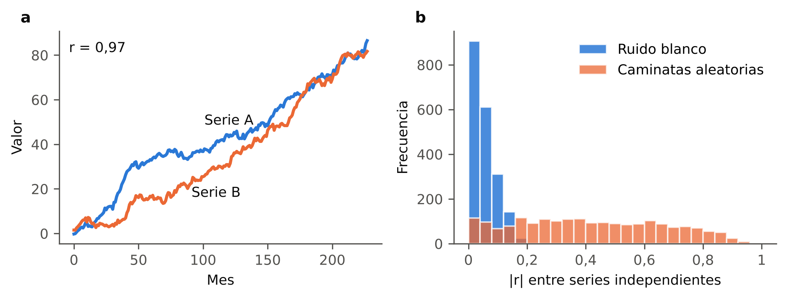{width=95%}

::: {custom-style="Nota"}
*Nota.* (a) Dos caminatas aleatorias independientes con deriva, de 228 meses. (b) Distribución del valor absoluto de la correlación en 2000 pares de series independientes de ruido blanco y de caminatas aleatorias sin deriva. Elaboración propia con datos simulados.
:::

**Diferenciación.** La primera diferencia elimina la tendencia estocástica de una serie DS; aplicada a una serie TS, introduce un componente de medias móviles no invertible. Su efecto sobre una oscilación de período $P$ meses es multiplicar la amplitud por

$$
\gamma_1(P)=\big\lvert 1-e^{-2\pi\mathrm{i}/P}\big\rvert=2\sin(\pi/P),
$$

que tiende a cero cuando $P$ crece. Como la correlación no depende de la escala, lo relevante es la atenuación relativa: frente a una oscilación anual, una oscilación de 96 meses conserva el 1,6 % de su varianza relativa. La diferencia interanual, $x_t-x_{t-12}$, tiene ganancia $\gamma_{12}(P)=2\lvert\sin(12\pi/P)\rvert$: elimina las oscilaciones de período 12, 6, 4, … meses, entre ellas la estacionalidad, y conserva en mayor medida las de baja frecuencia (para $P=96$, el 59 % de la varianza). La Figura 2 muestra ambas ganancias.

::: {custom-style="Rotulo"}
**Figura 2**\
*Factor que la primera diferencia y la diferencia interanual aplican a la varianza de una oscilación*
:::

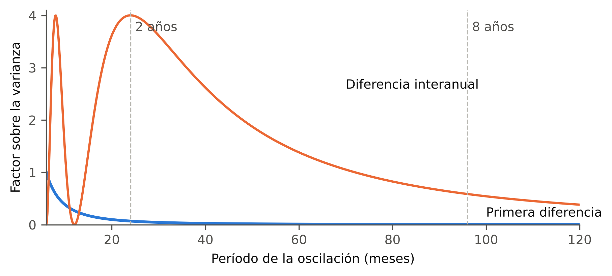{width=85%}

::: {custom-style="Nota"}
*Nota.* Factor $\gamma(P)^2$ para períodos de 6 a 120 meses. Elaboración propia.
:::

**Autocorrelación y tamaño efectivo.** La autocorrelación de orden $\tau$ de una serie es $\rho(\tau)=\operatorname{corr}(x_t,x_{t+\tau})$. Cuando las observaciones están autocorrelacionadas, $n$ meses contienen menos información que $n$ observaciones independientes. Para la correlación entre dos series $x$ e $y$, el **tamaño efectivo de muestra** se aproxima por

$$
\frac{1}{n_{\mathrm{ef}}}=\frac{1}{n}+\frac{2}{n}\sum_{\tau=1}^{J}\rho_{x}(\tau)\,\rho_{y}(\tau),
$$

donde $J$ es el retardo máximo considerado [@pyper_peterman_1998]. La aproximación es válida bajo la hipótesis de ausencia de correlación entre las series y, en la práctica, emplea autocorrelaciones estimadas. Con series muy persistentes, $n_{\mathrm{ef}}$ es una fracción pequeña de $n$, y los procedimientos que suponen independencia sobrestiman la evidencia.

### 2.2.3 Análisis en componentes principales

El análisis en componentes principales (PCA) resume $p$ variables correlacionadas en un número menor de variables no correlacionadas que conservan la mayor parte de su variabilidad.

**Datos y matriz de correlaciones.** Como los indicadores tienen unidades distintas, cada uno se estandariza:

$$
z_{tj}=\frac{x_{tj}-\bar x_j}{s_j},\qquad \bar x_j=\frac1n\sum_t x_{tj},\qquad s_j^2=\frac1n\sum_t (x_{tj}-\bar x_j)^2 .
$$

La tabla estandarizada $Z\in\mathbb{R}^{n\times p}$ define la matriz de correlaciones $R=\tfrac1n Z^\top Z$. Cada mes es un punto de $\mathbb{R}^p$, y la **inercia** de la nube de puntos (la media de sus distancias cuadradas al centro de gravedad) es $\operatorname{tr}R=p$: cada indicador estandarizado aporta una unidad.

**Ejes y valores propios.** El PCA es la descomposición espectral

$$
R=V\Lambda V^\top,\qquad V^\top V=I,\qquad \Lambda=\operatorname{diag}(\lambda_1,\dots,\lambda_p),\qquad \lambda_1\ge\dots\ge\lambda_p\ge 0 .
$$

La columna $\mathbf v_k$ es el $k$-ésimo **eje factorial** y $\lambda_k$ es la inercia que recoge; $\lambda_k/p$ es su proporción. Los ejes son las direcciones de máxima dispersión de la nube, cada una entre las ortogonales a las anteriores, y la proyección sobre los $d$ primeros es la mejor aproximación de rango $d$ de $Z$ en el sentido de mínimos cuadrados [@eckart_young_1936].

**Coordenadas e interpretación.** Las coordenadas de los meses (*scores*) son $F=ZV$; en series temporales, cada columna de $F$ es una nueva serie. La interpretación de cada eje se basa en tres medidas:

- la **correlación** del indicador $j$ con el eje $k$, $r_{jk}=\sqrt{\lambda_k}\,v_{jk}$, que con las series estandarizadas es la coordenada del indicador en el eje;
- la **calidad de representación** $\cos^2_{jk}=r_{jk}^2$, proporción de la varianza del indicador $j$ que recoge el eje $k$, aditiva entre ejes;
- la **contribución** $v_{jk}^2=r_{jk}^2/\lambda_k$, peso del indicador $j$ en la construcción del eje $k$, con $\sum_j v_{jk}^2=1$.

Estas correlaciones se representan en el **círculo de correlaciones**: para indicadores bien representados en el plano, el ángulo entre sus vectores aproxima su correlación, y el cuadrado de la longitud de cada vector es su calidad de representación en el plano. El signo de un eje es arbitrario; solo es interpretable el signo relativo de las correlaciones. La Figura 3 ilustra ambos elementos.

::: {custom-style="Rotulo"}
**Figura 3**\
*Ejes factoriales de una nube de puntos y círculo de correlaciones*
:::

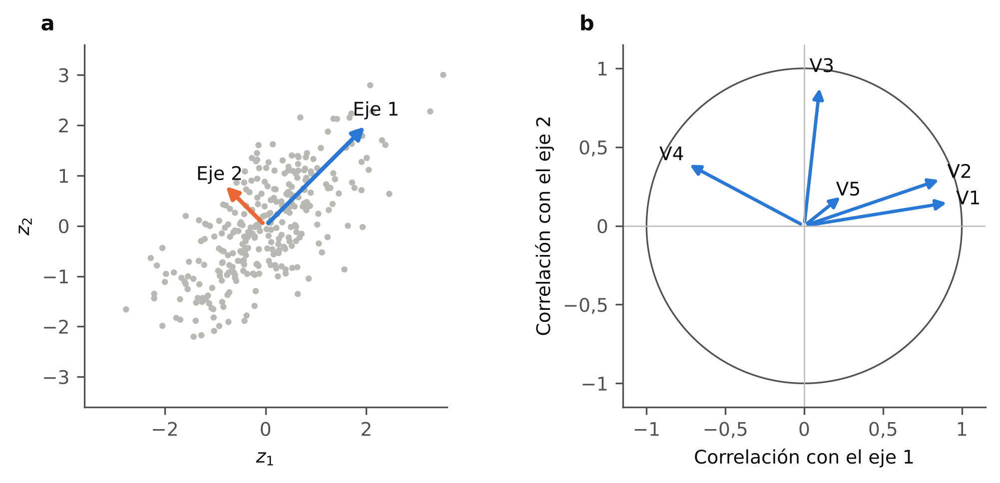{width=95%}

::: {custom-style="Nota"}
*Nota.* (a) Nube de 300 observaciones de dos variables estandarizadas y sus ejes factoriales, con longitud proporcional a $\sqrt{\lambda_k}$. (b) Círculo de correlaciones de cinco variables ilustrativas. Elaboración propia con datos simulados.
:::

**Reconstrucción.** La aproximación de rango $d$ es $\hat Z=ZV_dV_d^\top$, con $V_d$ las $d$ primeras columnas de $V$, y el error de reconstrucción del mes $t$ es $\lVert\mathbf z_t-V_dV_d^\top\mathbf z_t\rVert^2$. Para evaluarlo fuera de muestra, $V_d$ y los parámetros de estandarización se estiman con los datos de entrenamiento.

**Número de ejes.** No existe una regla única. Se emplean tres criterios con supuestos distintos:

- *Kaiser:* se retienen los ejes con $\lambda_k>1$, que resumen más que un indicador.
- *Vara quebrada:* se retienen los ejes cuya proporción de inercia supera la esperada si la inercia se repartiera al azar, $b_k=\frac1p\sum_{i=k}^{p}\frac1i$.
- *Análisis paralelo:* se retienen los ejes cuyo valor propio supera la media de los valores propios obtenidos en tablas de variables aleatorias independientes del mismo tamaño [@horn_1965]. Como las variables simuladas carecen de autocorrelación, con series persistentes el criterio tiende a retener más ejes de los justificados.

**Limitaciones.** El PCA es lineal y global: describe la asociación mediante correlaciones calculadas con todo el período, de modo que, si la estructura cambia, produce un promedio que puede no representar a ningún subperíodo [@camiz_spada_2024]. Sus ejes son ortogonales por construcción, lo que puede mezclar grupos de variables [@camiz_et_al_2020]. Si dos valores propios son casi iguales, los ejes correspondientes no están determinados por separado y solo es interpretable el plano que generan.

### 2.2.4 Clasificación factorial jerárquica

La clasificación factorial jerárquica (HFC) agrupa las variables de forma jerárquica y asocia a cada grupo un factor que lo resume [@denimal_2007; @camiz_et_al_2020]. A diferencia de los ejes del PCA, los factores de los grupos no son ortogonales entre sí.

**Algoritmo.** Cada variable estandarizada constituye inicialmente un grupo, cuyo **representante** es la propia variable. En cada paso:

1. para cada par de grupos $(A,B)$ se calcula el PCA de sus dos representantes;
2. se fusiona el par cuyo segundo valor propio es mínimo;
3. el primer componente del PCA de los dos representantes fusionados es el representante del nuevo grupo.

El proceso termina cuando todas las variables forman un solo grupo; con $p$ variables se obtienen $p-1$ nodos.

**Índice de nodo.** Si los representantes de $A$ y $B$ tienen varianzas $\lambda_A$ y $\lambda_B$ y correlación $r_{AB}$, los valores propios de su PCA son

$$
\eta_{1,2}=\frac{\lambda_A+\lambda_B\pm\sqrt{(\lambda_A-\lambda_B)^2+4\,r_{AB}^2\,\lambda_A\lambda_B}}{2}.
$$

El **índice del nodo** es $\eta_2$: la inercia que se pierde al resumir ambos grupos con un único factor. Como depende de $r_{AB}^2$, dos grupos fuertemente correlacionados con signo negativo también se fusionan con un índice bajo. Si en un nodo las variables se correlacionan con el representante con signos opuestos, el nodo es un **dipolo**: reúne dos subgrupos que varían en sentido contrario, y su representante crece con el subgrupo de correlación positiva y decrece con el de correlación negativa [@camiz_et_al_2020].

**Dendrograma y corte.** La jerarquía se representa en un dendrograma, con cada nodo a la altura de su índice. Una partición de las variables se obtiene cortando el dendrograma a una altura dada: se mantienen separados los grupos cuya fusión tendría un índice superior al umbral. @camiz_et_al_2020 emplean el umbral 0,7, tomado de la recomendación de Jolliffe de considerar relevante un valor propio de al menos 0,7. La Figura 4 muestra un ejemplo.

::: {custom-style="Rotulo"}
**Figura 4**\
*Dendrograma de una clasificación factorial jerárquica*
:::

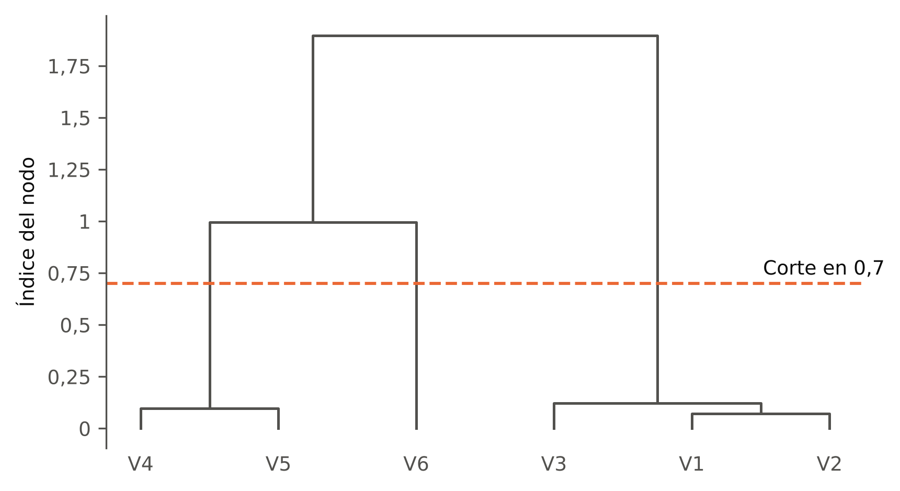{width=80%}

::: {custom-style="Nota"}
*Nota.* Seis variables simuladas: V1–V3 comparten un factor; V4 y V5 comparten otro con signos opuestos (dipolo), y V6 es independiente. Calculado con la rutina clahfac del paquete AedeClahfac. Elaboración propia con datos simulados.
:::

**Descomposición de la inercia.** La suma de los índices de todos los nodos más la varianza del representante de la raíz es igual a $p$ [@camiz_et_al_2020]: la inercia total se reparte entre lo que resume el factor común y lo que se pierde en cada fusión.

### 2.2.5 Análisis evolutivo

El análisis evolutivo estudia la variación temporal de la estructura de asociación repitiendo el análisis en subperíodos consecutivos [@camiz_maulucci_roig_2010; @camiz_spada_2024].

**Ventana móvil.** Una ventana de ancho $w$ es un conjunto de $w$ meses consecutivos $\{t_0,\dots,t_0+w-1\}$; la ventana se desplaza un mes cada vez, de modo que una muestra de $n$ meses produce $n-w+1$ ventanas. Cada resultado se asigna al centro de su ventana: el mes $t_0+(w-1)/2$ si $w$ es impar y, si $w$ es par, por convención de la rutina de referencia, el mes $t_0+w/2$. En consecuencia, las trayectorias evolutivas no cubren alrededor de $w/2$ meses en cada extremo de la muestra. Como en cada ventana las series se centran, el análisis evolutivo capta los cambios de la estructura de asociación y no los de nivel; estos se recogen en las coordenadas del análisis global.

**Pesos gaussianos.** Para atenuar el efecto de los meses que entran y salen de la ventana, el mes que ocupa la posición $r=1,\dots,w$ recibe un peso [@camiz_cerda_atoche_2026]

$$
\omega_r\propto\exp\!\Big[-\tfrac12\Big(\nu\,\frac{r-\bar r}{\kappa}\Big)^2\Big],\qquad \bar r=\frac{w+1}{2},\qquad \kappa=\frac{w-1}{\sqrt2},\qquad \sum_r\omega_r=1,
$$

donde $\nu$ controla la concentración de los pesos ($\nu=0$ corresponde a pesos uniformes); la desviación estándar de los pesos, expresada en meses, es $\kappa/\nu$. En cada ventana se calcula la correlación ponderada

$$
r^{\omega}_{jl}=\frac{\sum_r\omega_r\,(x_{rj}-\bar x^{\omega}_j)(x_{rl}-\bar x^{\omega}_l)}{\sqrt{\sum_r\omega_r(x_{rj}-\bar x^{\omega}_j)^2\;\sum_r\omega_r(x_{rl}-\bar x^{\omega}_l)^2}},\qquad \bar x^{\omega}_j=\sum_r\omega_r x_{rj},
$$

donde $x_{rj}$ denota el valor del indicador $j$ en el mes $t_0+r-1$. La ponderación reduce la información de la ventana: el número de meses con igual peso que equivale a una ventana ponderada es $n_\omega=1/\sum_r\omega_r^2$, igual a $w$ con pesos uniformes. Esta expresión supone observaciones independientes; con series autocorrelacionadas, la información de la ventana es menor, como se indicó en la sección 2.2.2. La Figura 5 ilustra el desplazamiento de la ventana y los dos esquemas de pesos.

::: {custom-style="Rotulo"}
**Figura 5**\
*Ventanas móviles sucesivas y pesos uniformes y gaussianos*
:::

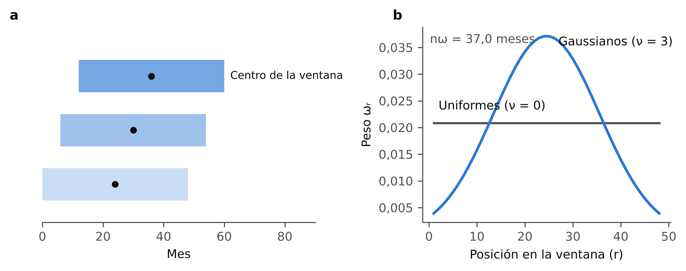{width=95%}

::: {custom-style="Nota"}
*Nota.* (a) Tres ventanas de 48 meses desplazadas seis meses entre sí, con su mes central. (b) Pesos de una ventana de 48 meses con $\nu=0$ y $\nu=3$, y tamaño efectivo $n_\omega$ de la segunda. Pesos calculados con la rutina de referencia del paquete AedeClahfac. Elaboración propia.
:::

**EPCA.** El análisis en componentes principales evolutivo aplica el PCA a la matriz $R^{\omega}$ de cada ventana. Sus resultados se resumen en dos trayectorias [@camiz_spada_2024]: los primeros valores propios $\lambda_k(t)$, que miden la intensidad de la asociación común en torno al mes $t$, y las correlaciones de cada variable con los primeros ejes, que indican si cambia el significado de los ejes. Como el signo de cada vector propio es arbitrario, se alinea con el de la ventana anterior [@camiz_spada_2024]; cuando dos valores propios son casi iguales, los ejes pueden intercambiar su orden entre ventanas, y su correspondencia se establece con el valor absoluto del coeficiente de congruencia. Ventanas sucesivas comparten $w-1$ meses, de modo que las trayectorias son suaves por construcción, y un cambio ocurrido en un mes afecta a todas las ventanas que lo contienen: su ubicación en la trayectoria tiene una imprecisión del orden de la semiamplitud efectiva de la ventana.

**HFC evolutiva.** La clasificación factorial jerárquica se aplica, con los mismos pesos, a cada ventana; se siguen los índices de los nodos superiores, que miden la diferenciación entre los grupos principales, y la composición de los grupos [@camiz_spada_2024].

**Similitud entre configuraciones.** Para comparar dos estructuras de las mismas variables se emplean dos coeficientes. El **coeficiente de congruencia** [@lorenzo_seva_ten_berge_2006] entre dos vectores de correlaciones con un eje, $\mathbf a$ y $\mathbf b$,

$$
\phi(\mathbf a,\mathbf b)=\frac{\sum_j a_jb_j}{\sqrt{\sum_j a_j^2\,\sum_j b_j^2}}\in[-1,1],
$$

compara un eje concreto; por la arbitrariedad del signo, se usa su valor absoluto. El **coeficiente RV** [@robert_escoufier_1976] entre dos matrices de correlaciones de las variables con los ejes, $A$ y $C$,

$$
\mathrm{RV}(A,C)=\frac{\operatorname{tr}(AA^\top CC^\top)}{\sqrt{\operatorname{tr}\big((AA^\top)^2\big)\operatorname{tr}\big((CC^\top)^2\big)}}\in[0,1],
$$

compara configuraciones completas y es invariante a rotaciones y cambios de signo de los ejes. Su valor esperado bajo ausencia de relación depende del número de filas y columnas, por lo que se evalúa frente a una distribución de referencia y no con un umbral fijo [@josse_pages_husson_2008].

### 2.2.6 Partición óptima de Fisher

Una forma de delimitar regímenes es dividir una trayectoria ordenada $\mathbf y_1,\dots,\mathbf y_n$ (univariada o multivariada) en $K$ intervalos contiguos $I_1,\dots,I_K$ de máxima homogeneidad interna. @fisher_1958 plantea el problema de minimizar la suma de cuadrados dentro de los grupos,

$$
\mathrm{SCD}_K=\sum_{k=1}^{K}\sum_{t\in I_k}\lVert\mathbf y_t-\bar{\mathbf y}_{I_k}\rVert^2,
$$

y distingue el caso sin restricciones del caso **restringido**, en que los grupos deben respetar un orden previo; en una serie temporal, cada grupo es un intervalo de períodos consecutivos. Con trayectorias multivariadas, la norma euclídea hace depender el resultado de la escala de cada componente.

**Solución exacta.** El **lema de suboptimización** de @fisher_1958 establece que, si una partición óptima en $K$ grupos se divide en dos partes, cada parte es óptima para su subconjunto con su número de grupos. De ello se sigue la recurrencia

$$
D(m,1)=S(1,m),\qquad D(m,k)=\min_{k\le j\le m}\Big[D(j-1,k-1)+S(j,m)\Big],
$$

donde $D(m,k)$ es el mínimo de la suma de cuadrados para los $m$ primeros elementos en $k$ grupos y $S(j,m)$ la suma de cuadrados del intervalo $\{j,\dots,m\}$. La recurrencia se resuelve por programación dinámica con un costo del orden de $Kn^2$ y proporciona, para cada $K$, la partición óptima global, sin dependencia de una inicialización.

**Número de tramos.** $\mathrm{SCD}_K$ decrece monótonamente con $K$, por lo que el método no determina el número de tramos. El índice de @calinski_harabasz_1974,

$$
\mathrm{CH}(K)=\frac{\mathrm{SCE}_K/(K-1)}{\mathrm{SCD}_K/(n-K)},
$$

donde $\mathrm{SCE}_K$ es la suma de cuadrados entre tramos, se usa para elegir $K$ en su máximo. En trayectorias suaves, como las del análisis evolutivo, $\mathrm{SCD}_K$ decrece rápidamente y el índice puede crecer sin alcanzar un máximo interior [@purizaca_2023]; además, como las observaciones de la trayectoria no son independientes, el índice carece de distribución de referencia. La Figura 6 ilustra la partición y la caída de $\mathrm{SCD}_K$.

::: {custom-style="Rotulo"}
**Figura 6**\
*Partición óptima de Fisher de una trayectoria*
:::

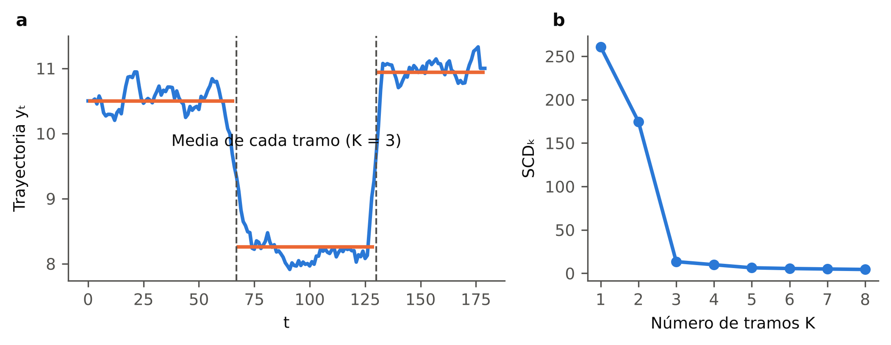{width=95%}

::: {custom-style="Nota"}
*Nota.* (a) Trayectoria simulada con tres niveles, partición óptima en $K=3$ tramos y media de cada tramo. (b) Suma de cuadrados dentro de los tramos para $K=1,\dots,8$. Elaboración propia con datos simulados.
:::

### 2.2.7 Contraste con series de referencia simuladas y remuestreo por bloques

**Contraste con series de referencia simuladas.** Todo método exploratorio produce un resultado aunque los datos carezcan de la estructura buscada: el PCA siempre tiene un primer eje y la partición de Fisher siempre produce $K$ tramos. El contraste consiste en: (i) especificar un mecanismo generador que conserve determinadas propiedades de los datos (por ejemplo, la tendencia de cada serie o su autocorrelación) y carezca de la estructura buscada; (ii) generar $B$ conjuntos de series con ese mecanismo; (iii) aplicar a cada uno el mismo procedimiento y calcular el estadístico de interés $T_b$, y (iv) comparar el valor observado $T$ con la distribución de $\{T_b\}$ mediante

$$
\hat p=\frac{1+\sum_{b=1}^{B}\mathbf 1\{T_b\ge T\}}{B+1},
$$

en un contraste unilateral cuya dirección depende del estadístico. Una proporción pequeña indica que el resultado observado es improbable bajo el mecanismo especificado. El análisis paralelo de @horn_1965 es un caso de este procedimiento, aplicado al número de ejes. La conclusión depende de las propiedades que el mecanismo conserva, y una proporción alta no prueba la ausencia de estructura: puede reflejar una baja capacidad del contraste para detectarla. La Figura 7 muestra cómo el mecanismo elegido cambia la distribución de referencia.

::: {custom-style="Rotulo"}
**Figura 7**\
*Distribución de referencia de la proporción de inercia del primer eje según el mecanismo generador*
:::

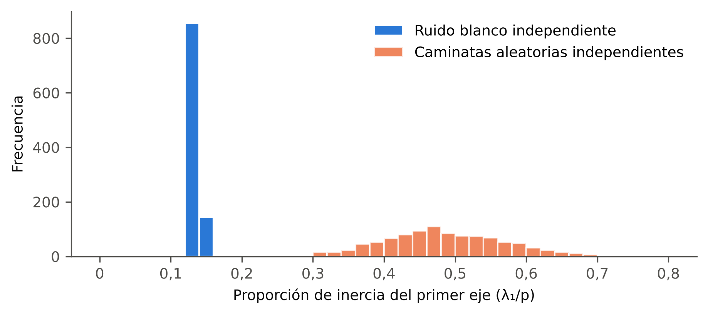{width=85%}

::: {custom-style="Nota"}
*Nota.* 1000 conjuntos de 10 series independientes de 228 meses, generadas como ruido blanco y como caminatas aleatorias. Con caminatas aleatorias, el primer eje recoge una proporción de inercia mucho mayor aunque las series no estén relacionadas. Elaboración propia con datos simulados.
:::

**Remuestreo por bloques.** El remuestreo ordinario sortea observaciones independientes y destruye la dependencia temporal. El bootstrap por bloques móviles [@kunsch_1989] sortea, con reemplazo, bloques de $\ell$ meses consecutivos y los concatena hasta completar $n$ meses; con los mismos inicios de bloque para todas las series se conservan la autocorrelación de cada una y la correlación entre ellas. El procedimiento supone series estacionarias con dependencia débil y no conserva la ubicación cronológica de las observaciones, por lo que es adecuado para evaluar la estabilidad de resultados globales (valores propios, correlaciones con los ejes, grupos) y no la de cortes temporales; para estos se requieren esquemas que conserven el orden, como el remuestreo dentro de cada régimen. El largo $\ell$ es un compromiso: bloques largos conservan mejor la dependencia, pero producen réplicas más parecidas entre sí. La Figura 8 esquematiza el procedimiento.

::: {custom-style="Rotulo"}
**Figura 8**\
*Esquema del bootstrap por bloques móviles*
:::

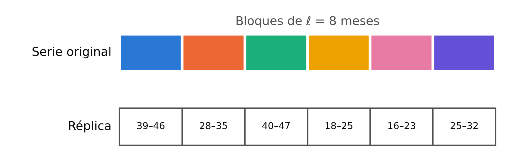{width=85%}

::: {custom-style="Nota"}
*Nota.* Una serie de 48 meses y una réplica formada por seis bloques de ocho meses consecutivos sorteados con reemplazo; los números indican los meses originales de cada bloque. Elaboración propia.
:::

**Comparación de particiones.** La reproducción de una partición en las réplicas se mide con un índice de concordancia, como el índice de Rand ajustado, que vale 1 si dos particiones coinciden y alrededor de 0 si coinciden por azar [@hubert_arabie_1985], o, para cortes temporales, con la frecuencia de cortes dentro de una tolerancia temporal fijada de antemano.

### 2.2.8 Redes neuronales artificiales

Una **red neuronal artificial** es una función paramétrica compuesta por unidades elementales organizadas en capas.

**Neurona y función de activación.** Una neurona transforma un vector de entrada $\mathbf u\in\mathbb R^{q}$ en

$$
y=\psi(\mathbf w^\top\mathbf u+b),
$$

donde $\mathbf w$ son los pesos, $b$ el sesgo y $\psi$ una **función de activación**, en general no lineal; las más usadas son la logística $\sigma(s)=1/(1+e^{-s})$, la tangente hiperbólica y la rectificada lineal $\max(0,s)$. La capa de salida suele ser lineal cuando la salida es continua.

**Red prealimentada multicapa.** Una red prealimentada compone $M$ capas sin conexiones cíclicas:

$$
\mathbf h^{(0)}=\mathbf u,\qquad \mathbf h^{(m)}=\psi\big(W^{(m)}\mathbf h^{(m-1)}+\mathbf b^{(m)}\big),\quad m=1,\dots,M,
$$

y su salida es $f_\theta(\mathbf u)=\mathbf h^{(M)}$, con parámetros $\theta=\{W^{(m)},\mathbf b^{(m)}\}$.

**Entrenamiento.** Los parámetros se estiman minimizando una **función de pérdida** sobre los datos de entrenamiento, por ejemplo el error cuadrático medio $\mathcal L(\theta)=\frac1n\sum_t\lVert\mathbf y_t-f_\theta(\mathbf u_t)\rVert^2$, mediante descenso de gradiente, $\theta\leftarrow\theta-\eta\,\nabla_\theta\mathcal L$, con tasa de aprendizaje $\eta$. El gradiente se calcula por **retropropagación**, que aplica la regla de la cadena desde la capa de salida hacia la de entrada. Como la red puede ajustar particularidades de la muestra de entrenamiento, su desempeño se evalúa **fuera de muestra** y se emplean técnicas de **regularización**, como la desactivación aleatoria de neuronas durante el entrenamiento (*dropout*).

**Clasificación.** Para los fines de esta investigación, las redes se distinguen según dos criterios independientes:

- *Por el tipo de aprendizaje:* **supervisado**, en el que la red aprende una relación entre entradas y salidas conocidas, y **no supervisado**, en el que solo se dispone de las entradas y el objetivo es describir su estructura.
- *Por la arquitectura:* **prealimentada**, que procesa cada observación de forma independiente, y **recurrente**, que transmite información de un período al siguiente y procesa secuencias.

El **autoencoder** se define por su objetivo (reproducir la entrada a través de una representación de menor dimensión) y no por su arquitectura: es una forma de aprendizaje no supervisado en la que la salida objetivo es la propia entrada. En esta investigación se emplean dos combinaciones de ambos criterios: el autoencoder prealimentado, al que se denomina simplemente autoencoder, y el autoencoder LSTM, de arquitectura recurrente. La Figura 9 resume la clasificación.

::: {custom-style="Rotulo"}
**Figura 9**\
*Clasificación de las redes neuronales según el tipo de aprendizaje y la arquitectura*
:::

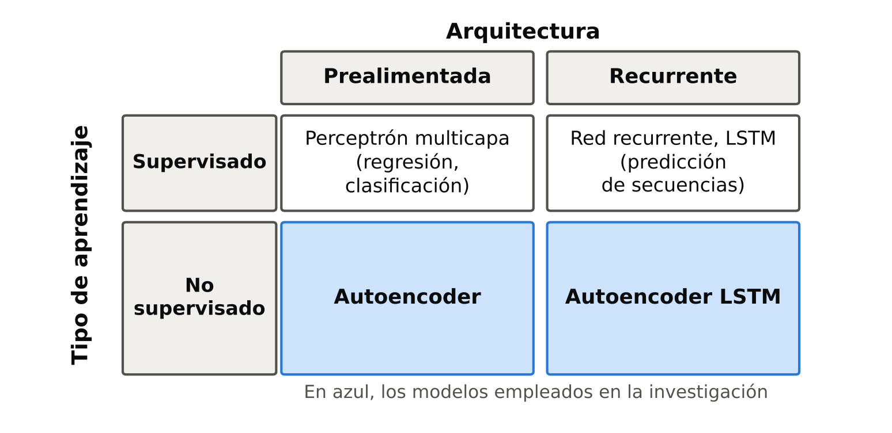{width=80%}

::: {custom-style="Nota"}
*Nota.* Elaboración propia.
:::

### 2.2.9 Autoencoders

Un **autoencoder** está formado por un codificador $\mathrm{enc}:\mathbb R^p\to\mathbb R^d$ y un decodificador $\mathrm{dec}:\mathbb R^d\to\mathbb R^p$, con $d<p$, cuyos parámetros se estiman para reproducir la entrada [@hinton_salakhutdinov_2006]:

$$
\min\ \frac1n\sum_{t=1}^{n}\big\lVert\mathbf z_t-\mathrm{dec}(\mathrm{enc}(\mathbf z_t))\big\rVert^2 .
$$

El vector $\mathrm{enc}(\mathbf z_t)$ es la **representación latente** del mes $t$, y la restricción $d<p$ obliga a la red a retener la información que permite reconstruir la entrada. La Figura 10 muestra su estructura.

::: {custom-style="Rotulo"}
**Figura 10**\
*Estructura de un autoencoder*
:::

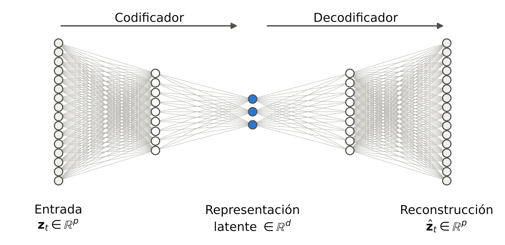{width=80%}

::: {custom-style="Nota"}
*Nota.* Ejemplo con $p=16$ entradas y $d=3$ dimensiones latentes. Elaboración propia.
:::

**Relación con el PCA.** Con activaciones no lineales, el autoencoder puede representar relaciones que el PCA no capta [@hinton_salakhutdinov_2006]; en la variante con eliminación de ruido, la red reconstruye la entrada original a partir de una versión perturbada.

**Error de reconstrucción.** El error de cada observación, $e_t=\lVert\mathbf z_t-\hat{\mathbf z}_t\rVert^2$, mide cuánto se aparta el mes $t$ de la estructura aprendida. Calculado fuera de muestra, permite comparar modelos en una misma escala (incluido el PCA, mediante la reconstrucción de la sección 2.2.3) y señalar los meses atípicos.

**Limitaciones.** La representación latente no es identificable: cualquier reparametrización invertible del espacio latente produce la misma reconstrucción, por lo que sus coordenadas no tienen la interpretación de las correlaciones con los ejes del PCA. El entrenamiento parte de una inicialización aleatoria y puede conducir a soluciones distintas, y con pocas observaciones el riesgo de sobreajuste es alto. En series temporales, la evaluación fuera de muestra exige separar los datos de entrenamiento y de evaluación por orden cronológico.

### 2.2.10 Redes recurrentes y LSTM

**Red recurrente.** Una red recurrente procesa una secuencia $\mathbf u_1,\dots,\mathbf u_q$ actualizando un estado oculto,

$$
\mathbf h_t=\psi(W\mathbf u_t+U\mathbf h_{t-1}+\mathbf b),
$$

que resume la información de los períodos anteriores. Su entrenamiento propaga el gradiente a lo largo de la secuencia; en secuencias largas, el gradiente tiende a desvanecerse o a crecer sin control, lo que impide aprender dependencias de muchos períodos [@hochreiter_schmidhuber_1997].

**Celda LSTM.** La red de memoria de corto y largo plazo (LSTM) resuelve ese problema con una celda de memoria $\mathbf c_t$ regulada por compuertas [@hochreiter_schmidhuber_1997]:

$$
\begin{aligned}
\mathbf i_t&=\sigma(W_i\mathbf u_t+U_i\mathbf h_{t-1}+\mathbf b_i), &
\mathbf f_t&=\sigma(W_f\mathbf u_t+U_f\mathbf h_{t-1}+\mathbf b_f), &
\mathbf o_t&=\sigma(W_o\mathbf u_t+U_o\mathbf h_{t-1}+\mathbf b_o),\\
\tilde{\mathbf c}_t&=\tanh(W_c\mathbf u_t+U_c\mathbf h_{t-1}+\mathbf b_c), &
\mathbf c_t&=\mathbf f_t\odot\mathbf c_{t-1}+\mathbf i_t\odot\tilde{\mathbf c}_t, &
\mathbf h_t&=\mathbf o_t\odot\tanh(\mathbf c_t),
\end{aligned}
$$

donde $\mathbf i_t$, $\mathbf f_t$ y $\mathbf o_t$ son las compuertas de entrada, de olvido y de salida, y $\odot$ el producto elemento a elemento. La Figura 11 esquematiza la celda.

::: {custom-style="Rotulo"}
**Figura 11**\
*Esquema de una celda LSTM*
:::

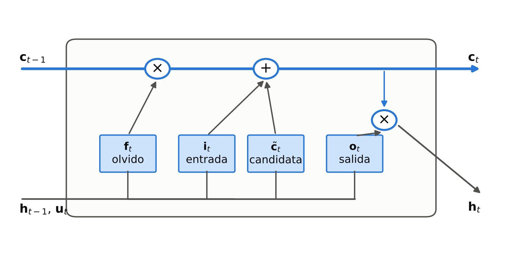{width=85%}

::: {custom-style="Nota"}
*Nota.* Las compuertas de olvido y de entrada regulan la actualización de la memoria $\mathbf c_t$; la de salida, el estado $\mathbf h_t$. Elaboración propia a partir de @hochreiter_schmidhuber_1997.
:::

**Autoencoder LSTM.** Un codificador LSTM lee una ventana de $q$ meses consecutivos y la resume en un vector latente; un decodificador LSTM reconstruye la ventana a partir de ese vector. La sucesión de vectores latentes de ventanas consecutivas forma una **trayectoria latente** que resume la evolución del sistema; como las ventanas se solapan, la trayectoria es suave por construcción.

## 2.3 Definición de términos

- **Régimen:** intervalo de meses consecutivos en el que una propiedad del conjunto de indicadores permanece relativamente estable.
- **Régimen de estructura:** régimen en el que permanece estable la estructura de asociación entre los indicadores.
- **Régimen de posición:** régimen en el que permanece estable el nivel conjunto de los indicadores.
- **Corte:** primer mes de cada régimen distinto del primero.
- **Partición:** división del período en intervalos contiguos y disjuntos.
- **Fase:** etiqueta económica (expansión, contracción o transición) asignada a un régimen según el comportamiento del crédito.
- **Estructura de asociación:** conjunto de correlaciones entre los indicadores.
- **Trayectoria:** sucesión ordenada en el tiempo de un resultado del análisis evolutivo, de las coordenadas de un análisis factorial o de una representación latente.
- **Inercia:** dispersión total de la nube de observaciones; con variables estandarizadas, igual al número de variables.
- **Eje factorial:** dirección de máxima dispersión de la nube de observaciones entre las ortogonales a las anteriores.
- **Representante:** primer componente principal del análisis de los representantes de los dos grupos que se fusionan; en el paso inicial, la propia variable estandarizada.
- **Índice de nodo:** inercia que se pierde al resumir dos grupos con un único factor.
- **Dipolo:** grupo cuyas variables se correlacionan con su representante con signos opuestos.
- **Ventana:** conjunto de meses consecutivos sobre el que se calcula un análisis evolutivo.
- **Tamaño efectivo:** número de observaciones independientes equivalente a una muestra autocorrelacionada o ponderada.
- **Series de referencia simuladas:** series generadas por un mecanismo que conserva propiedades especificadas de los datos y carece de la estructura buscada.
- **Remuestreo por bloques:** generación de réplicas de una serie mediante la concatenación de bloques de observaciones consecutivas.
- **Representación latente:** vector de baja dimensión que una red neuronal asigna a cada observación o secuencia.
- **Error de reconstrucción:** distancia cuadrática entre una observación y su reconstrucción por el modelo.

# CAPÍTULO III. METODOLOGÍA Y DESARROLLO DEL MODELO

## 3.1 Metodología

### 3.1.1 Tipo, nivel y diseño de la investigación

La investigación es cuantitativa, de nivel exploratorio y descriptivo, con un componente comparativo entre métodos. El diseño es no experimental, longitudinal y retrospectivo: se analizan series temporales publicadas, sin manipulación de variables.

### 3.1.2 Datos

**Población y muestra.** La población está formada por los indicadores macrofinancieros mensuales que publica el Banco Central de Reserva del Perú (BCRP). La muestra, obtenida por muestreo no probabilístico intencional, comprende 16 series que representan el crédito, los agregados monetarios, las tasas de interés, los precios, la actividad, el sector externo, el mercado bursátil y el riesgo soberano (Tabla 1), observadas mensualmente de enero de 2007 a diciembre de 2025 ($n=228$ meses). El período inicia en el primer mes en que todas las series están disponibles.

::: {custom-style="Rotulo"}
**Tabla 1**\
*Series analizadas, código en la base de datos del BCRP y unidad*
:::

| Serie | Código | Unidad |
|---|---|---|
| Crédito empresarial | PN00532MM | Millones de soles |
| Crédito de consumo | PN00533MM | Millones de soles |
| Crédito hipotecario | PN00534MM | Millones de soles |
| M1 | PN00199MM | Millones de soles |
| M3 | PN00214MM | Millones de soles |
| Tasa de referencia | PD04722MM | Porcentaje |
| Tasa interbancaria | PN07819NM | Porcentaje |
| TAMN | PN07807NM | Porcentaje |
| TIPMN | PN07816NM | Porcentaje |
| Índice de precios de Lima | PN38705PM | Índice |
| Tipo de cambio | PN01246PM | Soles por dólar |
| Índice de la BVL | PN01142MM | Índice |
| EMBIG | PD04709XD | Puntos básicos |
| PBI | PN01773AM | Índice, desestacionalizado |
| Demanda interna | PN01774AM | Índice, desestacionalizado |
| Reservas internacionales netas | PN00027MM | Millones de dólares |

::: {custom-style="Nota"}
*Nota.* Valores nominales, salvo los índices de actividad. TAMN: tasa activa en moneda nacional; TIPMN: tasa pasiva en moneda nacional; BVL: Bolsa de Valores de Lima; EMBIG: diferencial de rendimiento de los bonos soberanos peruanos frente a los del Tesoro de los Estados Unidos. Elaboración propia con datos del BCRP.
:::

**Criterios de selección.** Se excluyeron del análisis factorial el crédito total y la liquidez en moneda nacional (M2), casi colineales con los créditos por tipo y con M3, respectivamente: como cada indicador estandarizado aporta una unidad de inercia, su inclusión duplicaría el peso de esa información. El BCRP no publica un índice mensual de precios inmobiliarios, por lo que el componente inmobiliario del ciclo financiero [@borio_2014] no está representado; es una limitación del estudio. Se incluye el índice bursátil, que @borio_2014 excluye de su caracterización, porque el enfoque exploratorio deja que la estructura de los datos indique si su comportamiento difiere del resto.

**Tratamiento.** Las series se emplean tal como las publica el BCRP: el PBI y la demanda interna en su versión desestacionalizada y las demás sin ajuste estacional, en valores nominales. Los meses de 2020 no se modifican; su influencia se evalúa con el diagnóstico de la sección 3.2.4. Las series se descargaron por su código, se verificaron en unidades, frecuencia, cobertura y continuidad, y se congelaron el 16 de octubre de 2026 con una huella digital de cada archivo, de modo que los resultados no dependen de revisiones posteriores de la fuente (en particular, del ajuste estacional, que el BCRP revisa). El análisis principal emplea las series en niveles, porque la diferenciación atenúa las oscilaciones de baja frecuencia (sección 2.2.2); el riesgo de correlación espuria que conllevan los niveles se controla con el contraste con series de referencia con tendencia (sección 3.2.5), y las series en logaritmos y en primeras diferencias se emplean como control de robustez.

**Alcance temporal.** Los indicadores se observan entre enero de 2007 y diciembre de 2025. Con ventanas de 48 meses sin truncamiento, los regímenes de estructura se identifican entre enero de 2009 y enero de 2024; los de posición, en todo el período.

**Operacionalización.** La Tabla 2 relaciona cada objetivo específico con lo que se mide y con sus indicadores.

::: {custom-style="Rotulo"}
**Tabla 2**\
*Operacionalización: dimensiones e indicadores por objetivo específico*
:::

| Objetivo | Dimensión | Indicadores |
|---|---|---|
| OE1 | Estructura factorial global | Valores propios e inercia; correlaciones con los ejes, calidad de representación y contribuciones; clases e índices de la HFC; $\hat p$ de cada eje frente a series de referencia con tendencia |
| OE2 | Evolución de la estructura | Valores propios evolutivos; correlaciones evolutivas; índices y composición de los grupos por ventana; $\hat p$ del cambio de estructura |
| OE3 | Regímenes | Cortes; suma de cuadrados por número de tramos; $\hat p$ de la partición; precisión de la ubicación de cada corte |
| OE4 | Caracterización | Crecimiento del crédito, actividad, inflación, tasa de referencia y riesgo soberano por régimen; fase; compatibilidad con los episodios frente a la esperada por azar |
| OE5 | Comparación de representaciones | Error de reconstrucción fuera de muestra; coeficiente RV entre representaciones de distintas semillas; concordancia entre particiones |

::: {custom-style="Nota"}
*Nota.* Elaboración propia.
:::

### 3.1.3 Episodios documentados

Los cortes se comparan con seis episodios cuya fecha proviene de documentos externos a las series (Tabla 3). La lista se fijó antes de examinar los cortes y no se modifica en función de ellos. Los episodios no se fechan con las series ni con indicadores derivados de ellas, para que la comparación no sea circular; la fecha corresponde al evento externo y no a su efecto en la economía peruana. Un corte es compatible con un episodio si dista tres meses o menos de su fecha de inicio o de fin; seis meses se emplean como sensibilidad. Como las fechas de los episodios cubren una fracción apreciable del período, se informa también la proporción de compatibilidades esperada si los cortes se ubicaran al azar, respetando la duración mínima de los tramos, estimada con 10 000 ubicaciones simuladas.

::: {custom-style="Rotulo"}
**Tabla 3**\
*Episodios documentados y fuentes de sus fechas*
:::

| Episodio | Inicio | Fin | Fuente del inicio | Fuente del fin |
|---|---|---|---|---|
| Crisis financiera global | 2008-09 | 2009-06 | Lehman Brothers Holdings Inc. (2008) | National Bureau of Economic Research (2010) |
| *Taper tantrum* | 2013-05 | 2013-12 | Bernanke (2013) | Board of Governors of the Federal Reserve System (2013) |
| Colapso de los precios de las materias primas | 2014-06 | 2016-01 | Stocker et al. (2015) | International Monetary Fund (2016) |
| Renuncia presidencial de 2018 (Kuczynski) | 2018-03 | Puntual | Congreso de la República del Perú (2018) | — |
| Guerra comercial entre Estados Unidos y China | 2018-06 | 2020-01 | Office of the United States Trade Representative (2018) | Office of the United States Trade Representative (2020) |
| Pandemia de COVID-19 | 2020-03 | 2020-04 | World Health Organization (2020) | National Bureau of Economic Research (2021) |

::: {custom-style="Nota"}
*Nota.* La crisis global va de la quiebra de Lehman Brothers al valle de la recesión estadounidense fijado por el NBER; el *taper tantrum*, del testimonio del presidente de la Reserva Federal ante el Congreso al comunicado que anunció la reducción de las compras de activos; el colapso de las materias primas, de la caída del precio del petróleo al primer repunte de los precios informado por el FMI; la pandemia, de la declaración de la OMS al valle de la actividad estadounidense fijado por el NBER. Las fuentes se listan, separadas de la literatura, en «Fuentes documentales de los episodios». Elaboración propia.
:::

### 3.1.4 Estrategia de análisis

El análisis avanza de la estructura global a su evolución y de esta a los regímenes, y cada etapa responde a un objetivo específico (Figura 12): (1) la representación global de los indicadores mediante PCA y HFC (OE1); (2) su evolución mediante EPCA y HFC evolutiva (OE2); (3) la segmentación temporal de dos trayectorias mediante la partición de Fisher, con su contraste (OE3); (4) la caracterización de los regímenes y su comparación con los episodios (OE4), y (5) la comparación de la representación lineal con las no lineales (OE5).

::: {custom-style="Rotulo"}
**Figura 12**\
*Esquema del modelo: etapas, trayectorias y validación*
:::

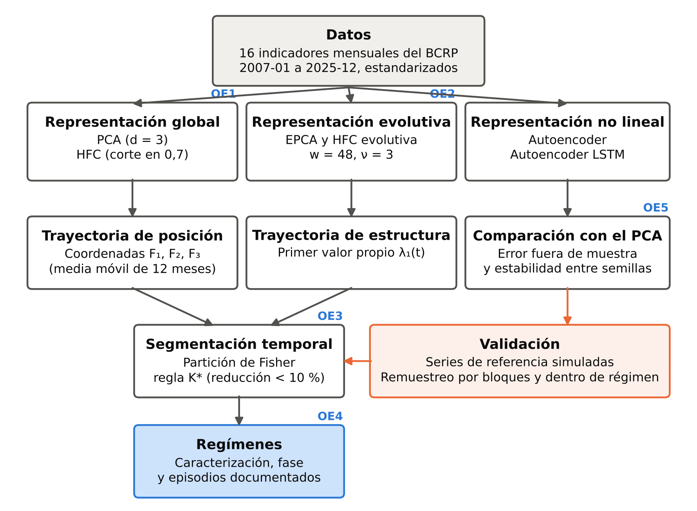{width=100%}

::: {custom-style="Nota"}
*Nota.* Elaboración propia.
:::

### 3.1.5 Implementación computacional

El procesamiento se realizó en R y en Python. Los métodos factoriales, las series de referencia, los remuestreos y la segmentación temporal se implementaron en ambos lenguajes, con verificación de que producen resultados idénticos hasta $10^{-12}$, y se contrastaron con las rutinas de referencia en R del paquete AedeClahfac, de S. Camiz (clahfac para la HFC y aede para el análisis evolutivo y la partición de Fisher); la HFC evolutiva sigue el procedimiento de su programa claede. Los autoencoders se implementaron con la biblioteca PyTorch, con semillas fijas. Los datos, el código y los resultados se publican en un repositorio de acceso público (https://github.com/RobertoSam/Tesis-modelamiento-matematico), con una versión etiquetada que corresponde a los resultados de este documento.

## 3.2 Desarrollo del modelo matemático y computacional

### 3.2.1 Formulación del problema

Sea $X\in\mathbb{R}^{n\times p}$ la matriz de los $p=16$ indicadores observados en $n=228$ meses, y $Z$ su versión estandarizada. El modelo tiene dos componentes:

1. **Representación.** Una aplicación $f:\mathbb{R}^p\to\mathbb{R}^d$, con $d<p$, que asigna a cada mes $\mathbf z_t$ una representación $f(\mathbf z_t)$ que conserva la información común de los indicadores. En el caso lineal, $f(\mathbf z)=V_d^\top\mathbf z$ (PCA), interpretable mediante las correlaciones de los indicadores con los ejes; en el no lineal, $f$ es el codificador de un autoencoder, cuya representación no es identificable (sección 2.2.9). La representación evolutiva aplica el PCA a cada ventana.
2. **Segmentación temporal.** Dada una trayectoria $\mathbf y_1,\dots,\mathbf y_N$ derivada de la representación global o evolutiva, una partición del índice temporal en $K$ intervalos contiguos de al menos 12 meses que minimiza $\mathrm{SCD}_K$. La restricción modifica la recurrencia de la sección 2.2.6: el índice $j$ que inicia el último intervalo cumple $j-1\ge 12(k-1)$ y $m-j+1\ge 12$.

Se segmentan dos trayectorias, que dan lugar a dos tipos de régimen:

- La **trayectoria de estructura**, $y_t=\lambda_1(t)$, primer valor propio del EPCA en la ventana asociada al mes $t$, mide la intensidad de la asociación común. Sus intervalos son **regímenes de estructura**: períodos en que la estructura de asociación entre los indicadores permanece relativamente estable.
- La **trayectoria de posición**, $\mathbf y_t=(F_{t1},F_{t2},F_{t3})$, coordenadas del mes $t$ en los tres primeros ejes del PCA global, mide el nivel conjunto de los indicadores. Sus intervalos son **regímenes de posición**: períodos en que el sistema permanece en una misma zona del espacio factorial.

Ambos tipos se caracterizan y se comparan entre sí; un corte común a las dos trayectorias indica un cambio simultáneo de estructura y de posición.

### 3.2.2 Representación global

**PCA.** Se aplica a la matriz de correlaciones de las 16 series en niveles. Se informan los valores propios y su proporción de inercia simple y acumulada; para cada eje, la correlación de cada serie con el eje, su calidad de representación y su contribución; las coordenadas de los meses; los círculos de correlaciones en los planos 1–2 y 1–3, y, como diagnósticos de adecuación, la medida de Kaiser, Meyer y Olkin (KMO), global y por serie, y la prueba de esfericidad de Bartlett, calculada con $n$ y con el tamaño efectivo $n_{\mathrm{ef}}$ (sección 2.2.2). El número de ejes interpretados se fija en $d=3$, por comparabilidad con los tres grupos identificados por @camiz_cerda_atoche_2026. Se informan los criterios de Kaiser, vara quebrada y análisis paralelo (este último con el percentil 95 de los valores propios de 1000 tablas simuladas, una variante más conservadora que la media empleada por @horn_1965, que como ella ignora la autocorrelación), y $d=2$ y $d=4$ se emplean como sensibilidad. El control apropiado frente a la tendencia y la autocorrelación es el contraste con series de referencia con tendencia (sección 3.2.5).

**HFC.** Se aplica a las mismas series. Se informan los 15 nodos de la jerarquía con su índice, la varianza de su representante y la proporción de inercia local y acumulada; el dendrograma; la partición por el corte en 0,7, y la correlación de cada serie con el representante de su clase.

### 3.2.3 Representación evolutiva

**Ventana y pesos.** El análisis principal emplea ventanas de $w=48$ meses con pesos gaussianos de parámetro $\nu=3$, la especificación de @camiz_cerda_atoche_2026, para que los resultados sean comparables con el antecedente; el tamaño efectivo de la ventana es $n_\omega\approx 37$ meses. Cada resultado se asigna al mes que ocupa la posición $w/2+1$ de la ventana, convención de la rutina de referencia, medio mes después del centro de los pesos. Con $w=48$ se obtienen 181 ventanas, asignadas a los meses de enero de 2009 a enero de 2024; no se emplean ventanas truncadas en los extremos. Como lectura multiescala se emplean los anchos de 24, 36 y 60 meses, con pesos uniformes y gaussianos. Como el primer valor propio de una matriz de correlaciones estimada con pocos meses está sesgado hacia arriba, y con 24 meses el tamaño efectivo es de unos 18 meses para 16 series, los anchos se comparan mediante el cociente entre $\lambda_1$ y el umbral del análisis paralelo del mismo ancho.

**EPCA.** En cada ventana se calculan los tres primeros valores propios y las correlaciones de las 16 series con los tres primeros ejes. Cada valor propio se compara con el umbral de Kaiser y con el del análisis paralelo calculado con el tamaño efectivo de la ventana, que ignora la autocorrelación. Para representar las correlaciones en el tiempo, el signo de cada eje se alinea con el de la ventana anterior por mínimos cuadrados, como en la rutina de referencia, y cada eje se empareja con el eje de la ventana anterior con el que tiene mayor congruencia en valor absoluto. Así, cuando dos valores propios se cruzan, el intercambio de los ejes no aparece como un cambio de las correlaciones. Se informan las ventanas en que ocurre ese intercambio.

**HFC evolutiva.** En cada ventana se calcula la jerarquía completa con los mismos pesos. Se informan los índices de los tres nodos superiores, el número de clases que deja el corte en 0,7, los dendrogramas de ventanas seleccionadas y, en cada ventana, la composición de la clase C1, definida como la clase que contiene al crédito hipotecario, representante de C1 en la HFC global.

### 3.2.4 Segmentación temporal

**Trayectorias.** La trayectoria de estructura es $\lambda_1(t)$ con $w=48$ y $\nu=3$. La trayectoria de posición son las coordenadas de los tres primeros ejes del PCA global, suavizadas con una media móvil centrada de 12 meses y sin estandarizar, de modo que la distancia euclídea es la del subespacio factorial y cada eje pesa según su inercia. Como sensibilidad se emplean la media móvil de los 12 meses anteriores, que introduce un retardo medio de 5,5 meses, y las coordenadas estandarizadas.

**Diagnóstico de influencia.** Un mes extremo $\tau$ entra en la ventana asignada al mes $\tau-23$ y sale de la asignada al mes $\tau+24$, y puede producir en $\lambda_1(t)$ saltos que no corresponden a un cambio de régimen. Se marca como posible efecto de la ventana todo corte de la trayectoria de estructura situado a tres meses o menos de las fechas $\tau-23$ o $\tau+24$ de un mes atípico $\tau$, y el EPCA se recalcula excluyendo los meses de marzo a junio de 2020.

**Partición y número de tramos.** Cada trayectoria se particiona con el algoritmo de @fisher_1958 para $K=1,\dots,10$. El número de tramos $K^*$ es el mayor $K$ tal que la reducción relativa de la suma de cuadrados al pasar de $K-1$ a $K$ tramos,

$$
\Delta_K=\frac{\mathrm{SCD}_{K-1}-\mathrm{SCD}_K}{\mathrm{SCD}_{K-1}},
$$

supera el percentil 95 de la misma reducción en las series de referencia de la sección 3.2.5: un tramo adicional se acepta solo si reduce la heterogeneidad más de lo que lo haría en series sin la estructura buscada. Como sensibilidad se informan la regla del menor $K$ a partir del cual un tramo adicional reduce $\mathrm{SCD}_K$ en menos de 10 % (con umbrales de 10, 12 y 15 %) y la regla de la mayor caída. El índice de @calinski_harabasz_1974 se informa, pero no se usa para elegir $K$ (sección 2.2.6).

**Especificación de trabajo.** Como el contraste de la sección 3.2.5 no identifica regímenes que superen a las series de referencia (capítulo 4), los regímenes que se caracterizan en este informe se obtienen con una especificación de trabajo, que se declara como tal y no como resultado validado: para la trayectoria de posición, las coordenadas de los tres primeros ejes suavizadas con la media móvil de los 12 meses anteriores y estandarizadas; para ambas trayectorias, el número de tramos elegido con la regla del menor $K$ a partir del cual un tramo adicional reduce $\mathrm{SCD}_K$ en menos de 10 % y, si ningún $K$ cumple esa condición, el de mayor caída de esa reducción. Esta especificación permite describir y caracterizar los regímenes de forma tentativa mientras se evalúan formulaciones alternativas de la segmentación.

**Sensibilidad.** Se informan los cortes obtenidos con $d=2$ y $d=4$ ejes en la trayectoria de posición, y con los anchos de 24, 36 y 60 meses en la trayectoria de estructura.

### 3.2.5 Validación

**Contraste de la partición.** La cadena completa (representación, trayectoria, partición de Fisher y número de tramos) se aplica a cada conjunto de series de referencia: las de estructura constante para la trayectoria de estructura y las de tendencia para la trayectoria de posición. Para cada $K\le 10$ se compara la reducción $\Delta_K$ observada con su distribución simulada y se informa $\hat p$ (sección 2.2.7); esa comparación determina $K^*$ (sección 3.2.4).

**Series de referencia con tendencia.** Para evaluar si los ejes del PCA y la trayectoria de posición reflejan asociación entre las series o solo su crecimiento, se generan 1000 conjuntos de 16 series independientes entre sí, cada una con el tipo de tendencia de la serie observada (sección 2.2.2): las series TS, como su recta de tendencia más sus residuos remuestreados por bloques de $\ell=24$ meses; las DS con deriva significativa ($\lvert t\rvert>2$), como la acumulación de sus incrementos centrados, remuestreados por bloques, más la deriva estimada, y las demás DS, como la acumulación de sus incrementos centrados remuestreados por bloques. Los remuestreos son independientes entre series, lo que elimina la asociación y conserva la tendencia y la dependencia temporal de cada una. Las series de tipo indeterminado se simulan de las dos formas, y se informan ambos resultados. Para los ejes del PCA, el estadístico es la proporción de inercia de cada uno de los tres primeros ejes.

**Series de referencia con estructura constante.** Para evaluar si la estructura de asociación cambia más de lo que cambiaría por azar, se generan 200 conjuntos de series por remuestreo conjunto de bloques de $\ell=24$ meses de los incrementos mensuales, con los mismos inicios de bloque para todas las series, acumulados desde el valor inicial: las series conservan la correlación contemporánea y la dinámica de corto plazo, pero cualquier cambio de estructura queda dispersado en el tiempo. En cada conjunto se calcula el coeficiente RV entre las correlaciones de las series con los dos primeros ejes de ventanas adyacentes que no comparten meses; el estadístico global es el mínimo de esa sucesión a lo largo del período, y se informa su $\hat p$, con una resolución de $1/201$, junto con la banda simulada. Como la acumulación de incrementos no conserva el tipo de tendencia de las series TS, el contraste se repite con esas series en desviaciones de su tendencia.

**Estabilidad de la estructura global.** Se evalúa con 500 réplicas obtenidas por remuestreo conjunto, en bloques móviles de $\ell=24$ meses (12 y 36 como sensibilidad), de los incrementos mensuales, acumulados desde el valor inicial: para el PCA, la congruencia de cada uno de los tres primeros ejes con el eje original emparejado por el valor absoluto de la congruencia, y la distribución de los valores propios; para la HFC, la frecuencia con que se reproduce la partición, medida con el índice de Rand ajustado, y la correlación cofenética entre dendrogramas.

**Precisión de la ubicación de los cortes.** Dados $K^*$ y la partición obtenida, se remuestrean por bloques de seis meses los residuos de la trayectoria respecto de la media de cada tramo, dentro de ese tramo, y se suman a la media del tramo; en cada una de 200 réplicas se repite la partición con $K^*$ y se informa, para cada corte, la proporción de réplicas con un corte a tres meses o menos y el intervalo entre los percentiles 5 y 95 de su ubicación. El procedimiento es condicional en la existencia de los cortes y en $K^*$: mide la precisión de su ubicación y no su existencia, que se evalúa con el contraste de la partición. Es un procedimiento propio de la investigación, análogo a los intervalos por remuestreo para la ubicación de un punto de cambio; en tramos de menos de 24 meses, el resultado se informa con esa advertencia.

**Correspondencia con los episodios.** Para cada corte se informa la distancia, en meses, al inicio o al fin del episodio más cercano, su compatibilidad con él y la proporción de compatibilidades esperada por azar (sección 3.1.3).

### 3.2.6 Caracterización de los regímenes y regla de fases

Cada régimen se caracteriza con indicadores calculados directamente de las series: el crecimiento interanual promedio del crédito, del PBI y del índice de precios; la tasa de referencia promedio del primer y del último trimestre del régimen, y el promedio del EMBIG.

La fase se asigna con una regla basada en el crecimiento interanual real del crédito total $C_t$, suma de los créditos empresarial, de consumo e hipotecario, deflactada por el índice de precios de Lima:

$$
g_t=100\Big(\frac{C_t/P_t}{C_{t-12}/P_{t-12}}-1\Big),
$$

donde $P_t$ es el índice de precios. La diferencia interanual conserva las oscilaciones de baja frecuencia y elimina la estacionalidad (sección 2.2.2). Sean $m$ la mediana y $s$ la desviación estándar de $g_t$ en el período, y $\tilde g_k$ la mediana de $g_t$ en el régimen $k$. La fase del régimen es:

$$
\text{fase}_k=\begin{cases}
\text{expansión} & \text{si } \tilde g_k>m+c\,s,\\
\text{contracción} & \text{si } \tilde g_k<m-c\,s,\\
\text{transición} & \text{en otro caso,}
\end{cases}
$$

con $c=1$ en el análisis principal y $c=0{,}5$ como sensibilidad. La mediana hace que la fase refleje el comportamiento predominante del régimen aunque contenga meses atípicos. Se informan $\tilde g_k$, la distribución de $g_t$ y el signo de la variación de $g_t$ dentro de cada régimen, porque la regla clasifica el crecimiento del crédito respecto de su valor habitual en el período y no la dirección del ciclo. Tres limitaciones se declaran: $g_t$ no está disponible en los primeros 12 meses de la muestra, de modo que la fase de un régimen que los incluye se calcula con los meses disponibles; el crédito en moneda extranjera está valorado al tipo de cambio de cada mes, por lo que una depreciación aumenta $C_t$ sin que aumente el crédito, y el crecimiento del crédito empresarial en 2020–2022 está afectado por el programa de créditos con garantía estatal Reactiva Perú.

### 3.2.7 Representaciones no lineales

**Autoencoder.** Red prealimentada con arquitectura $16\to 8\to 3\to 8\to 16$, activación tangente hiperbólica en la capa oculta, capas latente y de salida lineales, y pesos compartidos entre codificador y decodificador; $d=3$ dimensiones latentes, como en el PCA. Se entrena con el método de Adam, con penalización de los pesos, ruido gaussiano en la entrada (variante con eliminación de ruido) y detención temprana sobre el último 15 % cronológico de cada conjunto de entrenamiento.

**Autoencoder LSTM.** Codificador y decodificador LSTM con 16 unidades ocultas y $d=3$ dimensiones latentes, aplicados a ventanas de $q=12$ meses; cada vector latente se asigna al centro de su ventana, para que su trayectoria sea comparable con las de estructura y de posición.

**Especificación.** Los valores de la penalización, la varianza del ruido, la tasa de aprendizaje, el tamaño del lote, el número de épocas, la paciencia y el número de semillas se fijan en la corrida con las 16 series y se informarán con sus resultados; la corrida exploratoria del capítulo 4 se hizo con una versión anterior de la base.

**Evaluación.** Ambos modelos se comparan con el PCA de la misma dimensión mediante el error de reconstrucción fuera de muestra, con dos esquemas cronológicos: validación por cinco bloques contiguos, para $d=1,\dots,5$, que muestra si la ventaja relativa depende de la dimensión, y evaluación anual sucesiva (*walk-forward*), en la que el modelo se entrena con los meses anteriores a cada año y se evalúa en ese año, de 2011 a 2025. La estandarización se estima solo con los datos de entrenamiento, y entre bloques de entrenamiento y de evaluación se deja un margen de $q$ meses para que ninguna ventana del autoencoder LSTM los comparta. Como las series en niveles alcanzan en la evaluación valores fuera del rango de entrenamiento y la tangente hiperbólica se satura, la comparación se repite con las series en primeras diferencias. La estabilidad de la representación se mide con el coeficiente RV entre las representaciones latentes obtenidas con distintas semillas. La trayectoria latente se segmenta con el procedimiento de la sección 3.2.4, y su partición se compara con la de la trayectoria de posición mediante el índice de Rand ajustado y la distancia entre cortes. Con alrededor de 200 ventanas muy solapadas y miles de parámetros, el riesgo de sobreajuste del autoencoder LSTM es alto, y los resultados se interpretan con esa reserva.

# CAPÍTULO IV. RESULTADOS Y DISCUSIÓN

La estructura factorial y su evolución se presentan como resultados del análisis. Los regímenes se obtienen con la especificación de trabajo de la sección 3.2.4, porque el contraste con las series de referencia simuladas todavía no los respalda y su validación está en estudio (sección 4.3).

## 4.1 Estructura factorial global (OE1)

### 4.1.1 Las series

La Figura 13 muestra las 16 series en sus unidades originales. Los saldos y los niveles de actividad y de precios crecen de forma sostenida. Entre 2007 y 2025, los créditos se multiplicaron entre 6,5 y 9,5 veces, M3 por 5,9, las reservas internacionales por 5,1, el índice de precios aumentó 85 % y el PBI se duplicó. Las tasas de interés, el tipo de cambio, el índice bursátil y el EMBIG oscilan sin una tendencia sostenida. Doce series son integradas, una (el EMBIG) es estacionaria en tendencia y tres (el crédito de consumo, la TIPMN y el PBI) quedan sin clasificar. Por la persistencia de las series, la mediana del tamaño efectivo de los pares es de 10,6 observaciones independientes.

::: {custom-style="Rotulo"}
**Figura 13**\
*Series analizadas en sus unidades originales*
:::

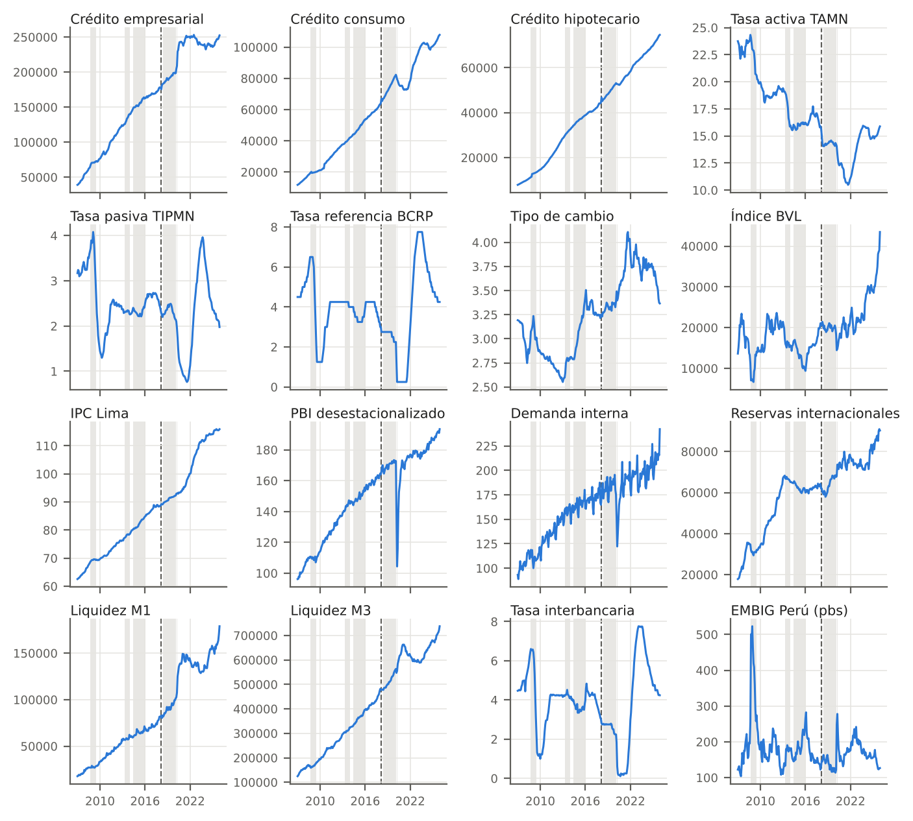{width=100%}

::: {custom-style="Nota"}
*Nota.* En gris, los episodios de la Tabla 3. Elaboración propia con datos del BCRP.
:::

### 4.1.2 Análisis en componentes principales

La medida KMO global es 0,84, y la de cada serie va de 0,61 (tasa de referencia) a 0,95 (demanda interna) (Tabla 4). La prueba de Bartlett rechaza la esfericidad con $n=228$ ($\chi^2=10\,492$, 120 grados de libertad); con el tamaño efectivo, el estadístico baja a 162 ($p=0{,}007$), y como $n_{\mathrm{ef}}<p$ la aproximación $\chi^2$ no es fiable y el resultado es solo un indicio.

::: {custom-style="Rotulo"}
**Tabla 4**\
*Medida KMO por serie y calidad de representación en los tres primeros ejes*
:::

| Serie | KMO | Calidad en los ejes 1–3 |
|---|---|---|
| Crédito empresarial | 0,90 | 0,99 |
| Crédito consumo | 0,85 | 0,98 |
| Crédito hipotecario | 0,87 | 0,99 |
| M1 (dinero) | 0,87 | 0,95 |
| M3 (liquidez total) | 0,85 | 0,99 |
| Tasa de referencia | 0,61 | 0,96 |
| Tasa interbancaria | 0,62 | 0,97 |
| TAMN | 0,88 | 0,93 |
| TIPMN | 0,70 | 0,89 |
| IPC Lima | 0,90 | 0,98 |
| Tipo de cambio | 0,77 | 0,77 |
| Índice BVL | 0,76 | 0,79 |
| EMBIG Perú | 0,68 | 0,86 |
| PBI desestacionalizado | 0,89 | 0,93 |
| Demanda interna | 0,95 | 0,91 |
| Reservas internacionales netas | 0,81 | 0,87 |

::: {custom-style="Nota"}
*Nota.* Elaboración propia con datos del BCRP.
:::

Los tres primeros ejes recogen el 65,2 %, el 19,4 % y el 7,6 % de la inercia, 92,2 % en conjunto (Tabla 5, Figura 14). Kaiser retiene tres ejes; el análisis paralelo y la vara quebrada, dos. El tercer valor propio (1,21) supera el umbral de Kaiser pero no el del análisis paralelo (1,36). Es un eje de frontera, y se interpreta por la decisión tomada en la sección 3.2.2.

::: {custom-style="Rotulo"}
**Tabla 5**\
*Valores propios, inercia y criterios para el número de ejes*
:::

| Eje | Valor propio | Inercia (%) | Acumulada (%) | Umbral del análisis paralelo | Vara quebrada (%) |
|---|---|---|---|---|---|
| 1 | 10,437 | 65,2 | 65,2 | 1,588 | 21,1 |
| 2 | 3,101 | 19,4 | 84,6 | 1,443 | 14,9 |
| 3 | 1,208 | 7,6 | 92,2 | 1,358 | 11,8 |
| 4 | 0,492 | 3,1 | 95,2 | 1,281 | 9,7 |
| 5 | 0,358 | 2,2 | 97,5 | 1,215 | 8,1 |
| 6 | 0,160 | 1,0 | 98,5 | 1,155 | 6,9 |

::: {custom-style="Nota"}
*Nota.* Umbral del análisis paralelo: percentil 95 de 1000 tablas simuladas. Vara quebrada: proporción esperada de inercia. Elaboración propia con datos del BCRP.
:::

::: {custom-style="Rotulo"}
**Figura 14**\
*Valores propios frente al análisis paralelo y la vara quebrada*
:::

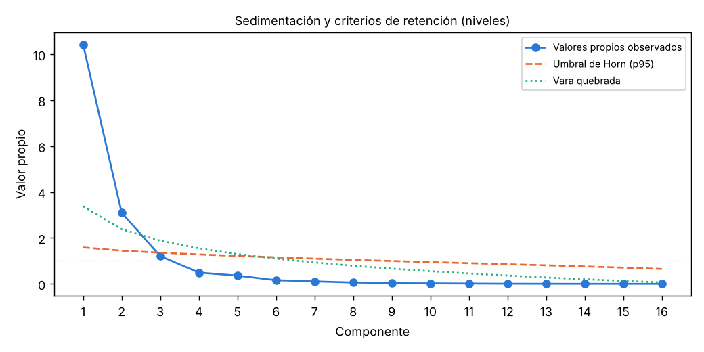{width=60%}

::: {custom-style="Nota"}
*Nota.* Elaboración propia con datos del BCRP.
:::

La Tabla 6 da, para cada eje, la correlación de cada serie con el eje, su calidad de representación (cos²) y su contribución a la inercia del eje. La Figura 15 representa esas correlaciones en los planos 1–2 y 1–3.

- *Eje 1, escala del sistema.* Once series contribuyen en proporciones parecidas, entre 6,1 % y 9,4 %, cerca de 1/11: los tres créditos, M1, M3, el índice de precios, el PBI, la demanda interna y las reservas, con correlaciones de 0,93 a 0,99; el tipo de cambio (0,80), y la TAMN con signo opuesto. Las otras cinco series aportan poco. La coordenada de los meses en este eje está casi perfectamente correlacionada con el tiempo (Figura 16).
- *Eje 2, condiciones monetarias.* Las tasas de referencia, interbancaria y pasiva suman el 88,0 % de su formación. Su mínimo coincide con la tasa de referencia en 0,25 % (julio de 2021) y su máximo, con el fin del ciclo de alzas (agosto de 2023).
- *Eje 3, riesgo de mercado.* Opone el EMBIG a la bolsa, que suman el 85,2 % de su formación. Sus valores más altos ocurren en diciembre de 2008, febrero de 2016 y abril de 2020.

El tipo de cambio (0,77) y el índice de la BVL (0,79) son las series peor representadas por los tres ejes.

::: {custom-style="Rotulo"}
**Tabla 6**\
*Correlación con el eje, calidad de representación (cos²) y contribución de cada serie en los tres primeros ejes*
:::

| Serie | r eje 1 | cos² eje 1 | Ctr. eje 1 (%) | r eje 2 | cos² eje 2 | Ctr. eje 2 (%) | r eje 3 | cos² eje 3 | Ctr. eje 3 (%) | Calidad (1–3) |
|---|---|---|---|---|---|---|---|---|---|---|
| Crédito empresarial | **0,99** | 0,97 | 9,3 | −0,02 | 0,00 | 0,0 | 0,13 | 0,02 | 1,3 | 0,99 |
| Crédito consumo | **0,98** | 0,95 | 9,1 | 0,16 | 0,02 | 0,8 | 0,02 | 0,00 | 0,0 | 0,98 |
| Crédito hipotecario | **0,99** | 0,98 | 9,4 | 0,09 | 0,01 | 0,3 | 0,03 | 0,00 | 0,1 | 0,99 |
| M1 | **0,98** | 0,95 | 9,1 | 0,01 | 0,00 | 0,0 | 0,06 | 0,00 | 0,3 | 0,95 |
| M3 | **0,99** | 0,98 | 9,4 | −0,02 | 0,00 | 0,0 | 0,05 | 0,00 | 0,2 | 0,99 |
| Tasa de referencia | 0,00 | 0,00 | 0,0 | **0,98** | 0,96 | 30,9 | −0,08 | 0,01 | 0,5 | 0,96 |
| Tasa interbancaria | 0,00 | 0,00 | 0,0 | **0,98** | 0,96 | 31,1 | −0,07 | 0,00 | 0,4 | 0,97 |
| TAMN | **−0,87** | 0,76 | 7,3 | 0,36 | 0,13 | 4,2 | −0,18 | 0,03 | 2,7 | 0,93 |
| TIPMN | −0,29 | 0,08 | 0,8 | **0,90** | 0,81 | 26,1 | −0,01 | 0,00 | 0,0 | 0,89 |
| IPC Lima | **0,97** | 0,93 | 8,9 | 0,22 | 0,05 | 1,5 | 0,02 | 0,00 | 0,0 | 0,98 |
| Tipo de cambio | **0,80** | 0,64 | 6,1 | 0,14 | 0,02 | 0,6 | 0,33 | 0,11 | 9,0 | 0,77 |
| Índice BVL | **0,62** | 0,39 | 3,7 | 0,16 | 0,02 | 0,8 | **−0,61** | 0,38 | 31,2 | 0,79 |
| EMBIG Perú | −0,32 | 0,10 | 1,0 | 0,33 | 0,11 | 3,5 | **0,81** | 0,65 | 54,0 | 0,86 |
| PBI | **0,96** | 0,92 | 8,9 | 0,06 | 0,00 | 0,1 | −0,02 | 0,00 | 0,0 | 0,93 |
| Demanda interna | **0,95** | 0,90 | 8,6 | 0,04 | 0,00 | 0,1 | −0,04 | 0,00 | 0,1 | 0,91 |
| RIN | **0,93** | 0,86 | 8,3 | −0,04 | 0,00 | 0,1 | −0,03 | 0,00 | 0,1 | 0,87 |

::: {custom-style="Nota"}
*Nota.* r: correlación de la serie con el eje; en negrita, valores absolutos iguales o mayores que 0,6. Ctr.: contribución a la inercia del eje. La calidad en el subespacio 1–3 es la suma de los cos² de los tres ejes. Elaboración propia con datos del BCRP.
:::

::: {custom-style="Rotulo"}
**Figura 15**\
*Círculos de correlaciones en los planos 1–2 y 1–3*
:::

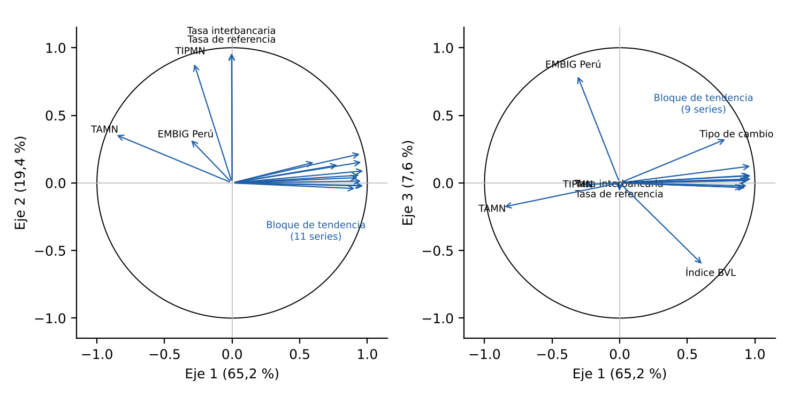{width=100%}

::: {custom-style="Nota"}
*Nota.* Elaboración propia con datos del BCRP.
:::

::: {custom-style="Rotulo"}
**Figura 16**\
*Coordenadas de los meses en los tres primeros ejes*
:::

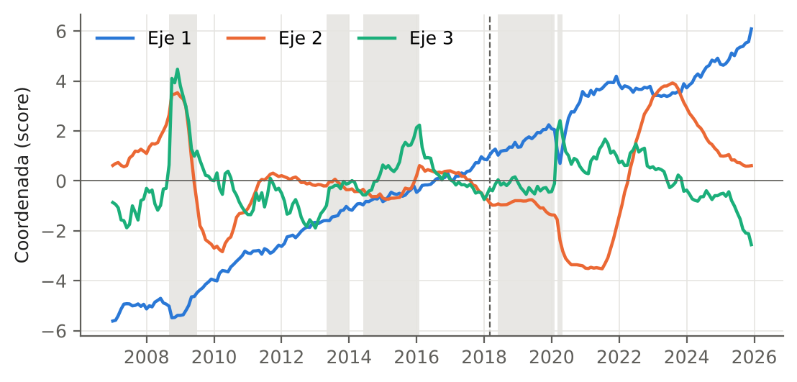{width=100%}

::: {custom-style="Nota"}
*Nota.* En gris, los episodios de referencia. Elaboración propia con datos del BCRP.
:::

Solo el segundo eje supera a las series de referencia (Tabla 7). Con series independientes, cada una con su propia tendencia, se obtiene un primer eje igual o mayor que el observado en cerca del 80 % de las simulaciones y un tercero en cerca del 25 %, mientras que un segundo eje como el observado aparece en menos del 1 %. El bloque de escala refleja, entonces, que casi todas las series crecen, y el único co-movimiento que no puede atribuirse a la tendencia es el de las tasas de interés.

::: {custom-style="Rotulo"}
**Tabla 7**\
*Proporción de inercia de los tres primeros ejes frente a series de referencia con tendencia*
:::

| Versión | Eje | Inercia observada (%) | Mediana simulada (%) | Percentil 95 simulado (%) | p̂ |
|---|---|---|---|---|---|
| Indeterminadas como TS | 1 | 65,2 | 68,5 | 76,3 | 0,773 |
| Indeterminadas como TS | 2 | 19,4 | 10,4 | 14,9 | 0,001 |
| Indeterminadas como TS | 3 | 7,6 | 6,9 | 8,9 | 0,272 |
| Indeterminadas como DS | 1 | 65,2 | 69,9 | 78,8 | 0,812 |
| Indeterminadas como DS | 2 | 19,4 | 11,2 | 16,4 | 0,009 |
| Indeterminadas como DS | 3 | 7,6 | 6,6 | 9,1 | 0,224 |

::: {custom-style="Nota"}
*Nota.* 1000 conjuntos de 16 series independientes, cada una con su tipo de tendencia (sección 3.2.5). Elaboración propia con datos del BCRP.
:::

Con el remuestreo de los incrementos en bloques de 24 meses, la mediana de la congruencia de cada eje con el original es de 0,87, 0,78 y 0,75, y el percentil 5, de 0,68, 0,56 y 0,54 (Tabla 8, Figura 17). El primer eje es el más estable; los ejes 2 y 3 conservan su orientación en la mayoría de las réplicas, pero con una dispersión apreciable. Como las réplicas recombinan los incrementos de cada serie, cambian las trayectorias en niveles y, con ellas, las correlaciones. La estructura en niveles depende en buena medida de la trayectoria particular que siguieron las series.

::: {custom-style="Rotulo"}
**Tabla 8**\
*Estabilidad de los ejes del PCA frente al remuestreo de los incrementos*
:::

| Bloque (meses) | Congruencia eje 1: mediana [p5] | Congruencia eje 2: mediana [p5] | Congruencia eje 3: mediana [p5] | λ₁ [p5; p95] |
|---|---|---|---|---|
| 12 | 0,85 [0,65] | 0,75 [0,53] | 0,70 [0,50] | [10,1; 13,9] |
| 24 | 0,87 [0,68] | 0,78 [0,56] | 0,75 [0,54] | [9,7; 13,8] |
| 36 | 0,88 [0,72] | 0,81 [0,57] | 0,77 [0,54] | [10,1; 13,4] |

::: {custom-style="Nota"}
*Nota.* 500 réplicas por largo de bloque. Elaboración propia con datos del BCRP.
:::

::: {custom-style="Rotulo"}
**Figura 17**\
*Congruencia de los tres primeros ejes con el original en 500 réplicas*
:::

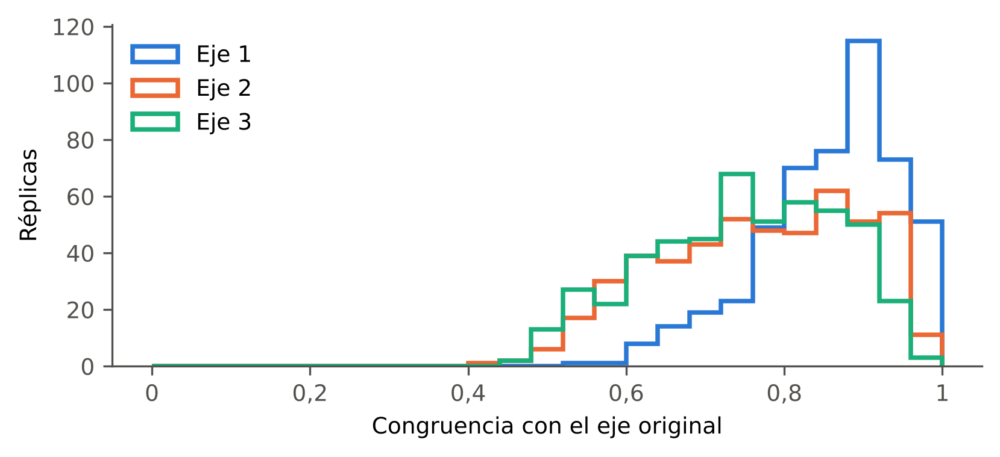{width=70%}

::: {custom-style="Nota"}
*Nota.* Bloques de 24 meses. Elaboración propia con datos del BCRP.
:::

### 4.1.3 Clasificación factorial jerárquica

La Figura 18 muestra el dendrograma y la Tabla 9, los 15 nodos de la jerarquía. Las series se unen primero en pares casi intercambiables, con índices menores que 0,03. Así se unen la tasa de referencia con la interbancaria, el crédito de consumo con el hipotecario, el crédito empresarial con M3 y el PBI con la demanda interna. El nodo 28 reúne once series con un índice de 0,353; el nodo 25, las tres tasas de corto plazo (0,207), y el nodo 29, el EMBIG y la bolsa (0,494). Los dos nodos superiores tienen índices de 1,110 y 2,768.

::: {custom-style="Rotulo"}
**Figura 18**\
*Dendrograma de la clasificación factorial jerárquica*
:::

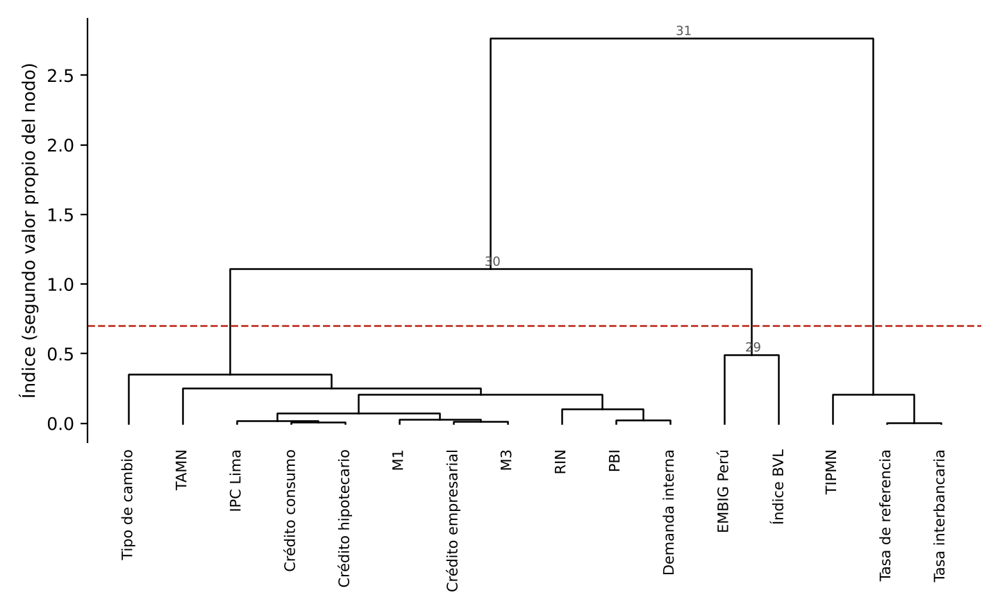{width=92%}

::: {custom-style="Nota"}
*Nota.* La altura de cada nodo es su índice; la línea discontinua marca el corte en 0,7. Elaboración propia con datos del BCRP.
:::

::: {custom-style="Rotulo"}
**Tabla 9**\
*Nodos de la jerarquía de la HFC*
:::

| Nodo | Une | Series | λ1 | Índice (λ2) | % local λ1 | % local λ2 | % global λ1 | % global λ2 | % acum. λ2 |
|---|---|---|---|---|---|---|---|---|---|
| 31 | nodo 30 + nodo 25 | 16 | 10,337 | 2,768 | 78,9 | 21,1 | 64,6 | 17,30 | 35,39 |
| 30 | nodo 28 + nodo 29 | 13 | 10,314 | 1,110 | 90,3 | 9,7 | 64,5 | 6,94 | 18,10 |
| 29 | EMBIG Perú + Índice BVL | 2 | 1,506 | 0,494 | 75,3 | 24,7 | 9,4 | 3,09 | 11,16 |
| 28 | Tipo de cambio + nodo 27 | 11 | 9,919 | 0,353 | 96,6 | 3,4 | 62,0 | 2,20 | 8,07 |
| 27 | TAMN + nodo 26 | 10 | 9,272 | 0,252 | 97,4 | 2,6 | 57,9 | 1,57 | 5,86 |
| 26 | nodo 23 + nodo 24 | 9 | 8,524 | 0,210 | 97,6 | 2,4 | 53,3 | 1,31 | 4,29 |
| 25 | TIPMN + nodo 17 | 3 | 2,791 | 0,207 | 93,1 | 6,9 | 17,4 | 1,29 | 2,97 |
| 24 | RIN + nodo 21 | 3 | 2,875 | 0,101 | 96,6 | 3,4 | 18,0 | 0,63 | 1,68 |
| 23 | nodo 20 + nodo 22 | 6 | 5,859 | 0,073 | 98,8 | 1,2 | 36,6 | 0,46 | 1,05 |
| 22 | M1 + nodo 19 | 3 | 2,956 | 0,030 | 99,0 | 1,0 | 18,5 | 0,18 | 0,59 |
| 21 | PBI + Demanda interna | 2 | 1,976 | 0,024 | 98,8 | 1,2 | 12,4 | 0,15 | 0,41 |
| 20 | IPC Lima + nodo 18 | 3 | 2,976 | 0,017 | 99,4 | 0,6 | 18,6 | 0,11 | 0,26 |
| 19 | Crédito empresarial + M3 | 2 | 1,986 | 0,014 | 99,3 | 0,7 | 12,4 | 0,09 | 0,15 |
| 18 | Crédito consumo + Crédito hipotecario | 2 | 1,992 | 0,008 | 99,6 | 0,4 | 12,5 | 0,05 | 0,06 |
| 17 | Tasa de referencia + Tasa interbancaria | 2 | 1,997 | 0,003 | 99,9 | 0,1 | 12,5 | 0,02 | 0,02 |

::: {custom-style="Nota"}
*Nota.* Los nodos 1 a 16 son las series. λ1: varianza del representante del nodo; índice (λ2): segundo valor propio del nodo; % local: proporción de la inercia de las series del nodo que recoge cada valor propio; % global: la misma cantidad como porcentaje de la inercia total (16); % acum. λ2: suma acumulada de los índices como porcentaje de la inercia total. Elaboración propia con datos del BCRP.
:::

El corte en 0,7 deja tres clases que coinciden con los tres ejes del PCA (Tabla 10). La clase de escala del sistema tiene 11 series, y su representante recoge el 96,6 % de su inercia. La de condiciones monetarias tiene 3 series (93,1 %), y la de riesgo de mercado, 2 (75,3 %); esta última es un dipolo, en el que el EMBIG y la bolsa se mueven en sentido opuesto. Las series más representativas de cada clase son el crédito hipotecario, la tasa interbancaria y el EMBIG. La varianza del representante de la raíz (10,337) es casi igual al primer valor propio del PCA (10,437), y la suma de los índices (5,663) más esa varianza da 16. Los representantes de la escala y de las tasas no están correlacionados en niveles (−0,07); al quitar a las series su recta de tendencia, su correlación es −0,41.

::: {custom-style="Rotulo"}
**Tabla 10**\
*Clases de la HFC en las particiones de tres y cuatro clases*
:::

| Partición | Clase | Series (representante en negrita) |
|---|---|---|
| 3 clases | C1 | Crédito empresarial, Crédito consumo, **Crédito hipotecario**, M1 (dinero), M3 (liquidez total), TAMN, IPC Lima, Tipo de cambio, PBI desestacionalizado, Demanda interna, Reservas internacionales netas |
| 3 clases | C2 | Tasa de referencia, **Tasa interbancaria**, TIPMN |
| 3 clases | C3 | Índice BVL, **EMBIG Perú** |
| 4 clases | C1 | Crédito empresarial, Crédito consumo, **Crédito hipotecario**, M1 (dinero), M3 (liquidez total), TAMN, IPC Lima, Tipo de cambio, PBI desestacionalizado, Demanda interna, Reservas internacionales netas |
| 4 clases | C2 | Tasa de referencia, **Tasa interbancaria**, TIPMN |
| 4 clases | C3 | **Índice BVL** |
| 4 clases | C4 | **EMBIG Perú** |

::: {custom-style="Nota"}
*Nota.* En negrita, la serie más correlacionada con el representante de su clase. Elaboración propia con datos del BCRP.
:::

Con el remuestreo de los incrementos en bloques de 24 meses, la partición en tres clases se reproduce exactamente solo en el 5,6 % de las réplicas, la mediana del índice de Rand ajustado es 0,50 y la de la correlación cofenética, 0,64; el corte en 0,7 deja tres clases en el 48 % de las réplicas. La organización en bloques es sensible, entonces, a la trayectoria particular de las series en niveles.

## 4.2 Evolución de la estructura (OE2)

### 4.2.1 Análisis en componentes principales evolutivo

En las ventanas asignadas a los meses de enero de 2009 a diciembre de 2019, el primer valor propio está entre 8,4 y 12,1, y las series se mueven casi como una sola (Figura 19). Desde 2020 cae hasta 6,20 en la ventana asignada a mayo de 2021, en la que el primer eje recoge el 39 % de la inercia, frente a cerca del 75 % en las ventanas de 2011. Con el tamaño efectivo de cada ventana, el segundo valor propio queda por debajo del umbral del análisis paralelo en 32 de las 181 ventanas y el tercero en 164; en la mayoría de las ventanas, entonces, solo dos ejes superan el ruido (Figura 20). El segundo y el tercer valor propio se cruzan en junio de 2011, abril de 2014 y mayo de 2018, y en las ventanas de 2021 el primero y el segundo son casi iguales (6,20 y 5,79).

::: {custom-style="Rotulo"}
**Figura 19**\
*Primer valor propio del EPCA y cortes de la especificación de trabajo*
:::

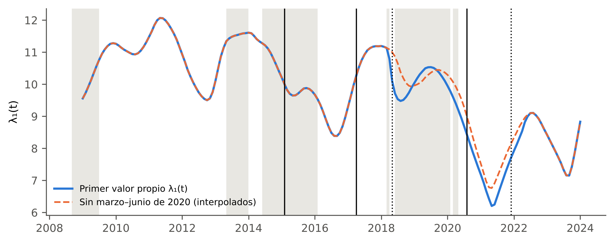{width=100%}

::: {custom-style="Nota"}
*Nota.* Ventana de 48 meses con pesos gaussianos ($\nu=3$). Líneas verticales: cortes de la especificación de trabajo; en punteado, los cortes relacionados con la entrada o salida de los meses atípicos de 2020. Línea discontinua: trayectoria con los meses de marzo a junio de 2020 interpolados. En gris, los episodios. Elaboración propia con datos del BCRP.
:::

::: {custom-style="Rotulo"}
**Figura 20**\
*Valores propios del EPCA frente al umbral del análisis paralelo*
:::

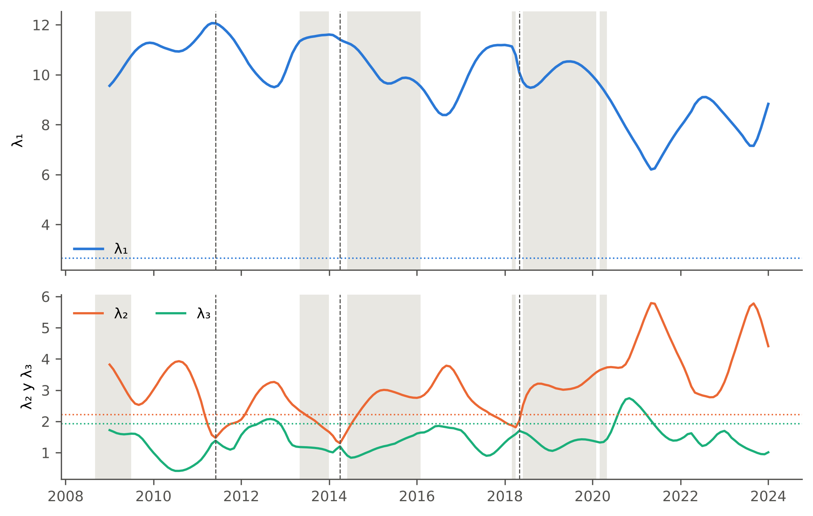{width=100%}

::: {custom-style="Nota"}
*Nota.* Líneas punteadas: percentil 95 del análisis paralelo con el tamaño efectivo de la ventana (37 meses), 2,65, 2,22 y 1,93 para los ejes 1 a 3. Líneas discontinuas verticales: ventanas en que los ejes 2 y 3 intercambian su orden. En gris, los episodios. Elaboración propia con datos del BCRP.
:::

La regla de signo de la rutina de referencia ya alinea cada eje con el de la ventana anterior, de modo que las discontinuidades de las correlaciones evolutivas no se deben a reflexiones del signo. Se deben a que, en las tres ventanas señaladas, el segundo y el tercer eje intercambian su orden, de modo que el antiguo segundo eje pasa a ser el tercero. Con el seguimiento de los ejes por congruencia (sección 3.2.3), la congruencia entre ventanas consecutivas es mayor que 0,9 en todas las ventanas salvo cinco, y la menor (0,57) corresponde al tercer eje en la ventana de julio de 2014. En junio de 2021 el primer eje rota hacia el segundo (congruencia de 0,75), porque sus valores propios son casi iguales. En ese caso los ejes no se intercambian, sino que giran dentro del plano 1–2.

La Figura 21 muestra la correlación de cada serie con los dos primeros ejes seguidos en cada ventana, y la Figura 22, las mismas correlaciones serie por serie. Hasta 2014, el crédito, la liquidez, los precios y la actividad tienen correlaciones mayores que 0,8 con el primer eje. Entre 2015 y 2020, el PBI y la demanda interna se desacoplan del crédito. Desde 2020, el crédito empresarial, M1 y M3 dejan de correlacionarse con el primer eje, mientras el crédito hipotecario, el de consumo y los precios se mantienen. En las ventanas de 2021, como el primer y el segundo eje no están determinados por separado, solo es interpretable el plano 1–2.

::: {custom-style="Rotulo"}
**Figura 21**\
*Correlaciones evolutivas de las series con los dos primeros ejes seguidos*
:::

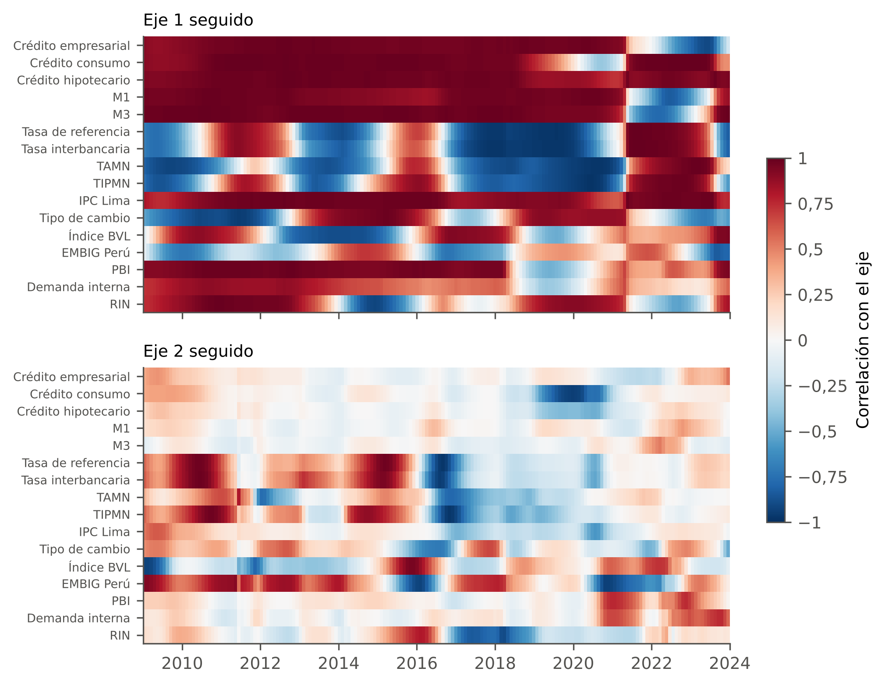{width=100%}

::: {custom-style="Nota"}
*Nota.* Ventana de 48 meses con pesos gaussianos ($\nu=3$). Signo alineado con la ventana anterior y ejes emparejados por congruencia. Elaboración propia con datos del BCRP.
:::

::: {custom-style="Rotulo"}
**Figura 22**\
*Correlación de cada serie con los dos primeros ejes seguidos, por ventana*
:::

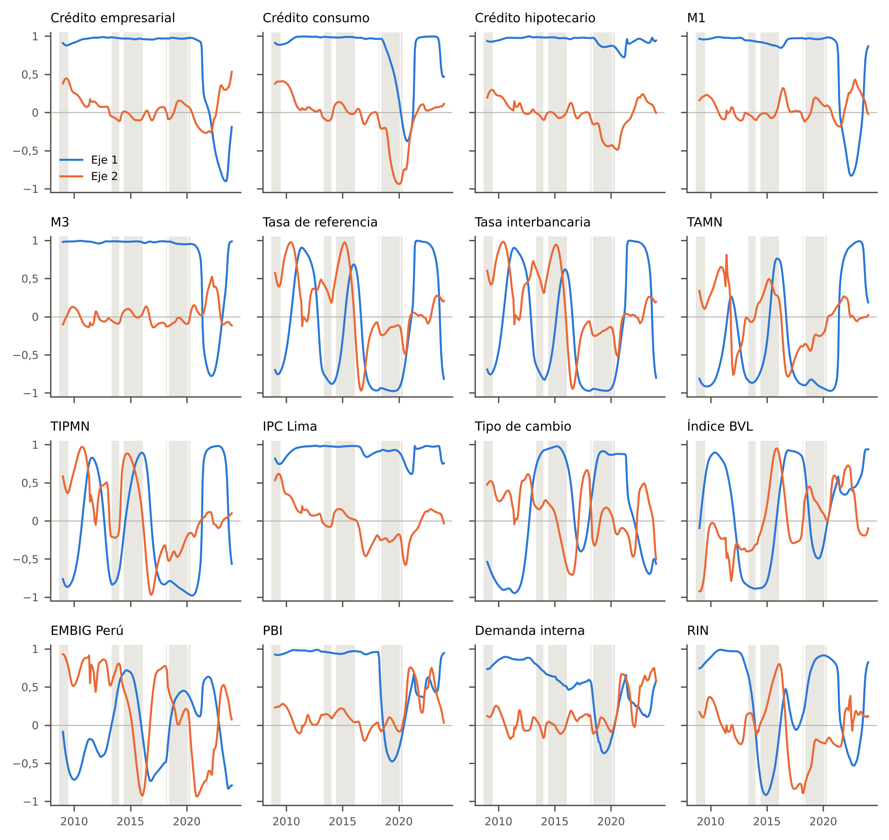{width=100%}

::: {custom-style="Nota"}
*Nota.* Igual que la Figura 21. En gris, los episodios. Elaboración propia con datos del BCRP.
:::

El coeficiente RV entre las correlaciones de las series con los ejes de ventanas adyacentes sin meses comunes alcanza su mínimo (0,09) en la frontera de junio de 2020 (Figura 23). Las series con estructura constante producen mínimos iguales o menores en el 37 % de las réplicas ($\hat p=0{,}37$). El cambio de 2020 es el mayor del período, pero no se distingue de las variaciones que produciría una estructura constante con la autocorrelación de los datos.

::: {custom-style="Rotulo"}
**Figura 23**\
*Coeficiente RV entre ventanas adyacentes sin meses comunes frente a series con estructura constante*
:::

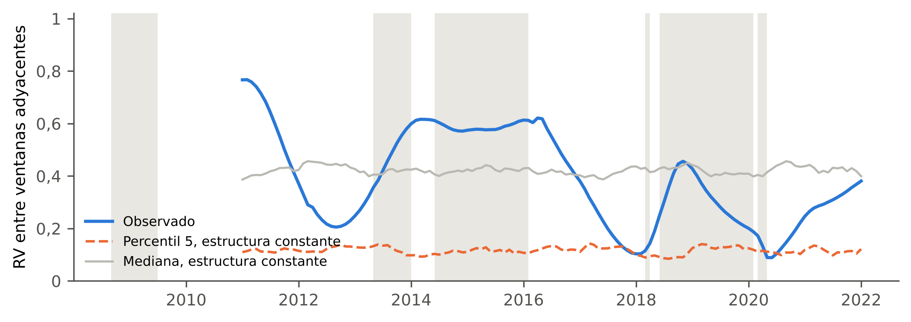{width=100%}

::: {custom-style="Nota"}
*Nota.* Correlaciones de las series con los dos primeros ejes; cada valor se asigna al primer mes de la segunda ventana. 200 réplicas. Elaboración propia con datos del BCRP.
:::

### 4.2.2 Clasificación factorial jerárquica evolutiva

El índice de la raíz fluctúa entre 1 y 3,6 hasta 2018 y sube de forma sostenida entre 2019 y 2021, hasta 4,9. Después de la pandemia los grupos de series están más diferenciados, lo que concuerda con la caída del primer valor propio. El número de clases por encima del corte en 0,7 varía entre 2 y 6, con 4 como valor más frecuente (Figura 24). En la ventana asignada a julio de 2009 hay tres clases, formadas por las cuatro tasas, por el tipo de cambio, la bolsa y el EMBIG, y por los saldos, los precios y la actividad. En la de julio de 2014 hay dos, las tasas de corto plazo y todas las demás. En la de julio de 2020, cuatro, con el crédito de consumo aislado y la bolsa y el EMBIG unidos al PBI y a la demanda interna. En la de julio de 2023, cinco.

::: {custom-style="Rotulo"}
**Figura 24**\
*Dendrogramas de la HFC evolutiva en cuatro ventanas*
:::

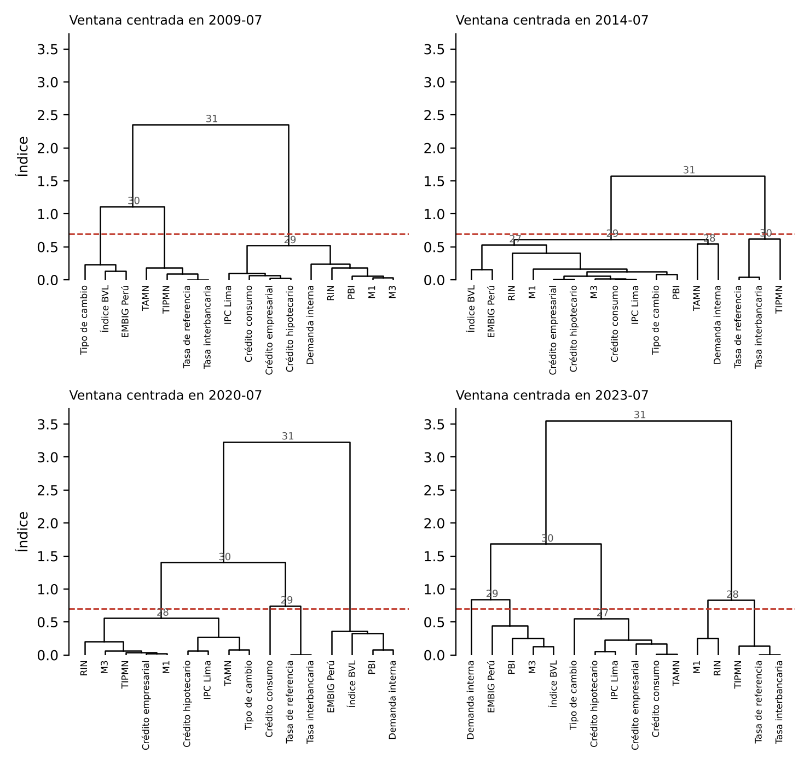{width=100%}

::: {custom-style="Nota"}
*Nota.* Ventanas de 48 meses con pesos gaussianos, asignadas a las fechas indicadas. Elaboración propia con datos del BCRP.
:::

La Figura 25 sigue la clase C1, la que contiene al crédito hipotecario, en las 181 ventanas. El crédito hipotecario y el índice de precios están juntos en todas. Hasta mediados de 2013, C1 reúne nueve de las once series de la clase de escala de la HFC global, que son los tres créditos, M1, M3, los precios, el PBI, la demanda interna y las reservas; el tipo de cambio se suma en algunas ventanas. Entre mediados de 2013 y setiembre de 2018 se le suman en parte de las ventanas las tasas activa y pasiva, el tipo de cambio y la bolsa, mientras la demanda interna y las reservas salen de ella con frecuencia. Entre octubre de 2018 y agosto de 2019, el crédito empresarial, M1 y M3 la abandonan, y la clase queda formada por el crédito de consumo, el hipotecario, los precios y las reservas. En las ventanas de setiembre de 2019 a agosto de 2020 llega a reunir 11 series, incluidas las tasas, pero no el crédito de consumo. Entre setiembre de 2020 y abril de 2021 se reduce a tres series, el crédito hipotecario, los precios y el tipo de cambio. Desde mayo de 2021 agrupa, en la mayoría de las ventanas, el crédito de consumo, el hipotecario, los precios y las tasas de interés, y deja fuera al crédito empresarial y a los agregados monetarios. El número de clases es 4 en 81 ventanas, 3 en 69, 5 en 22, 2 en 5 y 6 en 4.

::: {custom-style="Rotulo"}
**Figura 25**\
*Composición de la clase C1 de la HFC evolutiva por ventana*
:::

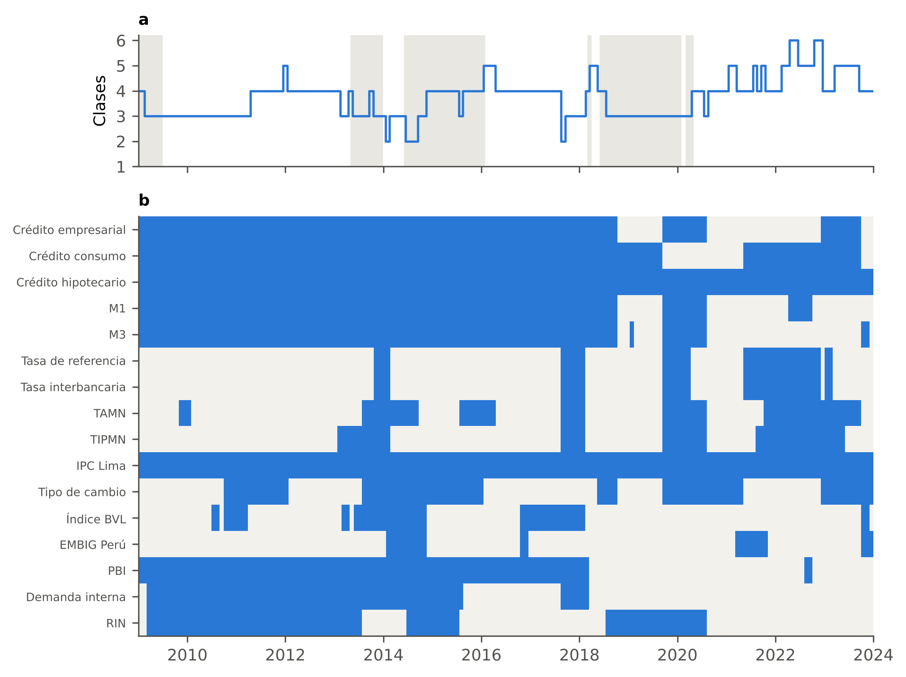{width=100%}

::: {custom-style="Nota"}
*Nota.* (a) Número de clases que deja el corte en 0,7. (b) En azul, las series que pertenecen a la clase del crédito hipotecario en cada ventana. Ventanas de 48 meses con pesos gaussianos. En gris, los episodios. Elaboración propia con datos del BCRP.
:::

## 4.3 Segmentación temporal (OE3)

### 4.3.1 Contraste de la partición

Ninguna partición supera a las series de referencia (Tabla 11, Figura 26). En la trayectoria de estructura, el mejor candidato son dos tramos con un corte en mayo de 2020, cuya reducción (0,627) queda apenas por debajo del percentil 95 simulado (0,639; $\hat p=0{,}065$); los tramos adicionales tienen $\hat p$ entre 0,13 y 0,94. En la trayectoria de posición, series que solo comparten su tendencia producen reducciones mayores que las observadas para todo $K$. Con la regla de la sección 3.2.4, $K^*=1$ en ambas trayectorias. Con las series en niveles, los regímenes no se distinguen de los que producirían la tendencia y la dependencia temporal de las series.

::: {custom-style="Rotulo"}
**Tabla 11**\
*Reducción relativa de la suma de cuadrados frente a las series de referencia simuladas*
:::

| Trayectoria | K | Δ observado | Percentil 95 simulado | p̂ |
|---|---|---|---|---|
| Estructura | 2 | 0,627 | 0,639 | 0,065 |
| Estructura | 3 | 0,269 | 0,560 | 0,622 |
| Estructura | 4 | 0,139 | 0,464 | 0,915 |
| Estructura | 5 | 0,113 | 0,361 | 0,935 |
| Estructura | 6 | 0,125 | 0,399 | 0,900 |
| Estructura | 7 | 0,099 | 0,289 | 0,846 |
| Estructura | 8 | 0,159 | 0,237 | 0,284 |
| Estructura | 9 | 0,117 | 0,209 | 0,303 |
| Estructura | 10 | 0,122 | 0,151 | 0,129 |
| Posición | 2 | 0,531 | 0,702 | 0,989 |
| Posición | 3 | 0,362 | 0,584 | 0,948 |
| Posición | 4 | 0,335 | 0,504 | 0,756 |
| Posición | 5 | 0,336 | 0,412 | 0,302 |
| Posición | 6 | 0,199 | 0,356 | 0,929 |
| Posición | 7 | 0,211 | 0,304 | 0,651 |
| Posición | 8 | 0,186 | 0,268 | 0,657 |
| Posición | 9 | 0,177 | 0,237 | 0,513 |
| Posición | 10 | 0,121 | 0,210 | 0,928 |

::: {custom-style="Nota"}
*Nota.* Estructura: 200 réplicas de estructura constante. Posición: 1000 réplicas de series con tendencia (indeterminadas como DS; la versión con indeterminadas como TS da resultados similares). Elaboración propia con datos del BCRP.
:::

::: {custom-style="Rotulo"}
**Figura 26**\
*Reducción relativa observada y percentil 95 simulado, por número de tramos*
:::

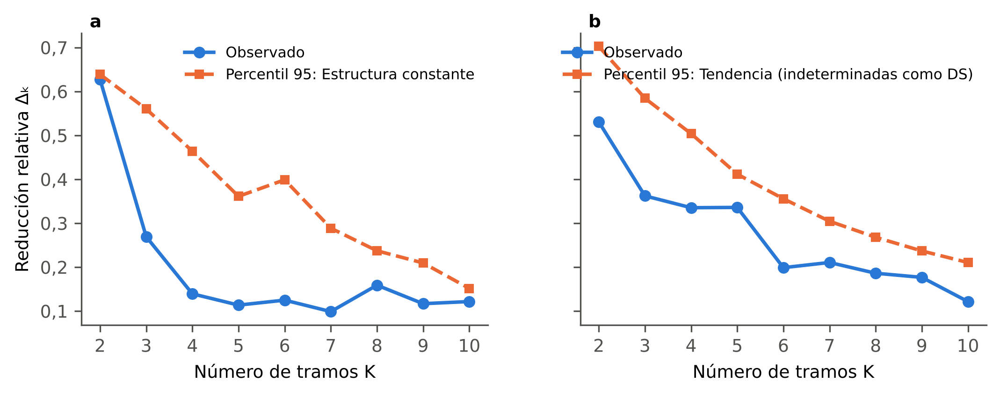{width=100%}

::: {custom-style="Nota"}
*Nota.* (a) Trayectoria de estructura. (b) Trayectoria de posición. Elaboración propia con datos del BCRP.
:::

La Tabla 12 resume los cortes con las reglas alternativas. La partición depende de la regla. En la trayectoria de estructura, la regla del 10 % da seis tramos; la del 12 %, cuatro; la del 15 %, tres, y la de mayor caída, dos. El único corte presente en todas es el de mediados de 2020.

::: {custom-style="Rotulo"}
**Tabla 12**\
*Cortes según la regla y la especificación*
:::

| Trayectoria | Variante | K | Cortes |
|---|---|---|---|
| Estructura | referencia simulada (principal) | 1 | — |
| Estructura | umbral 10 % | 6 | 2015-02, 2017-04, 2018-05, 2020-08, 2021-12 |
| Estructura | umbral 12 % | 4 | 2015-02, 2017-03, 2020-06 |
| Estructura | umbral 15 % | 3 | 2014-12, 2020-07 |
| Estructura | mayor caída | 2 | 2020-05 |
| Posición | referencia simulada (principal) | 1 | — |
| Posición | umbral 10 % | 2 | 2016-12 |
| Posición | umbral 12 % | 2 | 2016-12 |
| Posición | umbral 15 % | 9 | 2008-07, 2009-08, 2011-01, 2013-10, 2017-09, 2020-03, 2022-05, 2024-05 |
| Posición | mayor caída | 2 | 2016-12 |
| Posición | media causal | 1 | — |
| Posición | estandarizada | 1 | — |
| Posición | d = 2 | 1 | — |
| Posición | d = 4 | 1 | — |
| Estructura | w = 36 | 1 | — |
| Estructura | w = 60 | 1 | — |

::: {custom-style="Nota"}
*Nota.* Trayectoria de posición principal: coordenadas sin estandarizar, media móvil centrada. Elaboración propia con datos del BCRP.
:::

### 4.3.2 Regímenes tentativos

Con la especificación de trabajo de la sección 3.2.4 se obtienen seis regímenes de posición, con cortes en diciembre de 2008, marzo de 2010, abril de 2014, junio de 2020 y noviembre de 2022 (Figura 27), y seis de estructura, con cortes en febrero de 2015, abril de 2017, mayo de 2018, agosto de 2020 y diciembre de 2021 (Figura 19). En la trayectoria de posición, la regla del 10 % no se cumple para ningún $K$, y el número de tramos corresponde a la mayor caída de la reducción.

::: {custom-style="Rotulo"}
**Figura 27**\
*Coordenadas suavizadas y cortes de los regímenes tentativos de posición*
:::

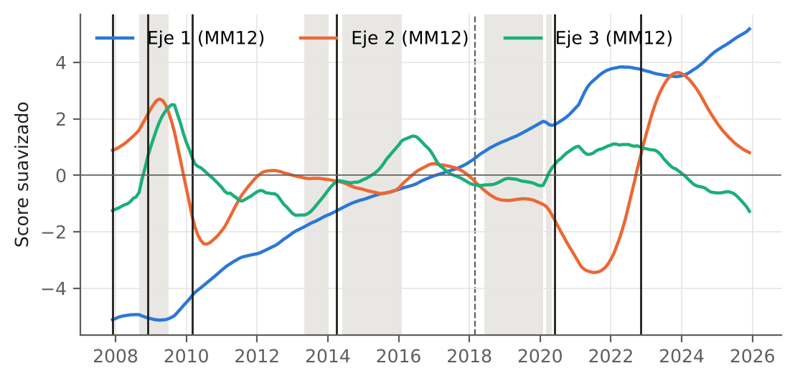{width=100%}

::: {custom-style="Nota"}
*Nota.* Media móvil de los 12 meses anteriores; en negro, los cortes; en gris, los episodios. Elaboración propia con datos del BCRP.
:::

Los cinco cortes de posición se reproducen a tres meses o menos en el 99 % o más de las réplicas (Tabla 13). En la trayectoria de estructura, los cortes de mayo de 2018 (70 %) y de diciembre de 2021 (61 %) son los menos precisos, y ambos coinciden con la entrada y la salida de la ventana de los meses atípicos de 2020 (marzo a junio). Si esos meses se interpolan, la trayectoria cambia en ese tramo (Figura 19). Los meses atípicos identificados son octubre de 2008 y marzo a junio de 2020.

::: {custom-style="Rotulo"}
**Tabla 13**\
*Precisión de la ubicación de los cortes tentativos*
:::

| Trayectoria | Corte | Frecuencia ±3 meses | Intervalo p5–p95 | Tramo previo (meses) | Tramo siguiente (meses) |
|---|---|---|---|---|---|
| Posición | 2008-12 | 1,00 | 2008-12 a 2008-12 | 12 | 15 |
| Posición | 2010-03 | 1,00 | 2010-03 a 2010-03 | 15 | 49 |
| Posición | 2014-04 | 0,99 | 2014-03 a 2014-04 | 49 | 74 |
| Posición | 2020-06 | 1,00 | 2020-06 a 2020-06 | 74 | 29 |
| Posición | 2022-11 | 1,00 | 2022-11 a 2022-11 | 29 | 38 |
| Estructura | 2015-02 | 0,84 | 2014-07 a 2015-02 | 73 | 26 |
| Estructura | 2017-04 | 0,96 | 2017-02 a 2017-04 | 26 | 13 |
| Estructura | 2018-05 | 0,70 | 2017-02 a 2018-11 | 13 | 27 |
| Estructura | 2020-08 | 1,00 | 2020-08 a 2020-08 | 27 | 16 |
| Estructura | 2021-12 | 0,61 | 2020-08 a 2022-10 | 16 | 26 |

::: {custom-style="Nota"}
*Nota.* 200 réplicas con los residuos de cada tramo remuestreados en bloques de seis meses. La medida es condicional en la existencia de los cortes. Elaboración propia con datos del BCRP.
:::

## 4.4 Caracterización de los regímenes (OE4)

Las Tablas 14 y 15 caracterizan los regímenes tentativos, y la Figura 28 muestra el crecimiento real del crédito con los umbrales de la regla de fases (mediana del período $m=6{,}2$ %, desviación estándar $s=8{,}1$ puntos).

::: {custom-style="Rotulo"}
**Tabla 14**\
*Perfil y fase de los regímenes tentativos de posición*
:::

| N.º | Período | Meses | Crédito real (%) | PBI (%) | Inflación (%) | Tasa BCRP (%) | EMBIG (pb) | Fase (c = 1; c = 0,5) |
|---|---|---|---|---|---|---|---|---|
| 1 | 2007-12 a 2008-11 | 12 | 27,6 | 9,4 | 5,7 | 5,17 → 6,50 | 244 | expansión; expansión |
| 2 | 2008-12 a 2010-02 | 15 | 13,8 | 1,9 | 2,9 | 6,42 → 1,25 | 294 | transición; expansión |
| 3 | 2010-03 a 2014-03 | 49 | 14,0 | 6,6 | 3,0 | 1,33 → 4,00 | 169 | transición; expansión |
| 4 | 2014-04 a 2020-05 | 74 | 5,3 | 1,7 | 2,7 | 4,00 → 0,58 | 166 | transición; transición |
| 5 | 2020-06 a 2022-10 | 29 | 0,2 | 6,1 | 4,8 | 0,25 → 6,75 | 179 | transición; contracción |
| 6 | 2022-11 a 2025-12 | 38 | −2,0 | 2,2 | 3,7 | 7,50 → 4,25 | 165 | contracción; contracción |

::: {custom-style="Nota"}
*Nota.* Crédito real: mediana del crecimiento interanual del crédito total deflactado por el índice de precios. PBI e inflación: promedio del crecimiento interanual. Tasa BCRP: promedio del primer y del último trimestre. EMBIG: promedio. El régimen 1 tiene un mes sin crecimiento interanual. Elaboración propia con datos del BCRP.
:::

::: {custom-style="Rotulo"}
**Tabla 15**\
*Perfil y fase de los regímenes tentativos de estructura*
:::

| N.º | Período | Meses | Crédito real (%) | PBI (%) | Inflación (%) | Tasa BCRP (%) | EMBIG (pb) | Fase (c = 1; c = 0,5) |
|---|---|---|---|---|---|---|---|---|
| 1 | 2009-01 a 2015-01 | 73 | 13,1 | 5,0 | 2,9 | 6,25 → 3,42 | 189 | transición; expansión |
| 2 | 2015-02 a 2017-03 | 26 | 3,7 | 3,4 | 3,6 | 3,25 → 4,25 | 194 | transición; transición |
| 3 | 2017-04 a 2018-04 | 13 | 3,4 | 3,3 | 2,1 | 4,08 → 2,83 | 141 | transición; transición |
| 4 | 2018-05 a 2020-07 | 27 | 6,2 | −2,1 | 1,9 | 2,75 → 0,25 | 152 | transición; transición |
| 5 | 2020-08 a 2021-11 | 16 | 6,3 | 10,8 | 3,2 | 0,25 → 1,50 | 160 | transición; transición |
| 6 | 2021-12 a 2024-01 | 26 | −2,8 | 1,3 | 6,9 | 3,00 → 6,75 | 195 | contracción; contracción |

::: {custom-style="Nota"}
*Nota.* Igual que la Tabla 14. Elaboración propia con datos del BCRP.
:::

::: {custom-style="Rotulo"}
**Figura 28**\
*Crecimiento interanual real del crédito, regímenes tentativos de posición y umbrales de la regla de fases*
:::

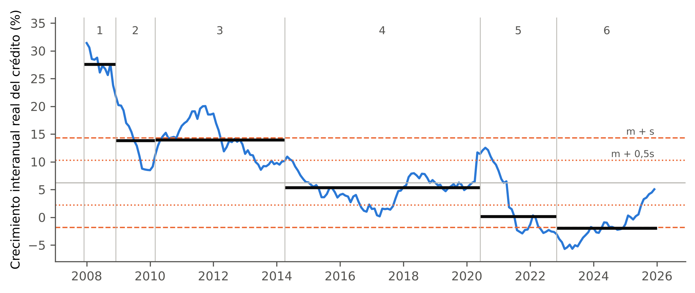{width=100%}

::: {custom-style="Nota"}
*Nota.* Líneas horizontales negras: mediana del crecimiento en cada régimen. Líneas discontinuas: $m\pm s$; punteadas: $m\pm 0{,}5s$. Elaboración propia con datos del BCRP.
:::

Los regímenes de posición siguen una secuencia económica coherente. El primero es el auge previo a la crisis global, con el crédito real creciendo 27,6 %. El segundo corresponde a la crisis y a la respuesta monetaria, con la tasa de referencia bajando de 6,5 % a 1,25 %. Le sigue una expansión, con el crédito real al 14 % y el PBI al 6,6 %, y luego una desaceleración entre 2014 y 2020, con el crédito real al 5,3 %. El quinto régimen es la reactivación posterior a la pandemia, en la que el crédito real se estanca (0,2 %) mientras la tasa sube de 0,25 % a 6,75 %, y el último es de contracción real del crédito (−2,0 %). Con $c=1$, la regla de fases clasifica como transición cuatro de los seis regímenes; con $c=0{,}5$, la secuencia es expansión (2007–2014), transición (2014–2020) y contracción (2020–2025). El régimen de la crisis (2008-12 a 2010-02) se clasifica como expansión con $c=0{,}5$ porque el crédito real aún crecía 13,8 %, aunque su crecimiento cayó 12,7 puntos dentro del régimen; la regla mide el ritmo del crecimiento y no su dirección. Con el crédito real, el régimen de 2020–2022 aparece estancado, porque su crecimiento nominal de 7,5 % correspondía a la inflación.

Tres de los cinco cortes de posición están a tres meses o menos de un episodio: diciembre de 2008, de la crisis global; abril de 2014, del colapso de las materias primas, y junio de 2020, de la pandemia. Por azar se esperarían 1,4 coincidencias, y la probabilidad de obtener tres o más es de 0,12. En la trayectoria de estructura coincide uno de los cinco cortes, menos de lo esperado por azar (Tabla 16).

::: {custom-style="Rotulo"}
**Tabla 16**\
*Compatibilidad de los cortes tentativos con los episodios frente a la esperada por azar*
:::

| Trayectoria | Tolerancia (meses) | Compatibles | Esperados por azar | Probabilidad por azar | Distancias (meses) |
|---|---|---|---|---|---|
| Posición | 3 | 3 de 5 | 1,4 | 0,12 | 3, 9, 2, 2, 31 |
| Posición | 6 | 3 de 5 | 2,2 | 0,37 | 3, 9, 2, 2, 31 |
| Estructura | 3 | 1 de 5 | 1,4 | 0,86 | 8, 11, 1, 4, 20 |
| Estructura | 6 | 2 de 5 | 2,2 | 0,78 | 8, 11, 1, 4, 20 |

::: {custom-style="Nota"}
*Nota.* 10 000 ubicaciones aleatorias de los cortes con tramos de al menos 12 meses. Distancia al inicio o al fin del episodio más cercano. Elaboración propia con datos del BCRP.
:::

## 4.5 Representaciones no lineales (OE5)

Los autoencoders se evaluaron en una corrida exploratoria con una versión anterior de la base, de 17 series (incluida M2), y deben repetirse con las 16 series y la especificación de la sección 3.2.7. En esa corrida, el autoencoder reconstruye peor que el PCA fuera de muestra, con un error 13,6 % mayor con tres dimensiones latentes y 40,7 % mayor con cinco (Figura 29). La trayectoria latente del autoencoder LSTM reproduce la de los dos primeros ejes del PCA sin una dinámica distinta. En la evaluación anual sucesiva, el error de reconstrucción mediano del PCA en los meses de la pandemia es unas siete veces el de los meses sin episodio (Figura 30); los modelos señalan la mitad de los meses de la pandemia y ninguno del *taper tantrum*.

::: {custom-style="Rotulo"}
**Figura 29**\
*Error de reconstrucción fuera de muestra del PCA y de dos autoencoders, por dimensión latente*
:::

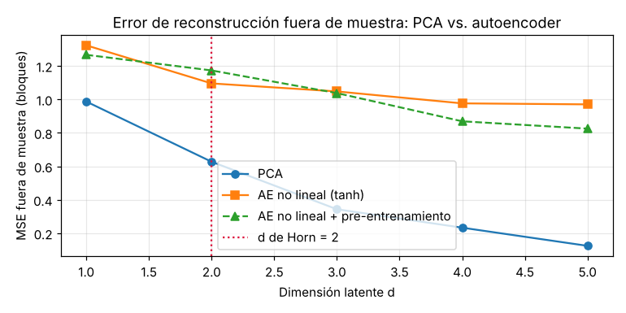{width=60%}

::: {custom-style="Nota"}
*Nota.* Validación por bloques. Corrida exploratoria con 17 series. Elaboración propia con datos del BCRP.
:::

::: {custom-style="Rotulo"}
**Figura 30**\
*Error de reconstrucción mensual del PCA y del autoencoder*
:::

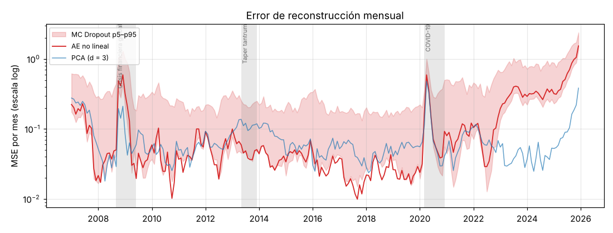{width=75%}

::: {custom-style="Nota"}
*Nota.* Corrida exploratoria con 17 series. Elaboración propia con datos del BCRP.
:::

## 4.6 Especificaciones evaluadas y robustez

Con las series en logaritmos, los tres ejes del PCA son prácticamente los mismos que en niveles (congruencias de 0,999, 0,996 y 0,992); con primeras diferencias, el primer eje baja a 23,5 % de la inercia y su congruencia con el de niveles es 0,61. Para la segmentación de la trayectoria de posición se evaluaron, además de las especificaciones de la Tabla 12, dos formulaciones alternativas que conservan las series en niveles, la partición por tendencias segmentadas, con una recta por tramo, y la partición de las desviaciones de las coordenadas respecto de su tendencia. La primera da su menor $\hat p$ con ocho tramos (0,002–0,004), pero los tramos de 2 a 5 no son significativos, la significación depende de la regla de elección de $K$ y dos de sus tramos, de 14 y 15 meses, corresponden a la caída y recuperación de 2008–2009 y de 2020–2021; la segunda no supera las series de referencia. Ambas están en estudio y no se emplean en este informe.

## 4.7 Discusión

### 4.7.1 Organización de los indicadores

El PCA y la HFC organizan los indicadores en los mismos tres bloques: escala del sistema, condiciones monetarias y riesgo de mercado. Cada bloque puede asociarse a un mecanismo distinto, que son el crecimiento y la profundización del sistema financiero, la política monetaria y la percepción de riesgo. Los bloques equivalen a los grupos de salud económica y financiera, tasas de interés y riesgo de mercado de @camiz_cerda_atoche_2026, obtenidos con otras series y otro período, y a los componentes de @atoche_murrieta_2022. Las diferencias están en la composición. La TAMN entra aquí en el bloque de escala por su caída secular, y el tipo de cambio, que el antecedente excluye por su baja correlación, se une a ese bloque en último lugar.

### 4.7.2 Efecto de la tendencia común

El bloque de escala no se distingue de series independientes con tendencia. Además, la partición en tres clases se reproduce en pocas réplicas cuando se remuestrean los incrementos, de modo que la organización en bloques depende de la trayectoria particular que siguieron las series. En niveles, la asociación entre las series refleja en buena medida su crecimiento común, lo que extiende al análisis factorial la advertencia de @granger_newbold_1974 sobre las regresiones entre series integradas. La señal común que resiste el contraste es la monetaria. Los antecedentes peruanos no realizan este contraste.

### 4.7.3 Cambio de estructura en 2020

La intensidad del movimiento común cae desde 2020, y el mayor cambio entre ventanas ocurre en la frontera de junio de 2020. La HFC evolutiva muestra que después de 2020 los bloques se fragmentan: desde mayo de 2021, la clase del crédito hipotecario deja fuera, en la mayoría de las ventanas, al crédito empresarial y a los agregados monetarios, e incluye las tasas de interés. Sin embargo, ni la partición del primer valor propio ($\hat p=0{,}065$) ni el mínimo del RV ($\hat p=0{,}37$) se distinguen de lo que produce una estructura constante. Con unas diez observaciones independientes, el contraste puede carecer de potencia para detectar un cambio de este tamaño.

Las discontinuidades que se observaban en las correlaciones evolutivas del segundo eje no se debían al signo, que la rutina de referencia ya alinea entre ventanas, sino al intercambio del segundo y el tercer eje cuando sus valores propios se cruzan. Con los ejes seguidos por congruencia, las correlaciones cambian de forma gradual, salvo en 2021, cuando el primer y el segundo valor propio se igualan y el plano 1–2 gira.

### 4.7.4 Regímenes tentativos

Los regímenes de posición describen una secuencia económica reconocible, y tres de sus cortes coinciden con episodios documentados, más de lo esperable por azar, aunque sin significación. La misma especificación, aplicada a series que solo comparten su tendencia, produce particiones igual de marcadas. Por eso, los regímenes describen por ahora la trayectoria, y no demuestran cambios de régimen del ciclo financiero. Para separar ambas cosas hace falta una segmentación que distinga la velocidad del crecimiento de su nivel acumulado, y ese es el objeto de las alternativas en estudio.

### 4.7.5 Representaciones no lineales

Con unas diez observaciones efectivas, el autoencoder ajusta particularidades de la muestra que no se repiten fuera de ella, una exigencia de datos que @tuhin_et_al_2025 ya advierten. Su aporte está en señalar meses atípicos, como los de la pandemia.

### 4.7.6 Limitaciones

La muestra de 19 años es corta para un ciclo de 8 a 30 años, y la autocorrelación limita la potencia de todos los contrastes. Los regímenes dependen de la regla con que se elige $K$. La HFC evolutiva está pendiente de verificación contra el programa original y los autoencoders deben repetirse con la base vigente. Por último, el crecimiento del crédito que usa la regla de fases incluye el efecto del tipo de cambio sobre el crédito en moneda extranjera.

# CAPÍTULO V. CONCLUSIONES Y RECOMENDACIONES

La estructura factorial y su evolución están establecidas con las series en niveles; la identificación de los regímenes, en cambio, no supera todavía el contraste con las series de referencia simuladas, y su validación estadística está en estudio. Los regímenes que se caracterizan en este informe se presentan, por ello, como una descripción tentativa.

## 5.1 Conclusiones

1. **Estructura factorial global (OE1).** Los 16 indicadores se organizan en tres bloques (escala del sistema financiero, condiciones monetarias y riesgo de mercado), que el análisis en componentes principales y la clasificación factorial jerárquica identifican por caminos distintos y que equivalen a los grupos reportados por los antecedentes peruanos. En niveles, el bloque de escala no se distingue de series independientes con tendencia, y la partición en bloques es sensible a la trayectoria particular de las series; el único co-movimiento que supera el contraste es el de las tasas de interés.

2. **Evolución de la estructura (OE2).** La intensidad del movimiento común es alta y relativamente estable hasta 2019 y cae desde 2020, cuando los bloques se fragmentan y el crédito empresarial y los agregados monetarios dejan de moverse con el resto. El crédito hipotecario y el índice de precios permanecen en la misma clase en todas las ventanas, y desde mayo de 2021 esa clase incluye, en la mayoría de las ventanas, las tasas de interés. Las discontinuidades de las correlaciones evolutivas se deben al intercambio del segundo y el tercer eje cuando sus valores propios se cruzan, y no al signo de los ejes. El mayor cambio de estructura del período ocurre alrededor de junio de 2020, pero no se distingue de las variaciones que produciría una estructura constante con la autocorrelación de los datos.

3. **Segmentación temporal (OE3).** Con las series en niveles, ninguna partición de las trayectorias de estructura y de posición supera a las series de referencia simuladas. El corte de 2020 en la trayectoria de estructura queda en el límite ($\hat p=0{,}065$), y los regímenes de posición no se distinguen de los que produce la tendencia común. El contraste con series de referencia simuladas muestra que la partición de una trayectoria con tendencia produce regímenes aparentes, y es por ello un componente necesario del modelo.

4. **Caracterización de los regímenes (OE4).** Con la especificación de trabajo, los seis regímenes de posición describen una secuencia económica coherente (auge previo a la crisis, crisis, expansión, desaceleración, reactivación con estancamiento del crédito real y contracción real del crédito), y tres de sus cinco cortes coinciden con episodios documentados, más de lo esperable por azar, aunque sin significación. La regla de fases basada en el crecimiento real del crédito produce una secuencia con sentido económico con $c=0{,}5$, y con $c=1$ clasifica la mayoría de los regímenes como transición.

5. **Representaciones no lineales (OE5).** En la corrida exploratoria, el autoencoder no supera al PCA en el error de reconstrucción fuera de muestra, y su principal aporte es señalar los meses atípicos de la pandemia. La comparación definitiva requiere repetir los modelos con la base vigente.

## 5.2 Recomendaciones

El proceso de análisis está en desarrollo, y los resultados de este informe son parciales. La representación factorial global y su evolución están establecidas, pero la segmentación en regímenes todavía no supera el contraste con las series de referencia simuladas, y la comparación con las representaciones no lineales se hizo con una versión anterior de la base.

Lo que aún falta mejorar es lo siguiente:

1. **Validación de la segmentación.** Completar la partición por tendencias segmentadas, que distingue la velocidad del crecimiento de su nivel acumulado sin transformar las series, con un contraste global sobre el número de tramos, tramos de al menos 24 meses, el análisis de la influencia de los choques transitorios de 2008–2009 y 2020, la sensibilidad al largo de los bloques del remuestreo y la descomposición del resultado por eje.
2. **Potencia del contraste de cambio de estructura.** Simular series con un cambio de estructura de tamaño conocido para establecer si el cambio de 2020 no se detecta por falta de información o porque la estructura es estable.
3. **Representaciones no lineales.** Repetir el autoencoder y el autoencoder LSTM con las 16 series y la especificación de la sección 3.2.7, y documentar los hiperparámetros con los que se obtienen los resultados.
4. **HFC evolutiva.** Verificar la implementación contra el programa original del asesor.
5. **Datos.** Obtener el crédito de 2006 y el crédito a tipo de cambio constante, para completar la regla de fases y separar el efecto del tipo de cambio; extender la muestra hacia 1999, con verificación serie por serie, para aumentar la información independiente, y buscar una serie mensual de precios inmobiliarios o un sustituto documentado.
6. **Regla de fases.** Fijar con el asesor el valor del parámetro $c$ antes de recalcular.

Algunas variantes que podrían ayudar son las siguientes:

- *En los componentes.* Aplicar el análisis evolutivo a cada bloque de indicadores por separado, como proponen @camiz_cerda_atoche_2026; elegir el ancho de la ventana con un criterio de estabilidad, como el coeficiente RV entre ventanas sucesivas; seguir el plano 1–2 completo, y no cada eje, en los períodos en que los dos primeros valores propios son casi iguales, como en 2021, y segmentar una trayectoria que combine los tres primeros valores propios con las correlaciones evolutivas, en lugar del primer valor propio solo.
- *En los autoencoders.* Preentrenar la red por capas [@hinton_salakhutdinov_2006] para estabilizar la estimación con pocas observaciones; aumentar los datos de entrenamiento con réplicas del remuestreo por bloques, que conservan la dependencia temporal, y usar el error de reconstrucción como insumo del diagnóstico de meses atípicos de la segmentación.

# REFERENCIAS

::: {#refs}
:::

# FUENTES DOCUMENTALES DE LOS EPISODIOS

Documentos oficiales y comunicados de los que se toman las fechas de los episodios de la Tabla 3. No forman parte de la literatura científica de la investigación.

::: {custom-style="Bibliography"}
Bernanke, B. S. (2013, mayo 22). *The economic outlook* [Testimonio ante el Joint Economic Committee del Congreso de los Estados Unidos]. Bank for International Settlements. https://www.bis.org/speeches/20130523-economic-outlook
:::

::: {custom-style="Bibliography"}
Board of Governors of the Federal Reserve System. (2013, diciembre 18). *Federal Reserve issues FOMC statement* [Comunicado de prensa]. https://www.federalreserve.gov/newsevents/pressreleases/monetary20131218a.htm
:::

::: {custom-style="Bibliography"}
Congreso de la República del Perú. (2018, marzo 23). *Resolución Legislativa del Congreso 008-2017-2018-CR, por la que se acepta la renuncia del ciudadano Pedro Pablo Kuczynski Godard al cargo de Presidente de la República y se declara la vacancia de la Presidencia de la República*. https://comunicaciones.congreso.gob.pe/noticias/resolucion-legislativa-del-congreso-008-2017-2018-cr-por-la-que-se-acepta-la-renuncia-del-ciudadano-pedro-pablo-kuczynski-godard-al-cargo-de-presidente-de-la-republica-y-se-declara-la-vacancia-de-la
:::

::: {custom-style="Bibliography"}
International Monetary Fund, Research Department, Commodities Unit. (2016). *Commodity market monthly* [Informe mensual]. International Monetary Fund. https://www.imf.org/external/np/res/commod/pdf/monthly/031516.pdf
:::

::: {custom-style="Bibliography"}
Lehman Brothers Holdings Inc. (2008, septiembre 15). *Lehman Brothers Holdings Inc. announces it intends to file Chapter 11 bankruptcy petition* [Comunicado de prensa, anexo 99.1 del formulario 8-K]. U.S. Securities and Exchange Commission. https://www.sec.gov/Archives/edgar/data/806085/000110465908059632/a08-22764_4ex99d1.htm
:::

::: {custom-style="Bibliography"}
National Bureau of Economic Research. (2010, septiembre 20). *Business Cycle Dating Committee announcement September 20, 2010*. https://www.nber.org/news/business-cycle-dating-committee-announcement-september-20-2010
:::

::: {custom-style="Bibliography"}
National Bureau of Economic Research. (2021, julio 19). *Business Cycle Dating Committee announcement July 19, 2021*. https://www.nber.org/news/business-cycle-dating-committee-announcement-july-19-2021
:::

::: {custom-style="Bibliography"}
Office of the United States Trade Representative. (2018, junio 15). *USTR issues tariffs on Chinese products in response to unfair trade practices* [Comunicado de prensa]. https://ustr.gov/about-us/policy-offices/press-office/press-releases/2018/june/ustr-issues-tariffs-chinese-products
:::

::: {custom-style="Bibliography"}
Office of the United States Trade Representative. (2020, enero 15). *Economic and trade agreement between the United States of America and the People's Republic of China: Fact sheet*. https://ustr.gov/sites/default/files/files/agreements/phase%20one%20agreement/US_China_Agreement_Fact_Sheet.pdf
:::

::: {custom-style="Bibliography"}
Stocker, M., Baffes, J., Kose, M. A., & Ohnsorge, F. (2015). *The great plunge in oil prices: Causes, consequences, and policy responses* (Policy Research Note PRN/15/01). World Bank. https://doi.org/10.1596/23611
:::

::: {custom-style="Bibliography"}
World Health Organization. (2020, marzo 11). *WHO Director-General's opening remarks at the media briefing on COVID-19, 11 March 2020*. https://www.who.int/news-room/speeches/item/who-director-general-s-opening-remarks-at-the-media-briefing-on-covid-19---11-march-2020
:::

# ANEXOS

## Anexo 1: Matriz de consistencia

::: {custom-style="Rotulo"}
**Tabla 17**\
*Matriz de consistencia*
:::

[[MATRIZ]]

## Anexo 2: Datos, código y resultados

Los datos congelados, el código en R y en Python y los resultados de este documento se encuentran en el repositorio público https://github.com/RobertoSam/Tesis-modelamiento-matematico. Los programas que generan los resultados de los capítulos 3 y 4 están en la carpeta `tesis/informe_mmc102/`, y sus salidas, en `data/results/final/mmc102/`.
